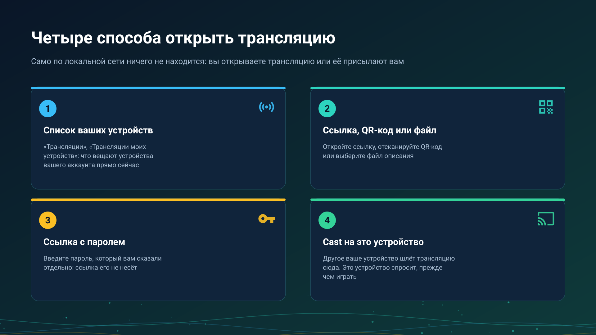

26.10.15 15:10

# Приём трансляции

Трансляция - это живой поток, который другое устройство снимает прямо сейчас. Устройство никогда не находит трансляцию само, обшаривая локальную сеть: вы открываете её, или другое ваше устройство присылает её вам cast. Сторона того, кто вещает, - на странице [Выход в эфир](broadcast-start-ru.html).

## 1. Список ваших устройств

В **Трансляциях** откройте раздел **Трансляции моих устройств**: в нём то, что другие устройства вашего аккаунта вещают сейчас. Устройство должно быть добавлено на сервер обмена в **Моих устройствах**, см. [Добавление сервера обмена в «Мои устройства»](my-devices-ru.html).

- Нажмите на запись: трансляция добавится в ваши потоки как живой канал («Канал трансляции добавлен»), и вы воспроизведёте её оттуда.
- Запись читается **Эта версия не может её воспроизвести**, когда ваша программа не знает такой трансляции, а нажатие на уже имеющуюся говорит **Эта трансляция уже есть в списке**; трансляция, ушедшая на новый адрес, обновляется, а не добавляется дважды.
- Пока никто не в эфире, раздел пишет «Ваши другие устройства сейчас ничего не транслируют».

## 2. Ссылка, QR-код или файл

- **Отсканируйте QR-код**, который показывает вещающий: **Импорт трансляции (QR / файл)**, **Сканировать QR-код**.
- **Откройте ссылку**, которую он прислал; она открывается в FastMediaSorter.
- **Выберите файл описания** (`.fmsbcast`): **Выбрать файл описания**.

Каждый из этих способов добавляет канал трансляции в ваш список. Когда вещающий меняет адрес, повторный импорт той же трансляции обновляет её.

## 3. Ссылка с паролем

Защищённая трансляция спрашивает пароль, прежде чем играть: «Введите пароль трансляции, который вам передали вместе со ссылкой». Ссылка и QR-код пароль не несут, поэтому вы получаете его от вещающего другим путём. Неверный пароль отклоняется, и трансляция остаётся закрытой.

## 4. Cast с другого вашего устройства

Вещающий выбирает **Cast на мои устройства**, а выбор **Воспроизвести на** перечисляет устройства аккаунта, которые умеют воспроизводить такую трансляцию.

- **Принимающее устройство сначала спрашивает.** Оно показывает **Cast с устройства** с именем отправителя и кнопки **Принять** и **Отклонить** либо уведомление вроде «Cast с устройства Телефон. Нажмите, чтобы смотреть». Ничего не запускается без вашего ответа.
- **Отправитель видит ответ**: устройство воспроизводит трансляцию, либо не приняло, не ответило вовремя или не умеет воспроизводить такую трансляцию.
- Cast идёт через [сервер обмена](exchange-server-ru.html), поэтому оба устройства входят в один и тот же аккаунт на нём.

### Cast на своё устройство - это не Google Cast

- **Cast на своё устройство** просит одно названное устройство вашего аккаунта воспроизвести вашу трансляцию.
- **Google Cast** - собственная передача системой видео, файла или живого потока на телевизор или колонку, см. [Chromecast и живая трансляция](../../documentation/player/casting-and-broadcast-ru.html).

Кнопки для них никогда не называются одинаково.

## Какие устройства воспроизводят

- **Телефон, планшет, ТВ и VR-шлем на Android** воспроизводят трансляции в **Трансляциях**.
- **Часы Wear OS** показывают трансляции своего аккаунта, сгруппированные по вещающему устройству, и воспроизводят звук или видео; на cast они сначала спрашивают; телефон также может отправить на них идущую трансляцию с экрана **Вещание**. См. [Часы в вашем аккаунте](watch-exchange-ru.html).
- **ПК с Windows** воспроизводит трансляции в [STREAMS Player](https://serzhyale.github.io/StreamsPlayer/).

## Пошаговые инструкции

- [Потоки на телевизоре, часах и VR-шлеме и приём живой трансляции](../../documentation/streams/tv-watch-vr-and-broadcast-ru.html)
- [Chromecast и живая трансляция](../../documentation/player/casting-and-broadcast-ru.html)

Назад на [главную страницу портала](index-ru.html).
