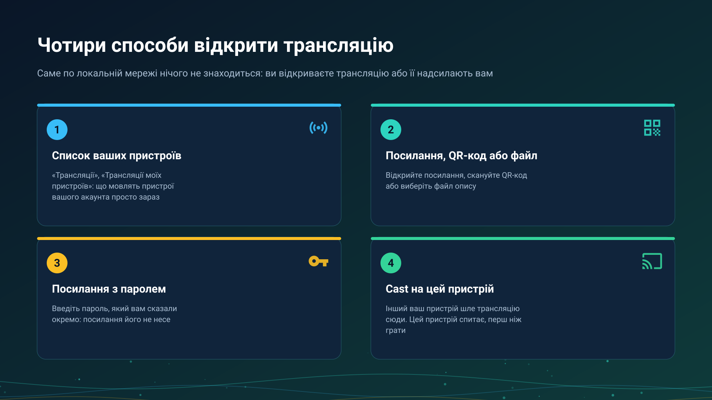

26.10.15 15:10

# Приймання трансляції

Трансляція - це живий потік, який інший пристрій знімає просто зараз. Пристрій ніколи не знаходить трансляцію сам, обшукуючи локальну мережу: ви відкриваєте її, або інший ваш пристрій надсилає її вам cast. Бік того, хто мовить, - на сторінці [Вихід в ефір](broadcast-start-uk.html).

## 1. Список ваших пристроїв

У **Трансляціях** відкрийте розділ **Трансляції моїх пристроїв**: у ньому те, що інші пристрої вашого акаунта мовлять зараз. Пристрій має бути доданий на сервер обміну в **Моїх пристроях**, див. [Додавання сервера обміну в «Мої пристрої»](my-devices-uk.html).

- Натисніть на запис: трансляцію буде додано у ваші потоки як живий канал («Канал трансляції додано»), і ви відтворите її звідти.
- Запис читається **Ця версія не може її відтворити**, коли ваша програма не знає такої трансляції, а дотик до вже наявної каже **Ця трансляція вже є у списку**; трансляція, що перейшла на нову адресу, оновлюється, а не додається двічі.
- Поки ніхто не в ефірі, розділ пише «Ваші інші пристрої зараз нічого не транслюють».

## 2. Посилання, QR-код або файл

- **Відскануйте QR-код**, який показує той, хто мовить: **Імпорт трансляції (QR / файл)**, **Сканувати QR-код**.
- **Відкрийте посилання**, яке він надіслав; воно відкривається у FastMediaSorter.
- **Виберіть файл опису** (`.fmsbcast`): **Обрати файл опису**.

Кожен із цих способів додає канал трансляції у ваш список. Коли той, хто мовить, змінює адресу, повторний імпорт тієї самої трансляції оновлює її.

## 3. Посилання з паролем

Захищена трансляція питає пароль, перш ніж грати: «Введіть пароль трансляції, який вам передали разом із посиланням». Посилання й QR-код пароль не несуть, тож ви отримуєте його від того, хто мовить, іншим шляхом. Неправильний пароль відхиляється, і трансляція лишається закритою.

## 4. Cast з іншого вашого пристрою

Той, хто мовить, вибирає **Cast на мої пристрої**, а вибір **Відтворити на** перелічує пристрої акаунта, які вміють відтворювати таку трансляцію.

- **Пристрій-одержувач спершу питає.** Він показує **Cast з пристрою** з іменем відправника та кнопки **Прийняти** й **Відхилити** або сповіщення на кшталт «Cast з пристрою Телефон. Натисніть, щоб дивитися». Нічого не запускається без вашої відповіді.
- **Відправник бачить відповідь**: пристрій відтворює трансляцію, або не прийняв, не відповів вчасно чи не вміє відтворювати таку трансляцію.
- Cast іде через [сервер обміну](exchange-server-uk.html), тож обидва пристрої входять в один і той самий акаунт на ньому.

### Cast на свій пристрій - це не Google Cast

- **Cast на свій пристрій** просить один названий пристрій вашого акаунта відтворити вашу трансляцію.
- **Google Cast** - власна передача системою відео, файлу чи прямого потоку на телевізор або колонку, див. [Chromecast і пряма трансляція](../../documentation/player/casting-and-broadcast-uk.html).

Кнопки для них ніколи не називаються однаково.

## Які пристрої відтворюють

- **Телефон, планшет, ТБ і VR-шолом на Android** відтворюють трансляції в **Трансляціях**.
- **Годинник Wear OS** показує трансляції свого акаунта, згруповані за пристроєм, що мовить, і відтворює звук чи відео; на cast він спершу питає; телефон також може надіслати на нього трансляцію, що йде, з екрана **Мовлення**. Див. [Годинник в акаунті](watch-exchange-uk.html).
- **ПК з Windows** відтворює трансляції в [STREAMS Player](https://serzhyale.github.io/StreamsPlayer/).

## Покрокові інструкції

- [Потоки на телевізорі, годиннику й VR-шоломі та приймання прямої трансляції](../../documentation/streams/tv-watch-vr-and-broadcast-uk.html)
- [Chromecast і пряма трансляція](../../documentation/player/casting-and-broadcast-uk.html)

Назад на [головну сторінку порталу](index-uk.html).
