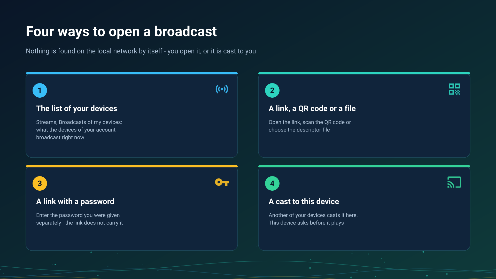

26.10.26 00:56

# Receiving a broadcast

A broadcast is a live stream that another device is capturing right now. A device never finds one by sweeping the local network on its own: you open a broadcast, or another of your devices casts it to you. The sender's side is on [Going on air](broadcast-start.html).

## 1. The list of your devices

In **Streams**, open the section **Broadcasts of my devices**: it lists what the other devices of your account are broadcasting now. It needs the device to be signed in to an exchange server in **My devices**, see [Adding your exchange server in My devices](my-devices.html).

- Tap an entry: the broadcast is added to your streams as a live channel ("Broadcast channel added"), and you play it from there.
- An entry reads **This version cannot play it** when your program does not know that kind of broadcast, and tapping one you already have says **This broadcast is already in the list**; a broadcast that moved to a new address is refreshed instead of added twice.
- While nothing is on air the section says "Your other devices are not broadcasting now".

## 2. A link, a QR code or a file

- **Scan the QR code** the sender shows: **Import stream (QR / file)**, **Scan QR Code**.
- **Open the link** the sender sent; it opens in FastMediaSorter.
- **Choose the descriptor file** (`.fmsbcast`): **Select Descriptor File**.

Each of these adds a broadcast channel to your list. When the sender changes the address, importing the same broadcast again refreshes it.

## 3. A link with a password

A protected broadcast asks for its password before it plays: "Enter the broadcast password you were given with the link". The link and the QR code never carry the password, so you get it from the sender another way. A wrong password is refused and the broadcast stays closed.

## A link to a broadcast that has not started

A link, a QR code or a file can arrive before the broadcast begins. It opens the window "This broadcast has not started yet", which shows until when the link works and checks for the start while it is open.

- **When the broadcast starts**, the window offers **Play**.
- **Play awaited broadcasts at once** in the **Streams** settings plays it without the question.
- **After the link's date** the window says the link no longer works.

## 4. A cast from another of your devices

The sender chooses **Cast to my devices**, and the **Play on** picker lists the devices of the account that can play this kind of broadcast.

- **The receiver asks first.** The device shows **Cast from** the sender's name with **Accept** and **Decline**, or a notification "cast a broadcast here. Tap to play". Nothing starts unasked.
- **The sender sees the answer**: the device is playing it, or declined, did not answer in time, or cannot play this kind of broadcast.
- A cast goes through the [exchange server](exchange-server.html), so both devices sign in to the same account there.

### A cast to your own device is not Google Cast

- **Cast to your own device** asks one named device of your account to play your broadcast.
- **Google Cast** is the system's own casting of a video, a file or a live stream to a television or a speaker, see [Chromecast casting and live broadcast](../../documentation/player/casting-and-broadcast.html).

The two never share a button label.

## Which devices play

- **An Android phone, a tablet, a TV and a VR headset** play broadcasts in **Streams**.
- **A Wear OS watch** lists the broadcasts of its account grouped by the broadcasting device and plays sound or video; it asks before it plays a cast; the phone can also send a running broadcast to it from the **Live Broadcast** screen. See [The watch on your account](watch-exchange.html).
- **A Windows PC** plays broadcasts in [STREAMS Player](https://serzhyale.github.io/StreamsPlayer/).

## Step-by-step guides

- [Streams on a TV, a watch or a VR headset, and tuning in to a live broadcast](../../documentation/streams/tv-watch-vr-and-broadcast.html)
- [Chromecast casting and live broadcast](../../documentation/player/casting-and-broadcast.html)

Back to the [portal start page](index.html).
