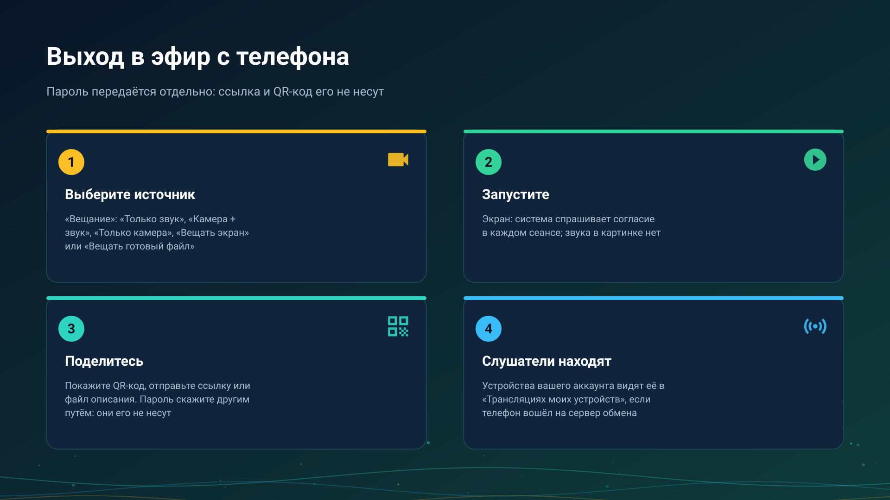

26.10.15 15:10

# Выход в эфир: вещание с телефона или часов

Трансляция - это живой поток, который устройство снимает прямо сейчас. Эта страница - со стороны того, кто вещает: что можно пустить в эфир, как начать и как слушатели находят трансляцию. Сторона слушателей - на странице [Приём трансляции](broadcast-receive-ru.html).

## Что можно пустить в эфир

Откройте **Вещание** из меню программ, панели быстрого доступа, ярлыка лаунчера, виджета на главном экране или плитки быстрых настроек. В **Режиме вещания** выберите один из трёх, а при камере - ещё и объектив:

- **Только звук** - микрофон.
- **Камера + звук** - видео со звуком.
- **Только камера** - видео без звука.
- **Камера** - **Задняя**, **Фронтальная** или **Внешняя**; **Сменить камеру** переключает объектив прямо в эфире.

Рядом с режимами есть ещё два источника:

- **Вещать экран** - картинка собственного экрана телефона, без звука. Система спрашивает согласие в начале каждого сеанса, и этот шаг пропустить нельзя.
- **Вещать готовый файл** - сохранённый музыкальный файл или фильм идёт как живая трансляция, поэтому все слушатели находятся в одном и том же месте файла.

Выход в эфир с телефона есть в редакциях Standard, noLegal и Legacy, см. [Редакции](editions-ru.html).

## Начать

Нажмите **Начать вещание**. Пока вы в эфире, висит уведомление с кнопкой **Остановить**; **Остановить вещание** на экране управления тоже завершает его, а экран управления считает слушателей.

- **Камера продолжает работать в фоне** в редакциях Standard и noLegal: **Погасить экран** даёт дисплею уснуть, пока вещание идёт. Редакция Legacy вместо этого закрывает приложение чёрным экраном и тоже продолжает вещание.
- **Часы вещают только звук.** Откройте **Вещание** на часах, нажмите **Начать вещание**, и они отдают звук микрофона не более чем четырём слушателям одновременно - по сумме локальной сети и сервера обмена. Видео с часов не уходит никогда.

## Передайте слушателям

На экране управления есть панель отправки, а **Автооткрытие экрана отправки** в настройках вещания открывает её само при начале трансляции. В ней три способа передать трансляцию:

- **QR-код** - показать устройству-слушателю, чтобы он отсканировал; нажатие открывает его на весь экран.
- **Ссылка**: **Копировать ссылку** или **Отправить**.
- **Файл описания**: **Экспорт в файл**, файл `.fmsbcast`, который открывает слушающее устройство.

Находят ли устройства вашего аккаунта трансляцию без всего этого, зависит от аккаунта, см. [Приём трансляции](broadcast-receive-ru.html).

## Пароль идёт отдельно

Трансляцию можно защитить паролем. Панель отправки показывает его как **Пароль**, а ссылка и QR-код его никогда не несут: сообщите его другим путём, голосом или в другом мессенджере. **Новый пароль** создаёт свежий, и старый перестаёт работать.

## Как это доходит до слушателей

- **В одной сети Wi-Fi** слушатель соединяется с вашим устройством напрямую, с наименьшей задержкой.
- **Из другой сети** - через ваш [сервер обмена](exchange-server-ru.html): когда устройство вошло на сервер в **Моих устройствах**, оно объявляет трансляцию там и загружает её один раз, а ретранслятор сервера раздаёт её каждому слушателю, храня только последние две секунды, так что медленный слушатель перескакивает вперёд, а не отстаёт. Что сервер видит в ней, написано на странице [сервера обмена](exchange-server-ru.html); картинка и звук шифруются на вашем устройстве.
- **Через Google Drive** трансляция только объявляется; сам поток через Drive никогда не идёт, см. [Файлы через Google Drive](folders-google-drive-ru.html).

## Пошаговые инструкции

- [Chromecast и живая трансляция](../../documentation/player/casting-and-broadcast-ru.html)
- [Прослушивание через часы и трансляция с них](../../documentation/wear/watch-listening-and-broadcast-ru.html)
- [Часы в вашем аккаунте](watch-exchange-ru.html)

Назад на [главную страницу портала](index-ru.html).
