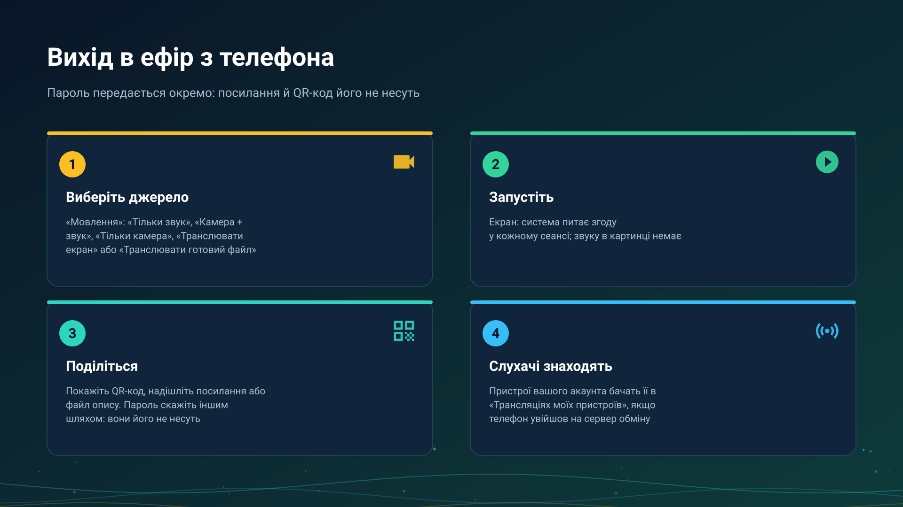

26.10.15 15:10

# Вихід в ефір: мовлення з телефона або годинника

Трансляція - це живий потік, який пристрій знімає просто зараз. Ця сторінка - з боку того, хто мовить: що можна пустити в ефір, як почати і як слухачі знаходять трансляцію. Бік слухачів - на сторінці [Приймання трансляції](broadcast-receive-uk.html).

## Що можна пустити в ефір

Відкрийте **Мовлення** з меню програм, панелі швидкого доступу, ярлика лаунчера, віджета на головному екрані або плитки швидких налаштувань. У **Режимі мовлення** виберіть один із трьох, а за камери - ще й об'єктив:

- **Тільки звук** - мікрофон.
- **Камера + звук** - відео зі звуком.
- **Тільки камера** - відео без звуку.
- **Камера** - **Задня**, **Фронтальна** або **Зовнішня**; **Змінити камеру** перемикає об'єктив просто в ефірі.

Поряд із режимами є ще два джерела:

- **Транслювати екран** - картинка власного екрана телефона, без звуку. Система питає згоду на початку кожного сеансу, і цей крок пропустити не можна.
- **Транслювати готовий файл** - збережений музичний файл чи фільм іде як жива трансляція, тому всі слухачі перебувають в одному й тому самому місці файлу.

Вихід в ефір із телефона є в редакціях Standard, noLegal і Legacy, див. [Редакції](editions-uk.html).

## Почати

Натисніть **Почати мовлення**. Поки ви в ефірі, висить сповіщення з кнопкою **Зупинити**; **Зупинити мовлення** на екрані керування теж завершує його, а екран керування рахує слухачів.

- **Камера продовжує працювати у фоні** в редакціях Standard і noLegal: **Погасити екран** дає дисплею заснути, поки мовлення триває. Редакція Legacy натомість закриває застосунок чорним екраном і теж продовжує мовлення.
- **Годинник мовить лише звук.** Відкрийте **Мовлення** на годиннику, натисніть **Почати мовлення**, і він віддає звук мікрофона не більш ніж чотирьом слухачам одночасно - за сумою локальної мережі та сервера обміну. Відео з годинника не йде ніколи.

## Передайте слухачам

На екрані керування є панель надсилання, а **Автовідкриття екрана надсилання** в налаштуваннях мовлення відкриває її саме, коли трансляція починається. У ній три способи передати трансляцію:

- **QR-код** - показати пристрою-слухачу, щоб він його відсканував; дотик відкриває його на весь екран.
- **Посилання**: **Копіювати посилання** або **Надіслати**.
- **Файл опису**: **Експорт у файл**, файл `.fmsbcast`, який відкриває слухаючий пристрій.

Чи знаходять пристрої вашого акаунта трансляцію без усього цього, залежить від акаунта, див. [Приймання трансляції](broadcast-receive-uk.html).

## Пароль іде окремо

Трансляцію можна захистити паролем. Панель надсилання показує його як **Пароль**, а посилання й QR-код його ніколи не несуть: повідомте його іншим шляхом, голосом чи в іншому месенджері. **Новий пароль** створює свіжий, і старий перестає працювати.

## Як це доходить до слухачів

- **В одній мережі Wi-Fi** слухач з'єднується з вашим пристроєм напряму, з найменшою затримкою.
- **З іншої мережі** - через ваш [сервер обміну](exchange-server-uk.html): коли пристрій увійшов на сервер у **Моїх пристроях**, він оголошує трансляцію там і завантажує її один раз, а ретранслятор сервера роздає її кожному слухачеві, зберігаючи лише останні дві секунди, тож повільний слухач перестрибує вперед, а не відстає. Що сервер бачить у ній, написано на сторінці [сервера обміну](exchange-server-uk.html); картинка й звук шифруються на вашому пристрої.
- **Через Google Drive** трансляція лише оголошується; сам потік через Drive ніколи не йде, див. [Файли через Google Drive](folders-google-drive-uk.html).

## Покрокові інструкції

- [Chromecast і пряма трансляція](../../documentation/player/casting-and-broadcast-uk.html)
- [Прослуховування через годинник і мовлення з нього](../../documentation/wear/watch-listening-and-broadcast-uk.html)
- [Годинник в акаунті](watch-exchange-uk.html)

Назад на [головну сторінку порталу](index-uk.html).
