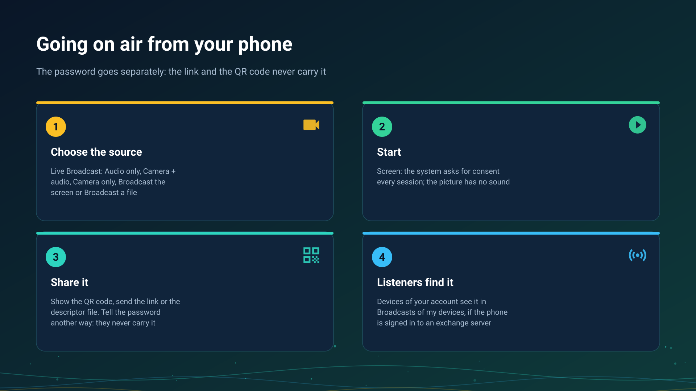

26.10.15 15:10

# Going on air: broadcast from a phone or a watch

A broadcast is a live stream that a device is capturing right now. This page is the sender's side: what you can put on air, how to start it and how listeners find it. The listeners' side is on [Receiving a broadcast](broadcast-receive.html).

## What you can put on air

Open **Live Broadcast** from the programs menu, the quick-access panel, a launcher shortcut, a home-screen widget or a quick tile. Under **Broadcast mode** choose one of three, and with a camera choose the lens:

- **Audio only** - the microphone.
- **Camera + audio** - video with sound.
- **Camera only** - video without sound.
- **Camera** - **Back**, **Front** or **External**; **Switch Camera** changes the lens while you are on air.

Two more sources sit beside the modes:

- **Broadcast the screen** - the picture of the phone's own screen, without sound. The system asks for your consent at the start of every session and the step cannot be skipped.
- **Broadcast a file** - a stored music file or a film goes out as a live broadcast, so every listener is at the same moment of it.

Going on air from a phone exists in the Standard, noLegal and Legacy editions, see [Editions](editions.html).

## Start

Tap **Start broadcast**. A notification stays up while you are on air, with a **Stop** button; **Stop Broadcast** on the control screen ends it too, and the control screen counts the listeners.

- **The camera keeps going in the background** in the Standard and noLegal editions: **Screen Off** lets the display sleep while the broadcast runs. The Legacy edition covers the app with a black screen instead and keeps the broadcast running.
- **A watch broadcasts sound only.** Open **Broadcast** on the watch, tap **Start broadcast**, and it serves its microphone to up to four listeners at once, counted together on the local network and through the exchange server. No video ever leaves a watch.

## Give it to listeners

The control screen carries the share panel, and **Auto-open share screen** in the broadcast settings opens it by itself when a broadcast starts. It has three ways to hand the broadcast over:

- **The QR code**, to scan from the listening device; tap it to see it full screen.
- **The link**: **Copy Link** or **Send to**.
- **The descriptor file**: **Export File**, a `.fmsbcast` file that a listening device opens.

Whether devices of your own account find the broadcast without any of these depends on the account, see [Receiving a broadcast](broadcast-receive.html).

## The password goes separately

A broadcast can be protected by a password. The share screen shows it as **Password**, and the link and the QR code never carry it: tell it another way, by voice or in another messenger. **New password** makes a fresh one and the old one stops working.

## How it reaches the listeners

- **On one Wi-Fi network** a listener connects to your device directly, with the lowest delay.
- **From another network**, through your [exchange server](exchange-server.html): when the device is signed in to a server in **My devices**, it announces the broadcast there and uploads it once, and the server's relay hands it to every listener, keeping only the last two seconds, so a slow listener skips ahead instead of falling behind. What the server sees of it is on the [exchange server](exchange-server.html) page; the picture and the sound are encrypted on your device.
- **Via Google Drive** a broadcast is only announced; the stream itself never goes through Drive, see [Files via Google Drive](folders-google-drive.html).

## Step-by-step guides

- [Chromecast casting and live broadcast](../../documentation/player/casting-and-broadcast.html)
- [Listening through the watch and broadcasting from it](../../documentation/wear/watch-listening-and-broadcast.html)
- [The watch on your account](watch-exchange.html)

Back to the [portal start page](index.html).
