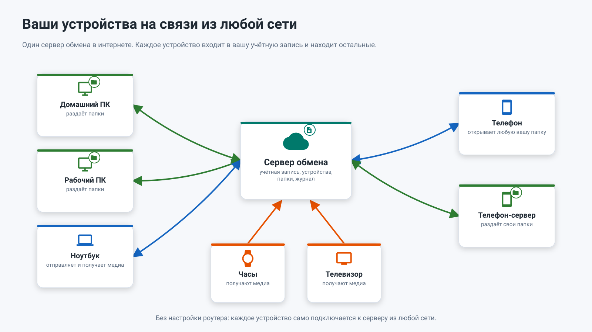
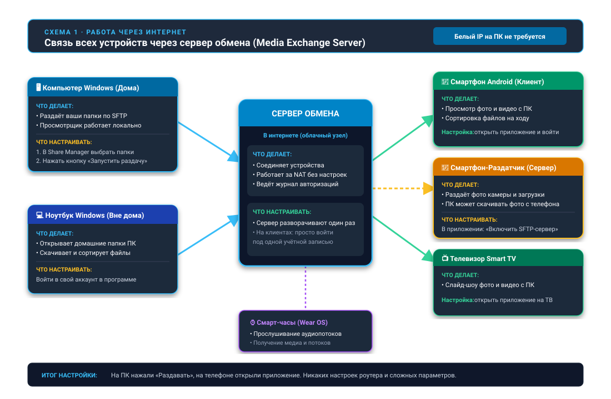

26.10.10 14:45

# Сервер обмена: ваши устройства из любой сети

**Ещё не выпущено.** Публичного сервера обмена пока нет. Сторона телефона готова: SFTP-сервер телефона уже умеет регистрироваться на сервере обмена (**Настройки**, **Общие**, **Доступ по SFTP**, **Доступ отовсюду**), но регистрироваться пока негде. Учётные записи, один список папок на всех устройствах и Cast между устройствами появятся вместе с сервером. До тех пор пользуйтесь способами из раздела [Что работает уже сегодня](#what-works-today).

Сервер обмена - для случая, который [домашняя сеть](home-network-ru.html) не покрывает: провайдер не даёт публичный адрес, Wi-Fi в гостинице, мобильная сеть. Каждое устройство само подключается к серверу, поэтому ни в одном роутере ничего открывать не нужно.

## Как это будет работать

1. **Каждое устройство входит один раз** и хранит токен устройства, а не ваш пароль.
2. **ПК или телефон публикует** свои общие папки.
3. **Любое другое устройство видит** список всех ваших папок и подключает нужные.
4. **Открытие папки запрашивает туннель**, и сервер соединяет два исходящих подключения, не читая передаваемые данные. Внутри туннеля папка по-прежнему идёт по зашифрованному SFTP, от устройства до устройства.

В одной сети Wi-Fi устройства по-прежнему подключаются друг к другу напрямую. Папка для человека вне вашей учётной записи передаётся по отдельной ссылке.

## Откуда берётся сервер

Сервер обмена - программа, которую делают необязательным компонентом пакета для Windows [Fast Media Sorter & Sharing for Windows](windows-servers-ru.html). При установке он не отмечен и остаётся выключенным, пока вы его не включите; управляется он в Share Manager: учётные записи, устройства, публичный адрес, сертификат и запуск как службы Windows. Ни в одном выпущенном пакете его пока нет.

Кто запускает сервер, тот и его оператор. Оператор видит то, что перечислено ниже в разделе «Что хранит сервер», и никогда - ваши файлы: они проходят насквозь, и их никто не читает. Публичной установки нет: никто не держит сервер для всех, и пользоваться пока нечем. То, как устройства подключаются к серверу, остаётся предложением, пока две независимые программы не согласуют его, поэтому эта страница описывает замысел, а не готовый протокол.

## Что хранит сервер

На диске:

- Учётные записи: логин и хеш пароля с солью.
- Подключённые устройства: имя, тип, когда были в сети.
- Названия общих папок.
- Журнал пользователя, где идентификаторы хешированы.

Только в памяти:

- Коды доступа к папкам - пока устройство, раздающее папку, в сети.
- Живые туннели и две последние секунды трансляции.
- Одноразовые коды привязки, действующие десять минут.

Никогда:

- Ваши файлы, фото и записи - они проходят через туннель и не попадают на диск сервера.
- Пароли, токены и коды привязки в журнале.
- Ваш список папок - для любого вне вашей учётной записи.

## Буфер на сервере

У телефона есть две программы для буфера ваших собственных устройств: **Отправить буфер на сервер** и **Получить буфер с сервера**. Они есть в меню программ главного окна, на панели быстрого доступа, как ярлыки лаунчера и в меню значка приложения.

- **Один объект за раз** - текст, картинка или один файл. Несколько файлов или папку сначала сложите в один архив, скопируйте архив и отправьте его.
- **Только последнее значение.** Сервер держит буфер только в памяти: новое значение заменяет прежнее, а перезапуск сервера его стирает.
- **Все аккаунты телефона.** Отправка уходит во все аккаунты, в которые вошёл телефон, кроме гостевого.
- **Тот, кто управляет сервером, может видеть отправленное**, пока не появится сквозное шифрование.

## Что работает уже сегодня {#what-works-today}

- **Домашняя сеть**: проброшенный порт и публичный адрес или имя динамического DNS делают ваши папки доступными откуда угодно - см. [Домашняя сеть](home-network-ru.html).
- **Серверная редакция программы для Windows** держит папки ПК доступными круглые сутки и без сервера обмена: она запускает ту же раздачу по SFTP как службу Windows, которая стартует при загрузке, а привязанные телефоны продолжают работать - см. [Серверы Windows](windows-servers-ru.html).
- **VPN в домашнюю сеть** работает с любой сетевой папкой: приложение видит домашние адреса как локальные.
- **Google Диск хранит актуальный адрес телефона.** Включите **Доступ через Google Диск** в карточке SFTP-сервера телефона (по умолчанию выключено): пока сервер работает, телефон записывает свой текущий адрес и данные для входа в закрытую папку приложения на вашем Google Диске. Другое устройство, вошедшее в тот же аккаунт Google, после смены сети открывает привязанную папку по новому адресу без повторного сканирования кода. Устройство по-прежнему должно иметь доступ к телефону - в той же сети, через VPN или через проброшенный порт; Диск лишь подсказывает, куда подключаться.
- **Облака** - Google Диск, Dropbox и OneDrive служат общим ящиком, который открывает каждое устройство, вошедшее в аккаунт, - см. [Облака](clouds-ru.html).

## Пошаговые инструкции

- [Телефон как SFTP-сервер](../../documentation/network/phone-as-sftp-server-ru.html)
- [Раздача папок ПК через Fast Media Sorter & Sharing for Windows](../../documentation/network/windows-companion-ru.html)
- [Работа с Google Диском](../../documentation/network/cloud-google-drive-ru.html)

Назад на [главную страницу портала](index-ru.html).
