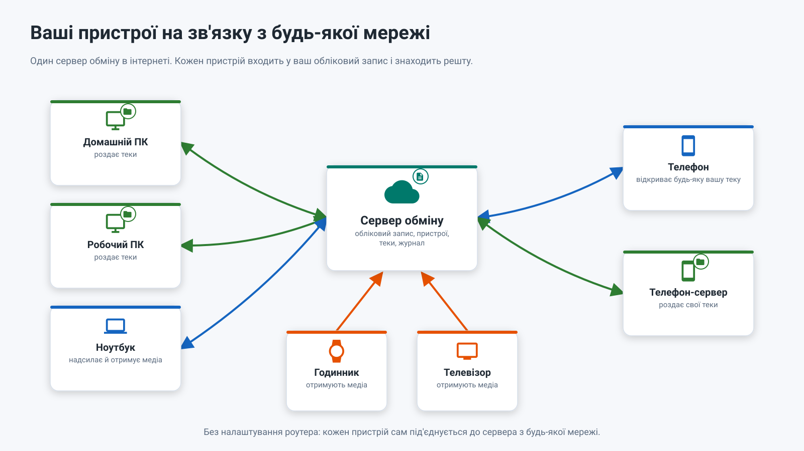

26.10.15 14:30

# Сервер обміну: ваші пристрої з будь-якої мережі

Сервер обміну - для випадку, який [домашня мережа](home-network-uk.html) не покриває: провайдер не дає публічної адреси, Wi-Fi у готелі, мобільна мережа. Кожен пристрій сам під'єднується до сервера, тож у роутері з боку пристроїв нічого відкривати не треба - адреса, до якої пристрої зможуть дотягнутися, потрібна лише самому серверу.

## Хто тримає сервер {#who-runs-a-server}

- **Ви тримаєте свій.** Сервер - програма на ПК з Windows, і той, хто її запускає, - власник сервера. Сервера для всіх немає: розробник застосунку свого не тримає і публічно не пропонує.
- **Або ви під'єднуєтеся до сервера людини, яку знаєте і яка тримає його для рідних і друзів.** Власник сервера дає вам запрошення, і ви створюєте на ньому акаунт.
- **Кого пускати, вирішує власник.** Акаунт створюється лише за запрошенням, а скільки акаунтів приймає сервер, задає власник (типово 10).

Акаунти, запрошення й паролі описано на окремій сторінці: [Акаунти, запрошення та паролі](exchange-accounts-uk.html).

## Як це працюватиме

1. **Кожен пристрій входить один раз** і зберігає токен пристрою, а не ваш пароль.
2. **ПК або телефон публікує** свої спільні теки.
3. **Будь-який інший пристрій бачить** список усіх ваших тек і під'єднує потрібні.
4. **Відкриття теки запитує тунель**, і сервер поєднує два вихідні під'єднання, не читаючи переданих даних. Усередині тунелю тека й далі йде зашифрованим SFTP, від пристрою до пристрою.

В одній мережі Wi-Fi пристрої й далі під'єднуються один до одного напряму. Тека для людини поза вашим акаунтом видається запрошенням виду «гість» або посиланням із паролем - див. [люди поза вашим акаунтом](exchange-accounts-uk.html#outside).

## Звідки береться сервер

Сервер обміну - частина програми [Fast Media Sorter & Sharing for Windows](windows-servers-uk.html). Вона виходить у двох моделях: **переглядач**, де сервери - необов'язкові компоненти й лишаються вимкненими, доки ви їх не ввімкнете, і **сервер**, розрахований на ПК, чия задача - бути завжди доступним, де необов'язковий якраз переглядач. У Microsoft Store є лише переглядач: застосунок зі Store не може працювати як служба Windows.

Сервером керують у Share Manager: акаунти й запрошення, публічна адреса, сертифікат і запуск як служби Windows. Як його встановити, що Windows каже про інсталятор і як перевірити, що він працює з іншої мережі: [Встановлення й перевірка сервера обміну](exchange-server-install-uk.html).

## Що бачить сервер {#what-the-server-sees}

Сервер обміну з'єднує ваші пристрої, тому знає імена вашого акаунта, пристроїв, папок і трансляцій, бачить, які пристрої в мережі, і скільки й коли передається. Відкрити те, що йде через нього, він не може: папки та їхні файли, трансляції й буфер шифруються на вашому пристрої та відкриваються лише на інших ваших пристроях або в тих, кому ви дали доступ. Щоб зазирнути всередину, тому, хто керує сервером, довелося б додати до вашого акаунта свій пристрій, і він з'явився б у списку ваших пристроїв.

Списком, бо без цього сервер нічого б не з'єднав:

- **Бачить:** логін і вид кожного акаунта; ім'я, програму, систему й роль кожного пристрою та те, чи він у мережі; назви й шляхи спільних тек і назви трансляцій; кому що віддано; хто, коли й з якої адреси до кого під'єднується; скільки й коли передано.
- **Не бачить:** ваші файли та їхній вміст, дані для входу у ваші теки, картинку й звук трансляції та все про буфер, окрім його розміру, часу й пристрою, з якого він прийшов.

Шифрування не дає тому, хто тримає сервер, читати. Але воно не робить сервер незупинним: його власник і далі може вимкнути його або притримати те, що через нього йде.

## Що зберігає сервер

На диску:

- Акаунти: логін, вид акаунта і хеш пароля із сіллю.
- Під'єднані пристрої: ім'я, тип, коли були в мережі та відкритий ключ пристрою.
- Запрошення - у вигляді хешів, щоб ніхто не міг прочитати їх назад, і обмеження, які задав власник.
- Назви спільних тек.
- Журнал користувача, де ідентифікатори хешовані, - на ту кількість днів, яку задав власник.

Лише в пам'яті:

- Коди доступу до тек, зашифровані на вашому пристрої, - поки пристрій, що роздає теку, у мережі.
- Живі тунелі й дві останні секунди трансляції.
- Одноразові коди прив'язки, чинні десять хвилин.
- Значення буфера кожного акаунта.

Ніколи:

- Ваші файли, фото й записи - вони проходять через тунель і не потрапляють на диск сервера.
- Паролі, токени, запрошення й коди прив'язки в журналі.
- Ваш список тек - для будь-кого поза вашим акаунтом.

## Буфер на сервері {#the-clipboard-on-the-server}

Дві кнопки - **Надіслати буфер на сервер** і **Отримати буфер із сервера** - переносять один об'єкт між вашими власними пристроями. Сервер тримає одне значення на акаунт, лише у своїй пам'яті, і прочитати його не може. Де ці кнопки і які в них межі: [Буфер на сервері](exchange-clipboard-uk.html).

## Акаунти {#accounts}

Акаунт - це логін і пароль на одному сервері. Ви створюєте його за запрошенням, змінюєте пароль у будь-якій програмі, де ви в нього ввійшли, і видаляєте в застосунку або попросивши власника сервера: [Акаунти, запрошення та паролі](exchange-accounts-uk.html) і [Як видалити акаунт](account-deletion-uk.html).

## Програми різних версій {#versions}

- **Один договір, що лише росте.** Програми родини дотримуються одного договору обміну. Нова його версія лише додає; програма, зустрівши незнайоме, пропускає це й не падає.
- **Стара програма зустрічає новий сервер, і навпаки.** Чого в іншого боку немає, те не пропонується: сервер без буфера відповідає «Цей сервер не зберігає буфер», а версія, що не вміє відтворити трансляцію, каже «Ця версія не може її відтворити».
- **Старі коди працюють і після оновлення**: коди `FMSSFTP1`, файли `.fmscfg`, теки у вашій мережі й збережені розклади.
- **Одне вимагає одного покоління з обох боків: шифрування вмісту.** Теки, трансляції та буфер ідуть через сервер, лише коли і програма, і сервер уміють шифрувати їх від пристрою до пристрою. Зі старішим сервером список ваших пристроїв працює, але через нього нічого не надсилається, доки сервер не оновлять; програма так і каже. Прямі під'єднання у вашій мережі через сервер не йдуть і не змінюються.

## Способи, яким сервер не потрібен {#what-works-today}

- **Домашня мережа**: прокинутий порт і публічна адреса або ім'я динамічного DNS роблять ваші теки доступними звідусіль - див. [Домашня мережа](home-network-uk.html).
- **Серверна редакція програми для Windows** тримає теки ПК доступними цілодобово й без сервера обміну: вона запускає ту саму роздачу через SFTP як службу Windows, що стартує під час завантаження, а прив'язані телефони й далі працюють - див. [Сервери Windows](windows-servers-uk.html).
- **VPN у домашню мережу** працює з будь-якою мережевою текою: застосунок бачить домашні адреси як локальні.
- **Google Диск зберігає актуальну адресу телефона.** Увімкніть **Доступ через Google Диск** у картці SFTP-сервера телефона (типово вимкнено): поки сервер працює, телефон записує свою поточну адресу й дані для входу в закриту теку застосунку на вашому Google Диску. Інший пристрій, що увійшов у той самий обліковий запис Google, після зміни мережі відкриває прив'язану теку за новою адресою без повторного сканування коду. Пристрій і далі мусить мати доступ до телефона - у тій самій мережі, через VPN або через прокинутий порт; Диск лише підказує, куди під'єднуватися. Через Google Drive файли й буфер зберігаються у вашому власному акаунті Google, як і інші ваші файли на Google Drive; сервер обміну в цьому не бере участі.
- **Хмари** - Google Диск, Dropbox і OneDrive слугують спільною скринькою, яку відкриває кожен пристрій, що увійшов в обліковий запис, - див. [Хмари](clouds-uk.html).

## Покрокові інструкції

- [Встановлення й перевірка сервера обміну](exchange-server-install-uk.html)
- [Акаунти, запрошення та паролі](exchange-accounts-uk.html)
- [Буфер на сервері](exchange-clipboard-uk.html)
- [Як видалити акаунт](account-deletion-uk.html)
- [Телефон як SFTP-сервер](../../documentation/network/phone-as-sftp-server-uk.html)
- [Роздавання тек ПК через Fast Media Sorter & Sharing for Windows](../../documentation/network/windows-companion-uk.html)
- [Робота з Google Диском](../../documentation/network/cloud-google-drive-uk.html)

Назад на [головну сторінку порталу](index-uk.html).
