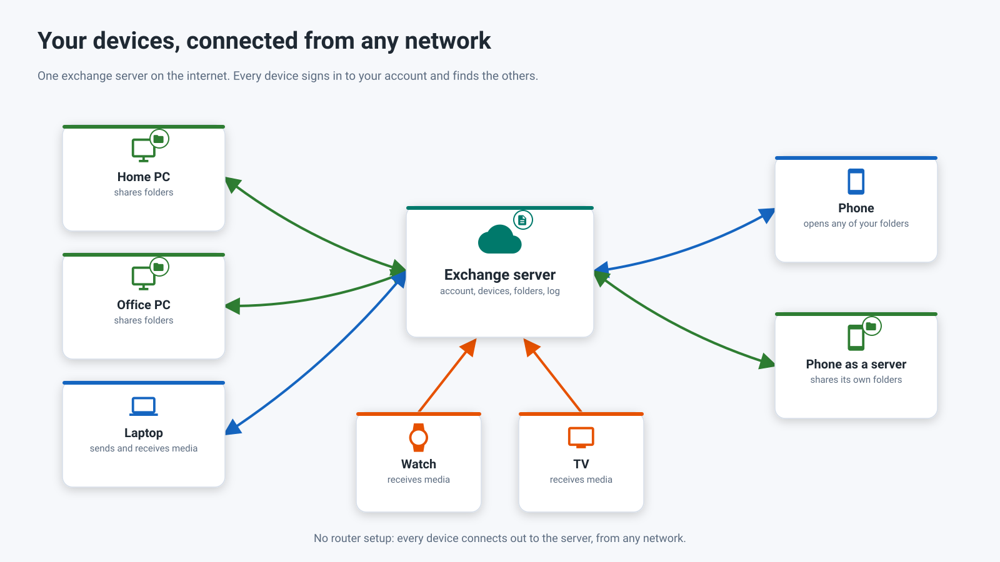

26.10.20 12:24

# Exchange server: your devices from any network

The exchange server is for the case the [home network](home-network.html) cannot cover: a provider that gives you no public address, a hotel Wi-Fi, a mobile network. Every device dials out to the server, so nothing has to be opened in a router on the devices' side - only the server itself needs an address the devices can reach.

Short versions: [what the server is for and everything you can do with it](exchange-server-purpose.html) and [deploying your own server in steps](exchange-server-quick-start.html).

## Who runs a server {#who-runs-a-server}

- **You run your own.** A server is a program on a Windows PC, and whoever runs it is its owner. Nobody runs a server for everybody: the developer of the app runs none and offers none to the public.
- **Or you join a server that a person you know runs for relatives and friends.** Its owner gives you an invitation, and you create an account on it.
- **The owner decides who gets in.** An account is created only by an invitation, and the owner sets how many accounts the server takes (10 by default).

Accounts, invitations and passwords are on their own page: [Accounts, invitations and passwords](exchange-accounts.html).

## How it works {#how-it-will-work}

1. **Each device signs in once** and keeps a device token, never your password.
2. **A PC or a phone publishes** its shared folders.
3. **Any other device lists** all your folders and attaches the ones it needs.
4. **Opening a folder asks for a tunnel**, and the server joins the two outgoing connections without reading the bytes. Inside the tunnel the folder still travels over encrypted SFTP, end to end.

On one Wi-Fi network the devices still connect to each other directly. A folder for someone outside your account is given by an invitation of the kind "guest" or by a link with a password - see [people outside your account](exchange-accounts.html#outside).

## Where the server comes from {#where-the-server-comes-from}

**Not released yet.** The server program for Windows is in the development version of [Fast Media Sorter & Sharing for Windows](windows-servers.html), and no released package contains it. Nothing is offered for download, and no exchange server is running anywhere.

The exchange server is the third optional part of that program, next to the viewer and sorter and to folder sharing. It is not folder sharing: sharing hands a PC's folders to a device that can reach the PC, while the exchange server is a meeting point for devices that cannot. When a release carries it, it will be an optional part, unticked by default, whichever way you start - [viewer first](windows-servers.html#viewer-first) or [server first](windows-servers.html#server-first). The Microsoft Store version will not carry it, because it runs in user mode only and a Store app cannot run as a Windows service. What each part is and where it is released: [Windows servers](windows-servers.html#availability).

The server is administered in Share Manager: accounts and invitations, the public address, the certificate and running it as a Windows service. How to install it, what Windows says about the installer and how to check that it works from another network: [Installing and checking your exchange server](exchange-server-install.html).

## What the server sees {#what-the-server-sees}

The exchange server connects your devices, so it knows the names of your account, devices, folders and broadcasts, sees which devices are online, and how much is sent and when. It cannot open what goes through it: folders and their files, broadcasts and the clipboard are encrypted on your device and opened only on your other devices or by the people you gave access to. To look inside, whoever runs the server would have to add a device of their own to your account, and it would appear in your list of devices.

In a list, because without these the server could connect nothing:

- **Seen:** the login and the kind of each account; the name, program, system and role of each device, and whether it is online; the names and paths of shared folders and the titles of broadcasts; who was given what; who connects to whom, when and from which address; and the size and timing of what is sent.
- **Not seen:** your files and what is in them, the sign-in details of your folders, the picture and the sound of a broadcast, and everything about the clipboard except its size, its time and the device it came from.

Encryption keeps whoever runs the server from reading. It does not make the server unstoppable: its owner can still switch it off or hold back what goes through it.

## What the server keeps {#what-the-server-keeps}

On its disk:

- Accounts: a login, the kind of the account and a salted password hash.
- Enrolled devices: name, type, last seen and the public key of the device.
- Invitations, kept as hashes so that nobody can read one back, and the limits its owner set.
- The names of shared folders.
- A user log, with identifiers hashed, kept for the number of days its owner set.

In memory only:

- Folder access codes, encrypted on your device, while the device that shares the folder is online.
- Live tunnels, and the last two seconds of a broadcast.
- One-time pairing codes, valid for ten minutes.
- The clipboard value of each account.

Never:

- Your files, photos and recordings - they pass through a tunnel and never touch the server's disk.
- Passwords, tokens, invitations or pairing codes in the log.
- Your folder list, for anyone outside your account.

## The clipboard on the server {#the-clipboard-on-the-server}

Two buttons - **Send the clipboard to the server** and **Get the clipboard from the server** - move one object between your own devices. The server holds one value for the account, in its memory only, and cannot read it. Where the buttons are and what the limits are: [Clipboard on the server](exchange-clipboard.html).

## Accounts {#accounts}

An account is a login and a password on one server. You create it from an invitation, change its password in any program that is signed in to it, and delete it in the app or by asking the server's owner: [Accounts, invitations and passwords](exchange-accounts.html) and [How to delete an account](account-deletion.html).

## Programs of different versions {#versions}

- **One contract, only growing.** The programs of the family follow one exchange contract. A new version of it only adds; a program that meets something it does not know skips it and does not fail.
- **An older program meets a newer server, and the other way round.** What the other side lacks is not offered: a server that keeps no clipboard answers "This server does not keep the clipboard.", and a version that cannot play a broadcast says "This version cannot play it".
- **Old codes keep working after an update**: `FMSSFTP1` codes, `.fmscfg` files, folders on your own network and saved schedules.
- **One thing needs the same generation on both sides: encryption of content.** Folders, broadcasts and the clipboard go through a server only when the program and the server can both encrypt them end to end. With an older server the list of your devices still works, but nothing is sent through it until the server is updated; the program says so. Direct connections on your own network do not pass through a server and do not change.

## Ways that need no server {#what-works-today}

- **The home network**: a forwarded port and a public address or a dynamic DNS name make your folders reachable from anywhere - see [Home network](home-network.html).
- **Folder sharing on a Windows PC** needs no exchange server: the Server edition runs the same SFTP sharing as a Windows service that starts at boot, keeps a PC's folders available around the clock, and paired phones keep working - see [Windows servers](windows-servers.html#editions).
- **A VPN to your home network** works with every network folder, because the app then sees your home addresses as local ones.
- **Google Drive keeps the phone's address up to date.** Switch on **Share access through Google Drive** in the phone's SFTP server card (it is off by default): while the server runs, the phone then writes its current address and sign-in details into the app's private space of your Google Drive. Another device signed in to the same Google account then opens the paired folder at its new address after a network change, without scanning the code again. The device still has to be able to reach the phone - on the same network, over a VPN or through a forwarded port; Drive only tells it where to look. Via Google Drive, files and the clipboard are kept in your own Google account, like your other files on Google Drive; no exchange server takes part.
- **Clouds** - Google Drive, Dropbox and OneDrive are a shared box every signed-in device opens - see [Clouds](clouds.html).

## Step-by-step guides

- [What the exchange server is for](exchange-server-purpose.html)
- [Deploy your own exchange server](exchange-server-quick-start.html)
- [Installing and checking your exchange server](exchange-server-install.html)
- [Accounts, invitations and passwords](exchange-accounts.html)
- [Clipboard on the server](exchange-clipboard.html)
- [How to delete an account](account-deletion.html)
- [Turning the phone into an SFTP server](../../documentation/network/phone-as-sftp-server.html)
- [Sharing PC folders with Fast Media Sorter & Sharing for Windows](../../documentation/network/windows-companion.html)
- [Google Drive integration](../../documentation/network/cloud-google-drive.html)

Back to the [portal start page](index.html).
