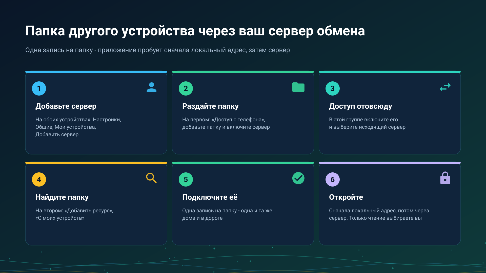

26.10.22 01:23

# Папки через сервер обмена

Папку, которая лежит на одном вашем устройстве, можно открыть на другом из любой сети, без настройки роутера. Устройство с папкой само подключается к вашему [серверу обмена](exchange-server-ru.html), устройство, которое открывает папку, просит у сервера соединение, а сервер только соединяет их.

## Прежде чем начать

- **Сервер обмена и аккаунт на нём.** Вы держите свой сервер или входите на сервер, который держит знакомый вам человек для родственников и друзей. См. [сервер обмена](exchange-server-ru.html) и [аккаунты, приглашения и пароли](exchange-accounts-ru.html).
- **Сервер добавлен на обоих устройствах**: в **Настройках**, на вкладке **Общие**, в **Мои устройства**. Как это сделать: [Добавление сервера обмена в «Мои устройства»](my-devices-ru.html).
- **Устройство, которое хранит папку.** На этой странице это телефон; ПК с Windows публикует свои общие папки так же, из Share Manager, см. [серверы Windows](windows-servers-ru.html).

## Раздайте папку с телефона

1. Откройте **Настройки**, вкладку **Общие**, карточку **Доступ с телефона**.
2. В разделе **Общие папки** нажмите **Добавить папку** и выберите папку системным выбором папок. Каждая папка - отдельная запись, а папка, добавленная при работающем сервере, подключается к нему сразу.
3. Включите **SFTP-сервер**.
4. В группе **Доступ отовсюду** включите **Сервер обмена**. Если серверов несколько, кнопка **Изменить** выбирает исходящий: строка **Через сервер** называет его. Строка состояния тогда читается **Доступен отовсюду через** с именем сервера.

## Откройте папку на другом устройстве

1. Откройте **Добавить ресурс** и выберите **С моих устройств**. В списке - папки, которые публикуют ваши другие устройства; пока таких нет, там написано «Ваши другие устройства пока ничего не публикуют».
2. Отметьте папки и нажмите **Подключить** или **Подключить все**.
3. Папка, защищённая PIN-кодом, один раз спросит его. PIN проверяется на устройстве, которое раздаёт папку, и хранится у вас в зашифрованном виде.
4. Открывайте папку, как любой другой ресурс. Только чтение или нет - ваш выбор на устройстве, которое открывает; раздающее устройство его не навязывает.

## Одна запись, несколько путей

На папку - одна запись, каким бы путём она ни открывалась. Приложение пробует пути этой записи от самого быстрого:

- **Локальный адрес**, когда оба устройства в одной сети Wi-Fi, - на полной локальной скорости.
- **Через сервер обмена**, из любой другой сети.
- **Через Google Drive**, когда не получилось ни то, ни другое: ошибка предлагает **Открыть через Google Drive**, а другое устройство отвечает при следующей проверке. См. [Файлы через Google Drive](folders-google-drive-ru.html).

Запись остаётся в вашем списке, когда устройство выключено. Она показывается как «Устройство не в сети», «Сейчас недоступно» или «Больше не публикуется», и ничего из подключённого вами не удаляется.

## Отдайте папку тому, кто вне вашего аккаунта

Рядом с общей папкой **Доступ снаружи** открывает два способа, каждый отзывается отдельно: **Ссылка с паролем** для человека без аккаунта и **Пригласить гостя** - логин на вашем сервере, который видит только эту папку. Оба описаны в [аккаунтах, приглашениях и паролях](exchange-accounts-ru.html).

## Если подключиться не получается

Приложение показывает **Не удалось подключиться** с тем, что не сработало, а под **Что ещё попробовать** - следующий шаг. Чаще всего это:

- разбудить устройство, которое хранит папку, и не давать ему засыпать;
- перевести оба устройства в одну сеть Wi-Fi - основную, не гостевую сеть роутера;
- на минуту выключить VPN;
- на компьютере с Windows - назначить сети тип «частная»;
- попробовать другую сеть, например мобильный интернет, и проверить, отвечает ли сервер из интернета.

В **Подробностях** - код, а **Отправить журнал** отправляет журнал; код никогда не стоит в заголовке.

## Что видит сервер

> Сервер обмена соединяет ваши устройства, поэтому знает имена вашего аккаунта, устройств, папок и трансляций, видит, какие устройства в сети, и сколько и когда передаётся. Открыть то, что идёт через него, он не может: папки и их файлы, трансляции и буфер шифруются на вашем устройстве и открываются только на других ваших устройствах или у тех, кому вы дали доступ. Чтобы заглянуть внутрь, тому, кто управляет сервером, пришлось бы добавить в ваш аккаунт своё устройство, и оно появилось бы в списке ваших устройств.

## Пошаговые инструкции

- [Телефон как SFTP-сервер](../../documentation/network/phone-as-sftp-server-ru.html)
- [Сетевые папки и облачные хранилища как источники](../../documentation/storage/network-and-cloud-sources-ru.html)
- [Телефон как сервер: сколько он работает и чего это стоит](phone-sharing-ru.html)
- [Расписание над папками других устройств](schedule-remote-folders-ru.html)

Назад на [главную страницу портала](index-ru.html).

## Окна настроек программы для Windows {#windows-settings-windows}

В Windows вход, публикация ресурсов и управление этим ПК находятся в **настройках менеджера**, на странице учётной записи обмена. Запуск собственного сервера настраивается в отдельном окне и не нужен, чтобы войти на чужой сервер. Управление сервером с другого компьютера продолжает работать с тем сервером, который вы выбрали.
