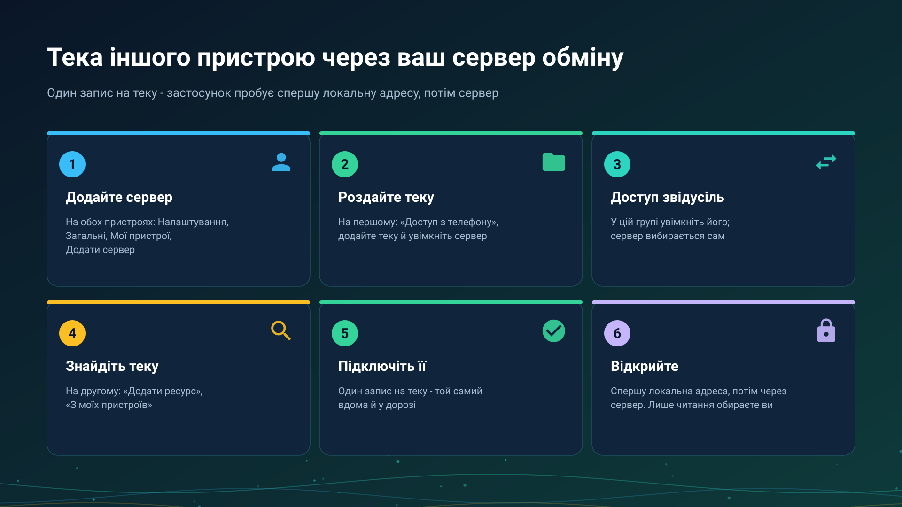

26.10.23 15:45

# Теки через сервер обміну

Теку, яка лежить на одному вашому пристрої, можна відкрити на іншому з будь-якої мережі, без налаштування роутера. Пристрій із текою сам під'єднується до вашого [сервера обміну](exchange-server-uk.html), пристрій, який відкриває теку, просить у сервера з'єднання, а сервер лише поєднує їх.

## Перш ніж почати

- **Сервер обміну й акаунт на ньому.** Ви тримаєте свій сервер або входите на сервер, який тримає знайома вам людина для родичів і друзів. Див. [сервер обміну](exchange-server-uk.html) та [акаунти, запрошення й паролі](exchange-accounts-uk.html).
- **Сервер додано на обох пристроях**: у **Налаштуваннях**, на вкладці **Загальні**, у **Мої пристрої**. Як це зробити: [Додавання сервера обміну в «Мої пристрої»](my-devices-uk.html).
- **Пристрій, який зберігає теку.** На цій сторінці це телефон; ПК з Windows публікує свої спільні теки так само, зі Share Manager, див. [сервери Windows](windows-servers-uk.html).

## Роздайте теку з телефона

1. Відкрийте **Налаштування**, вкладку **Загальні**, картку **Доступ з телефону**.
2. У розділі **Спільні папки** натисніть **Додати папку** й виберіть теку системним вибором тек. Кожна тека - окремий запис, а тека, додана за працюючого сервера, підключається до нього одразу.
3. Увімкніть **SFTP-сервер** - звичайний спосіб роздавання тек у мережі, через нього ваші інші пристрої відкривають вибрані теки.
4. У групі **Доступ звідусіль** увімкніть **Сервер обміну**. Перший доданий сервер стає вихідним сам; якщо серверів кілька, кнопка **Змінити** вибирає інший: рядок **Через сервер** називає його. Рядок стану тоді читається **Доступний звідусіль через** з назвою сервера.

## Відкрийте теку на іншому пристрої

1. Відкрийте **Додати ресурс** і виберіть **З моїх пристроїв**. У списку - теки, які публікують ваші інші пристрої; поки таких немає, там написано «Ваші інші пристрої поки нічого не публікують».
2. Позначте теки й натисніть **Підключити** або **Підключити всі**.
3. Тека, захищена PIN-кодом, один раз спитає його. PIN перевіряється на пристрої, який роздає теку, і зберігається у вас у зашифрованому вигляді.
4. Відкривайте теку, як будь-який інший ресурс. Лише читання чи ні - ваш вибір на пристрої, який відкриває; пристрій, що роздає, його не нав'язує.

## Один запис, кілька шляхів

На теку - один запис, яким би шляхом вона не відкривалася. Застосунок пробує шляхи цього запису від найшвидшого:

- **Локальна адреса**, коли обидва пристрої в одній мережі Wi-Fi, - на повній локальній швидкості.
- **Через сервер обміну**, з будь-якої іншої мережі.
- **Через Google Drive**, коли не вийшло ні те, ні інше: помилка пропонує **Відкрити через Google Drive**, а інший пристрій відповідає під час наступної перевірки. Див. [Файли через Google Drive](folders-google-drive-uk.html).

Запис лишається у вашому списку, коли пристрій вимкнено. Він показується як «Пристрій не в мережі», «Зараз недоступно» або «Більше не публікується», і нічого з підключеного вами не видаляється.

## Віддайте теку тому, хто поза вашим акаунтом

Поруч зі спільною текою **Доступ ззовні** відкриває два способи, кожен відкликається окремо: **Посилання з паролем** для людини без акаунта і **Запросити гостя** - логін на вашому сервері, який бачить лише цю теку. Обидва описано в [акаунтах, запрошеннях і паролях](exchange-accounts-uk.html).

## Коли під'єднатися не вдається

Застосунок показує **Не вдалося підключитися** з тим, що не спрацювало, а під **Що ще спробувати** - наступний крок. Найчастіше це:

- розбудити пристрій, який зберігає теку, і не давати йому засинати;
- перевести обидва пристрої в одну мережу Wi-Fi - основну, не гостьову мережу роутера;
- на хвилину вимкнути VPN;
- на комп'ютері з Windows - призначити мережі тип «приватна»;
- спробувати іншу мережу, наприклад мобільний інтернет, і перевірити, чи відповідає сервер з інтернету.

У **Подробицях** - код, а **Надіслати журнал** надсилає журнал; код ніколи не стоїть у заголовку.

## Що бачить сервер

> Сервер обміну з'єднує ваші пристрої, тому знає імена вашого акаунта, пристроїв, папок і трансляцій, бачить, які пристрої в мережі, і скільки й коли передається. Відкрити те, що йде через нього, він не може: папки та їхні файли, трансляції й буфер шифруються на вашому пристрої та відкриваються лише на інших ваших пристроях або в тих, кому ви дали доступ. Щоб зазирнути всередину, тому, хто керує сервером, довелося б додати до вашого акаунта свій пристрій, і він з'явився б у списку ваших пристроїв.

## Покрокові інструкції

- [Телефон як SFTP-сервер](../../documentation/network/phone-as-sftp-server-uk.html)
- [Мережеві теки й хмарні сховища як джерела](../../documentation/storage/network-and-cloud-sources-uk.html)
- [Телефон як сервер: скільки він працює і чого це коштує](phone-sharing-uk.html)
- [Розклад над теками інших пристроїв](schedule-remote-folders-uk.html)

Назад на [головну сторінку порталу](index-uk.html).

## Вікна налаштувань програми для Windows {#windows-settings-windows}

У Windows вхід, публікація ресурсів і керування цим ПК знаходяться в **налаштуваннях менеджера** на сторінці облікового запису обміну. Запуск власного сервера налаштовується в окремому вікні й не потрібен, щоб увійти на чужий сервер. Керування сервером з іншого комп’ютера й далі працює з тим сервером, який ви вибрали.
