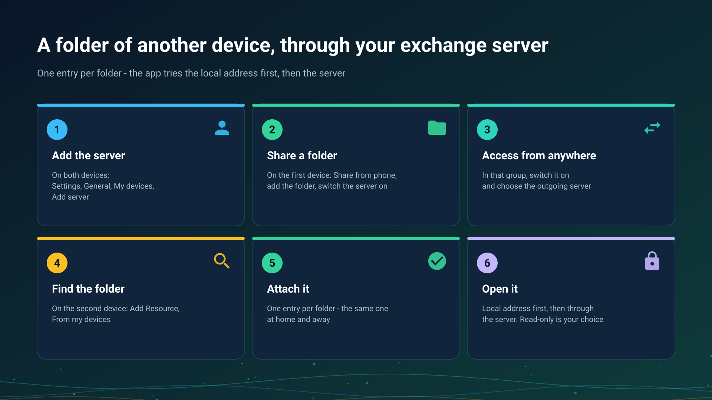

26.10.15 15:10

# Folders through the exchange server

A folder that lives on one of your devices can be opened on another from any network, with no router setup. The device that keeps the folder dials out to your [exchange server](exchange-server.html), the device that opens it asks the server for a connection, and the server only joins the two.

## Before you start

- **An exchange server and an account on it.** You run your own, or join one that a person you know runs for relatives and friends. See the [exchange server](exchange-server.html) and [accounts, invitations and passwords](exchange-accounts.html).
- **The server added on both devices**, in **Settings**, the **General** tab, **My devices**. How: [Adding your exchange server in My devices](my-devices.html).
- **A device that keeps the folder.** On this page it is a phone; a Windows PC publishes its shared folders the same way from Share Manager, see [Windows servers](windows-servers.html).

## Share a folder from a phone

1. Open **Settings**, the **General** tab, the **Share over SFTP** card.
2. Under **Shared folders** tap **Add folder** and pick the folder with the system folder picker. Each folder is an entry of its own, and a folder you add while the server runs joins it at once.
3. Switch on **SFTP server**.
4. In the same card, in the **Access from anywhere** section, switch on **Exchange server**. With more than one server, **Change** picks the outgoing one: the line **Through the server** names it. The status line then reads **Reachable from anywhere through** the server's name.

## Open the folder on another device

1. Open **Add Resource** and choose **From my devices**. The list shows the folders your other devices publish; until one does it reads "Your other devices publish no resources yet".
2. Mark the folders and tap **Attach**, or **Attach all listed**.
3. A folder protected with a PIN asks for it once. The PIN is checked on the device that shares the folder and kept on yours, encrypted.
4. Open the folder like any other resource. Whether it is read-only is your choice on the device that opens it; the sharing device does not impose it.

## One entry, several paths

You get one entry per folder, whichever way it is reached. The app tries the paths of that entry fastest first:

- **The local address**, when both devices are on the same Wi-Fi network - the full local speed.
- **Through the exchange server**, from any other network.
- **Via Google Drive**, when neither works: the error offers **Open via Google Drive**, and the other device answers when it next checks. See [Files via Google Drive](folders-google-drive.html).

The entry stays in your list when the device is off. It shows as offline, unavailable right now or no longer published, and nothing you attached is deleted.

## Give a folder to someone outside your account

Next to a shared folder, **Access from outside** opens two ways, each withdrawn on its own: **Link with a password** for a person with no account, and **Invite a guest** for a login on your server that sees only that folder. Both are described in [accounts, invitations and passwords](exchange-accounts.html).

## When it does not connect

The app shows **The connection did not work** with what failed and, under **Another thing to try**, the next step to take. The usual ones:

- wake the device that keeps the folder and stop it from going to sleep;
- put both devices on the same Wi-Fi network - the main one, not the router's guest network;
- turn a VPN off for a moment;
- on a Windows computer, set the network to private;
- try another network, for example mobile data, to see whether the server answers from the internet.

**Details** carries the code and **Send the log** sends the log; a code is never the headline.

## What the server sees

> The exchange server connects your devices, so it knows the names of your account, devices, folders and broadcasts, sees which devices are online, and how much is sent and when. It cannot open what goes through it: folders and their files, broadcasts and the clipboard are encrypted on your device and opened only on your other devices or by the people you gave access to. To look inside, whoever runs the server would have to add a device of their own to your account, and it would appear in your list of devices.

## Step-by-step guides

- [Turning the phone into an SFTP server](../../documentation/network/phone-as-sftp-server.html)
- [Adding network folders and cloud storage as sources](../../documentation/storage/network-and-cloud-sources.html)
- [The phone as a server: how long it lasts and what it costs](phone-sharing.html)
- [A schedule over folders of other devices](schedule-remote-folders.html)

Back to the [portal start page](index.html).
