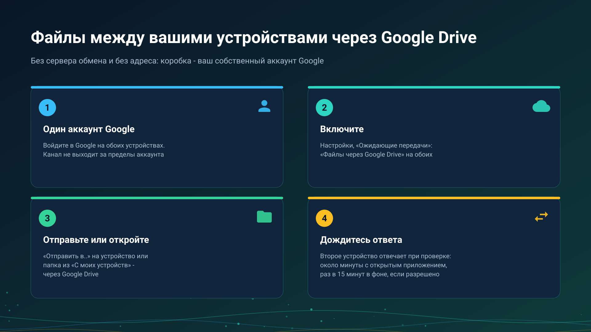

26.10.15 15:10

# Файлы и папки через Google Drive

Через Google Drive ваш собственный аккаунт Google служит коробкой между устройствами: одно устройство кладёт туда запрос или файл, другое его забирает. Сервер обмена не участвует, и ни одному устройству не нужен доступный адрес.

## Что нужно

- **Один и тот же аккаунт Google на каждом устройстве.** Канал работает только внутри одного аккаунта: пакет никогда не адресуется в другой аккаунт Google, и ничего не выдаётся наружу из закрытой папки приложения на вашем Drive. До людей вне вашего аккаунта дотягиваются через [сервер обмена](exchange-server-ru.html) или ссылку.
- **Переключатель на каждом устройстве**: **Настройки**, вкладка **Общие**, **Ожидающие передачи** в карточке **Резервные копии, восстановление и экспорт**, затем **Файлы через Google Drive** вверху этого экрана.
- **Редакция с облаками.** Переключатель есть там, где в редакции есть облака, см. [Редакции](editions-ru.html).

## Что проходит

- **Файлы.** **Отправить на моё устройство (Drive)** в меню действий файла; диалог **Отправить через Google Drive на** спрашивает, на какое устройство: на одно из них или на **Любое моё устройство**. Передача показывается как ожидающая, пока другое устройство её не получит.
- **Папка другого устройства.** На устройстве, которое хранит папку, работает SFTP-сервер с её папками и включено **Файлы через Google Drive**. На другом папка есть в списке **Добавить ресурс**, **С моих устройств**; когда до неё нельзя дотянуться напрямую или через сервер обмена, ошибка предлагает **Открыть через Google Drive**. Вы получаете имена, размеры и даты, а выбранные файлы сохраняются во входящую папку приложения.
- **Одна сторона расписания.** Копирование, которое берёт файлы другого устройства через Google Drive, см. [Расписание над папками других устройств](schedule-remote-folders-ru.html).
- **Буфер**, как сказано на [странице буфера](exchange-clipboard-ru.html).

Трансляция там только объявляется: её адрес появляется в списке, а картинка и звук идут напрямую или через сервер обмена, но никогда через Drive.

## Сколько это занимает

Google Drive ничего не присылает программе сам, поэтому каждое устройство смотрит в очередь самостоятельно:

- каждые 10 секунд, пока экран ждёт ответа или идёт отправка;
- примерно раз в минуту, пока приложение открыто;
- раз в 15 минут в фоне, только если включено **Проверять через Google Drive в фоне**.

Поэтому ответ приходит через интервал другого устройства плюс сама передача. Экран показывает «Ждём ответа устройства через Google Drive» со временем, когда оно было видно в последний раз, а через две минуты на переднем плане пишет, что устройство не ответило: убедитесь, что оно включено и приложение на нём открыто, и попробуйте снова. Часы сами Drive не проверяют; файл, дошедший до телефона, передаёт часам телефон.

## Пределы

- **Одна передача несёт до 5 ГиБ.** Файл больше копируют по прямому соединению.
- **Занимается место вашего аккаунта Google.** Отправка отклоняется заранее, если места не хватает; действует и собственный суточный предел загрузки Google.
- **Папка с PIN-кодом остаётся закрытой** на этом пути; откройте её по прямому соединению.
- **Пакеты устаревают.** Файл, который никто не получил, удаляется через семь дней или сразу по **Удалить устаревшие пакеты**; полученный удаляет с Drive получатель.
- **Каждое устройство показывает, что ждёт**, в **Ожидающих передачах**, и любой пакет там можно удалить.

## Что хранится и где

Через Google Drive файлы и буфер хранятся в вашем собственном аккаунте Google, как и другие ваши файлы на Google Drive; сервер обмена в этом не участвует.

На этом пути в этой версии ничего не шифруется заранее: Google хранит файлы так же, как другие ваши файлы на Drive. То, что идёт через сервер обмена, зашифровано на ваших устройствах, см. [сервер обмена](exchange-server-ru.html).

## Пошаговые инструкции

- [Интеграция с Google Drive](../../documentation/network/cloud-google-drive-ru.html)
- [Резервное копирование настроек и синхронизация устройств](../../documentation/settings/backup-and-device-sync-ru.html)
- [Папки через сервер обмена](folders-exchange-server-ru.html)

Назад на [главную страницу портала](index-ru.html).
