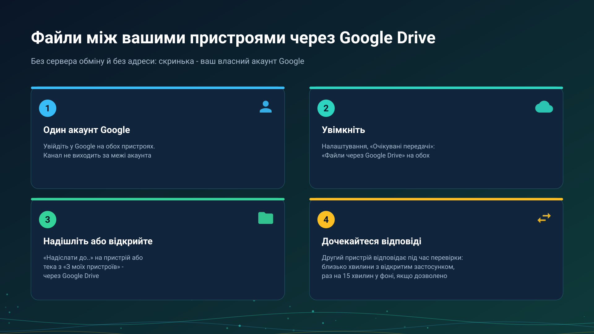

26.10.23 14:53

# Файли й теки через Google Drive

Через Google Drive ваш власний акаунт Google править за скриньку між пристроями: один пристрій кладе туди запит чи файл, інший його забирає. Сервер обміну не бере участі, і жодному пристрою не потрібна доступна адреса.

## Що потрібно

- **Один і той самий акаунт Google на кожному пристрої.** Канал працює лише всередині одного акаунта: пакет ніколи не адресується в інший акаунт Google, і нічого не віддається назовні із закритої теки застосунку на вашому Drive. До людей поза вашим акаунтом дотягуються через [сервер обміну](exchange-server-uk.html) або посилання.
- **Перемикач на кожному пристрої**: **Налаштування**, вкладка **Загальні**, **Очікувані передачі** в картці **Резервні копії, відновлення й експорт**, далі **Файли через Google Drive** угорі цього екрана.
- **Редакція з хмарами.** Перемикач є там, де в редакції є хмари, див. [Редакції](editions-uk.html).

## Що проходить

- **Файли.** **Надіслати на мій пристрій (Drive)** у меню дій файлу; діалог **Надіслати через Google Drive на** питає, на який пристрій: на один із них чи на **Будь-який мій пристрій**. Передача показується як очікувана, доки інший пристрій її не отримає.
- **Тека іншого пристрою.** На пристрої, який зберігає теку, увімкнено перемикач **SFTP-сервер** (звичайний спосіб роздавання тек у мережі) з її теками та **Файли через Google Drive**. На іншому тека є в списку **Додати ресурс**, **З моїх пристроїв**; коли до неї не можна дотягнутися напряму чи через сервер обміну, помилка пропонує **Відкрити через Google Drive**. Ви отримуєте імена, розміри й дати, а вибрані файли зберігаються у вхідну теку застосунку.
- **Одна сторона розкладу.** Копіювання, яке бере файли іншого пристрою через Google Drive, див. [Розклад над теками інших пристроїв](schedule-remote-folders-uk.html).
- **Буфер**, як сказано на [сторінці буфера](exchange-clipboard-uk.html).

Трансляція там лише оголошується: її адреса з'являється в списку, а картинка й звук ідуть напряму або через сервер обміну, але ніколи через Drive.

## Скільки це триває

Google Drive нічого не надсилає програмі сам, тому кожен пристрій дивиться в чергу самостійно:

- кожні 10 секунд, поки екран чекає відповіді або триває надсилання;
- приблизно раз на хвилину, поки застосунок відкрито;
- раз на 15 хвилин у фоні, лише коли ввімкнено **Перевіряти через Google Drive у фоні**.

Тому відповідь приходить через інтервал іншого пристрою плюс сама передача. Екран показує «Чекаємо відповіді пристрою через Google Drive» з часом, коли його востаннє було видно, а за дві хвилини на передньому плані пише, що пристрій не відповів: переконайтеся, що його ввімкнено і застосунок на ньому відкрито, і спробуйте знову. Годинник сам Drive не перевіряє; файл, що дійшов до телефона, передає годиннику телефон.

## Межі

- **Одна передача несе до 5 ГіБ.** Більший файл копіюють прямим з'єднанням.
- **Займається місце вашого акаунта Google.** Надсилання відхиляється заздалегідь, якщо місця не вистачає; діє й власна добова межа завантаження Google.
- **Тека з PIN-кодом лишається закритою** на цьому шляху; відкрийте її прямим з'єднанням.
- **Пакети застарівають.** Файл, який ніхто не отримав, видаляється через сім днів або одразу через **Видалити застарілі пакети**; отриманий видаляє з Drive одержувач.
- **Кожен пристрій показує, що чекає**, в **Очікуваних передачах**, і будь-який пакет там можна видалити.

## Що зберігається і де

Через Google Drive файли й буфер зберігаються у вашому власному акаунті Google, як і інші ваші файли на Google Drive; сервер обміну в цьому не бере участі.

На цьому шляху в цій версії нічого наперед не шифрується: Google зберігає файли так само, як інші ваші файли на Drive. Те, що йде через сервер обміну, зашифровано на ваших пристроях, див. [сервер обміну](exchange-server-uk.html).

## Покрокові інструкції

- [Інтеграція з Google Drive](../../documentation/network/cloud-google-drive-uk.html)
- [Резервне копіювання налаштувань і синхронізація пристроїв](../../documentation/settings/backup-and-device-sync-uk.html)
- [Теки через сервер обміну](folders-exchange-server-uk.html)

Назад на [головну сторінку порталу](index-uk.html).
