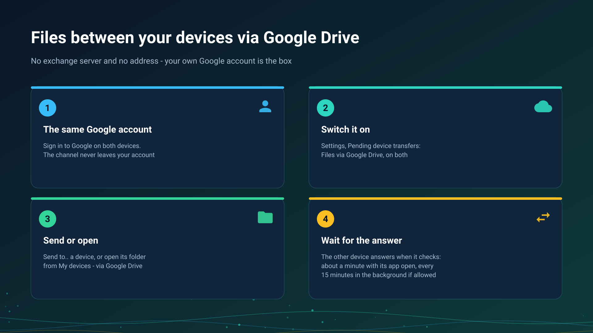

26.10.15 15:10

# Files and folders via Google Drive

Via Google Drive, your own Google account is the box between your devices: one device puts a request or a file there, another one picks it up. No exchange server takes part and no device needs a reachable address.

## What you need

- **The same Google account on every device.** The channel works inside one account only: a packet is never addressed to another Google account, and nothing is shared out of the app's private folder on your Drive. People outside your account are reached through an [exchange server](exchange-server.html) or a link.
- **The switch on every device**: **Settings**, the **General** tab, **Pending device transfers** in the **Backups, restore and settings export** card, then **Files via Google Drive** at the top of that screen.
- **An edition with clouds.** The switch exists where the edition carries clouds, see [Editions](editions.html).

## What goes through

- **Files.** **Send to my device (Drive)** on the action sheet of a file; the dialog **Send via Google Drive to** asks which device: one of them or **Any of my devices**. The transfer shows as waiting until the other device receives it.
- **A folder of another device.** On the device that keeps the folder, the SFTP server runs with its folders and **Files via Google Drive** is on. On the other one the folder is listed in **Add Resource**, **From my devices**; when it cannot be reached directly or through an exchange server, the error offers **Open via Google Drive**. You get names, sizes and dates, and the files you pick are saved to the app's incoming folder.
- **One side of a schedule.** A copy that takes the files of another device via Google Drive, see [A schedule over folders of other devices](schedule-remote-folders.html).
- **The clipboard**, as the [clipboard page](exchange-clipboard.html) says.

A broadcast is only announced there: its address appears in the list, and the picture and the sound go directly or through an exchange server, never through Drive.

## How long it takes

Google Drive pushes nothing to a program, so each device looks at the queue on its own:

- every 10 seconds while a screen waits for an answer or a send is under way;
- about once a minute while the app is open;
- every 15 minutes in the background, only when **Check via Google Drive in the background** is on.

So an answer takes the other device's interval plus the transfer. The screen shows "Waiting for the device via Google Drive" with the time it was last seen, and after two minutes in the foreground it says the device did not answer: make sure it is on and the app is open there, then try again. The watch does not check Drive on its own; a file that reached the phone is handed to it by the phone.

## Limits

- **One transfer carries up to 5 GiB.** A larger file is copied over a direct connection.
- **It uses the space of your Google account.** A send is refused up front when the free space is not enough, and Google's own daily upload limit applies.
- **A folder protected with a PIN stays locked** on this path; open it over a direct connection.
- **Packets expire.** A file nobody received is removed after seven days, or at once with **Remove expired packets**; a received one is deleted from Drive by the receiver.
- **Each device shows what waits** in **Pending device transfers**, and you can delete any packet there.

## What is kept and where

Via Google Drive, files and the clipboard are kept in your own Google account, like your other files on Google Drive; no exchange server takes part.

Nothing is sealed on this path in this version: Google keeps the files as it keeps your other files on Drive. What passes through an exchange server instead is sealed on your devices, see [the exchange server](exchange-server.html).

## Step-by-step guides

- [Google Drive integration](../../documentation/network/cloud-google-drive.html)
- [Backing up your settings and keeping devices in sync](../../documentation/settings/backup-and-device-sync.html)
- [Folders through the exchange server](folders-exchange-server.html)

Back to the [portal start page](index.html).
