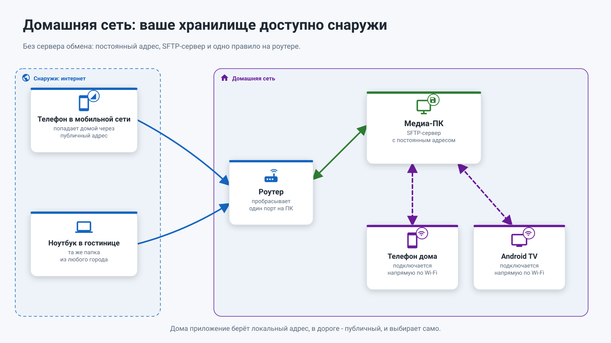
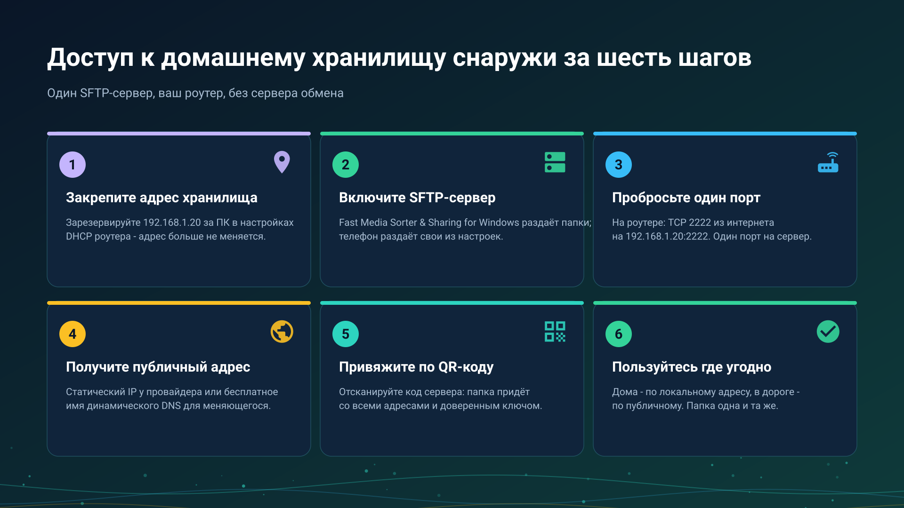
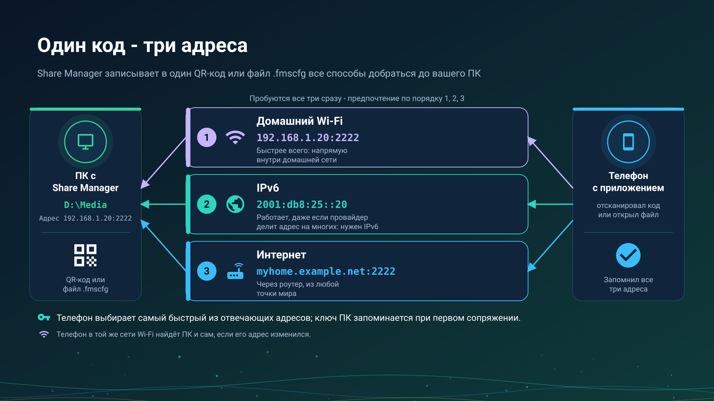

26.10.22 01:24

# Домашняя сеть: ваше хранилище, доступное снаружи

Способу «домашняя сеть» не нужен чужой сервер: только ваш роутер и одно устройство, которое хранит папки, - медиа-ПК или телефон. **Работает уже сегодня.**

## Кто раздаёт, кто открывает

- **ПК с Windows раздаёт** выбранные папки через **Share Manager** - программу в трее, которая служит частью раздачи папок в [Fast Media Sorter & Sharing for Windows](windows-servers-ru.html#three-parts). Начните [с просмотрщика](windows-servers-ru.html#viewer-first) для ПК, на котором вы ещё и работаете, или [с сервера](windows-servers-ru.html#server-first) с серверной редакцией для ПК, который должен быть доступен, даже когда никто не вошёл в систему: она запускает ту же раздачу в фоне, как службу Windows. Раздача папок поставляется выключенной и запускается, только когда вы её включите. Сервер обмена - другая часть, и для домашней сети он не нужен.
- **Телефон раздаёт** свои папки: FastMediaSorter включает раздачу в **Настройках**, на вкладке **Общие**, в карточке **Доступ с телефона**, переключателем **SFTP-сервер** (SFTP - стандартный способ, которым устройства делятся папками).
- **NAS (небольшое сетевое хранилище) или ПК с общими папками Windows** отдаёт свои общие папки как есть (SMB - раздача, встроенная в Windows), ничего устанавливать не нужно.
- **Все остальные устройства их открывают**: телефон, планшет, Android TV и VR-шлем добавляют папку как сетевой ресурс в FastMediaSorter; часы тоже открывают сетевые папки.

## Дома

Внутри домашней сети устройства подключаются друг к другу напрямую, на полной локальной скорости. FastMediaSorter сам находит устройства с раздачей папок в вашей сети (серверы SMB, FTP и SFTP), поэтому чаще всего устройство выбирается из списка, а не вводится вручную. Папка, которую раздаёт ПК или телефон, приходит по сканированию его QR-кода - адрес, логин и ключ, подтверждающий, что это нужное устройство, уже заполнены.

## Снаружи - за шесть шагов

1. **Закрепите адрес хранилища.** Зарезервируйте адрес для ПК или телефона в настройках роутера (список DHCP, ищите «резервирование адреса»), например `192.168.1.20`, чтобы он не менялся.
2. **Включите раздачу папок** (переключатель **SFTP-сервер**) на устройстве, которое хранит папки.
3. **Впустите одно подключение через роутер.** В роутере это называется «проброс порта»: направьте, например, порт 2222 из интернета на `192.168.1.20:2222`. Каждому раздающему устройству нужен свой порт.
4. **Получите адрес в интернете**: постоянный адрес у провайдера или бесплатное имя вроде `myhome.example.net`, которое следует за меняющимся адресом (услуга «динамический DNS»).
5. **Привяжите устройство по QR-коду.** Папка приходит с обоими адресами и ключом, подтверждающим, что это нужное устройство.
6. **Пользуйтесь откуда угодно.** Дома приложение берёт локальный адрес, в дороге - адрес в интернете и выбирает само.

**Share Manager может попробовать шаг 3 за вас.** Если роутер позволяет, Share Manager просит роутер открыть порт самостоятельно (эти возможности роутера называются UPnP и NAT-PMP), если только вы не включили режим «только локальная сеть». Затем он проверяет порт из интернета и прямо говорит, что из трёх вариантов верно: работает из интернета, порт не отвечает и настройку в роутере стоит проверить, либо роутер порт открыл, но провайдер блокирует входящие подключения. Не каждый роутер разрешает автоматическое открытие, поэтому настройка порта вручную в роутере остаётся надёжным способом.

**Один код, три адреса.** QR-код или файл из Share Manager несёт все адреса, по которым ПК достижим: локальный, IPv6 (более новый вид интернет-адреса) и адрес в интернете. Телефон пробует их все и предпочитает локальный, поэтому одного сканирования хватает и дома, и в дороге. IPv6 может работать даже тогда, когда провайдер выдаёт один интернет-адрес на многих клиентов и настройка роутера не помогает, если IPv6 есть на обоих концах. Порт выбирается один раз и сам никогда не меняется, поэтому настройка в роутере и напечатанный код остаются в силе. При включённом режиме «только локальная сеть» в коде остаётся только локальный адрес.

**Провайдер не даёт собственного адреса?** Многие мобильные и часть домашних провайдеров выдают один интернет-адрес на многих клиентов, и тогда ничто, настроенное в роутере, снаружи недоступно. Первое, что стоит попробовать, - IPv6: если у ПК есть адрес IPv6, код из Share Manager уже его несёт, и по нему можно дойти до ПК там, где настройка роутера не работает. VPN в домашнюю сеть по-прежнему работает; для этого случая задуман [сервер обмена](exchange-server-ru.html): каждое устройство само подключается к нему, поэтому в роутере ничего настраивать не нужно. Как папка открывается через него, по шагам: [Папки через сервер обмена](folders-exchange-server-ru.html).

## Пошаговые инструкции

- [Подключение общих папок SMB/Windows](../../documentation/network/smb-samba-shares-ru.html)
- [Подключение серверов SFTP и FTP](../../documentation/network/sftp-ftp-servers-ru.html)
- [Раздача папок ПК через Fast Media Sorter & Sharing for Windows](../../documentation/network/windows-companion-ru.html)
- [Телефон как SFTP-сервер](../../documentation/network/phone-as-sftp-server-ru.html)
- [Телефон как сервер: сколько он работает, режим лаунчера и мобильный трафик](phone-sharing-ru.html)
- [Папки через сервер обмена](folders-exchange-server-ru.html)
- [Сетевые папки и облачные хранилища как источники](../../documentation/storage/network-and-cloud-sources-ru.html)
- [Публикация папок ПК для Android](https://serzhyale.github.io/FastMediaSorter_Lite/publish-folders-android.html) - на сайте продукта для Windows

Назад на [главную страницу портала](index-ru.html).

## Окна настроек программы для Windows {#windows-settings-windows}

Сначала определите, как соединены устройства: напрямую с общими папками этого ПК или через учётную запись на сервере обмена. Для прямого способа откройте «Сеть и хостинг» в **настройках общего доступа SFTP**. Для учётной записи на сервере обмена откройте её страницу в **настройках менеджера**. Для сервера обмена, установленного на этом ПК, откройте **настройки сервера обмена**. «Установлен», «включён», «запущен» и «доступен по сети» - четыре разных состояния: открытие настроек ничего не включает и не запускает.
