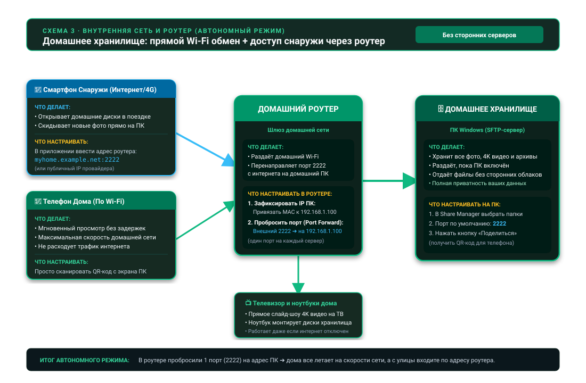

26.10.15 15:03

# Домашняя сеть: ваше хранилище, доступное снаружи

Способу «домашняя сеть» не нужен чужой сервер: только ваш роутер и одно устройство, которое хранит папки, - медиа-ПК или телефон. **Работает уже сегодня.**

## Кто раздаёт, кто открывает

- **ПК с Windows раздаёт** выбранные папки через **Share Manager** - программу в трее, входящую в [Fast Media Sorter & Sharing for Windows](windows-servers-ru.html). ПК, который должен быть доступен, даже когда никто не вошёл в систему, работает через [серверную редакцию](windows-servers-ru.html): она запускает ту же раздачу как службу Windows. SFTP-служба поставляется выключенной и запускается, только когда вы её включите.
- **Телефон раздаёт** свои папки: FastMediaSorter превращает его в SFTP-сервер в **Настройках**, на вкладке **Общие**, в карточке **Доступ по SFTP**.
- **NAS или ПК с общими папками Windows** отдаёт свои SMB-ресурсы как есть, ничего устанавливать не нужно.
- **Все остальные устройства их открывают**: телефон, планшет, Android TV и VR-шлем добавляют папку как сетевой ресурс в FastMediaSorter; часы тоже открывают сетевые папки.

## Дома

Внутри домашней сети устройства подключаются друг к другу напрямую, на полной локальной скорости. FastMediaSorter сам находит SMB-, FTP- и SFTP-серверы в вашей сети, поэтому чаще всего сервер выбирается из списка, а не вводится вручную. Папка, которую раздаёт ПК или телефон, приходит по сканированию его QR-кода - адрес, логин и доверенный ключ сервера уже заполнены.

## Снаружи - за шесть шагов

1. **Закрепите адрес хранилища.** Зарезервируйте адрес для ПК или телефона в настройках DHCP роутера, например `192.168.1.20`.
2. **Включите SFTP-сервер** на устройстве, которое хранит папки.
3. **Пробросьте один порт** в роутере: например, TCP 2222 из интернета на `192.168.1.20:2222`. Каждому серверу нужен свой порт.
4. **Получите публичный адрес**: статический IP у провайдера или бесплатное имя динамического DNS, например `myhome.example.net`.
5. **Привяжите устройство по QR-коду.** Папка приходит с обоими адресами и своим доверенным ключом.
6. **Пользуйтесь откуда угодно.** Дома приложение берёт локальный адрес, в дороге - публичный и выбирает само.

**Share Manager может попробовать шаг 3 за вас.** Если роутер позволяет, Share Manager просит роутер открыть порт самостоятельно (через UPnP или NAT-PMP), если только вы не включили режим «только локальная сеть». Затем он пробует порт из интернета и прямо говорит, что из трёх вариантов верно: работает из интернета, порт не отвечает и проброс стоит проверить, либо роутер порт открыл, но провайдер блокирует входящие подключения. Не каждый роутер разрешает автоматическое открытие, поэтому проброс порта вручную в роутере остаётся надёжным способом.

**Один код, три адреса.** QR-код или файл из Share Manager несёт все адреса, по которым ПК достижим: локальный, IPv6 и интернет-адрес. Телефон пробует их все и предпочитает локальный, поэтому одного сканирования хватает и дома, и в дороге. IPv6 может работать даже за NAT оператора, где проброс порта не помогает, если он есть на обоих концах. Порт выбирается один раз и сам никогда не меняется, поэтому правило в роутере и напечатанный код остаются в силе. При включённом режиме «только локальная сеть» в коде остаётся только локальный адрес.

**Провайдер не даёт публичный адрес?** Многие мобильные и часть домашних провайдеров ставят вас за NAT оператора, и тогда никакой проброшенный порт до роутера не доходит. Первое, что стоит попробовать, - IPv6: если у ПК есть адрес IPv6, код из Share Manager уже его несёт, и по нему можно дойти до ПК там, где проброс не работает. VPN в домашнюю сеть по-прежнему работает; для этого случая задуман [сервер обмена](exchange-server-ru.html): каждое устройство само подключается к нему, поэтому проброшенный порт на стороне устройств не нужен. Как папка открывается через него, по шагам: [Папки через сервер обмена](folders-exchange-server-ru.html).

## Пошаговые инструкции

- [Подключение общих папок SMB/Windows](../../documentation/network/smb-samba-shares-ru.html)
- [Подключение серверов SFTP и FTP](../../documentation/network/sftp-ftp-servers-ru.html)
- [Раздача папок ПК через Fast Media Sorter & Sharing for Windows](../../documentation/network/windows-companion-ru.html)
- [Телефон как SFTP-сервер](../../documentation/network/phone-as-sftp-server-ru.html)
- [Телефон как сервер: сколько он работает, режим лаунчера и мобильный трафик](phone-sharing-ru.html)
- [Папки через сервер обмена](folders-exchange-server-ru.html)
- [Сетевые папки и облачные хранилища как источники](../../documentation/storage/network-and-cloud-sources-ru.html)
- [Публикация папок ПК для Android](https://serzhyale.github.io/FastMediaSorter_Lite/publish-folders-android.html) - на сайте продукта для Windows

Назад на [главную страницу портала](index-ru.html).
