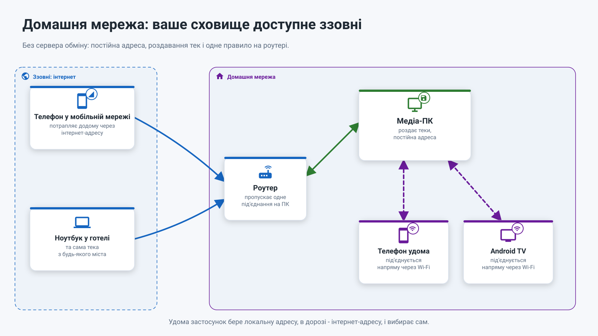
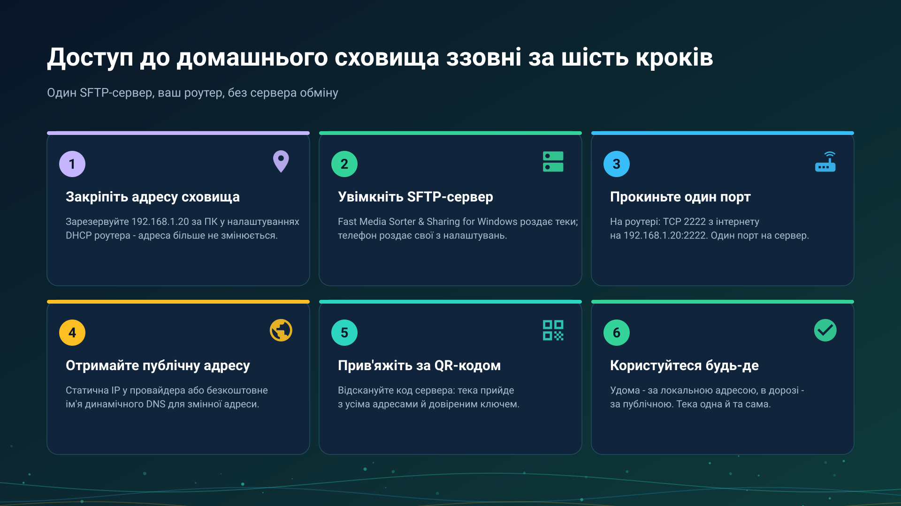
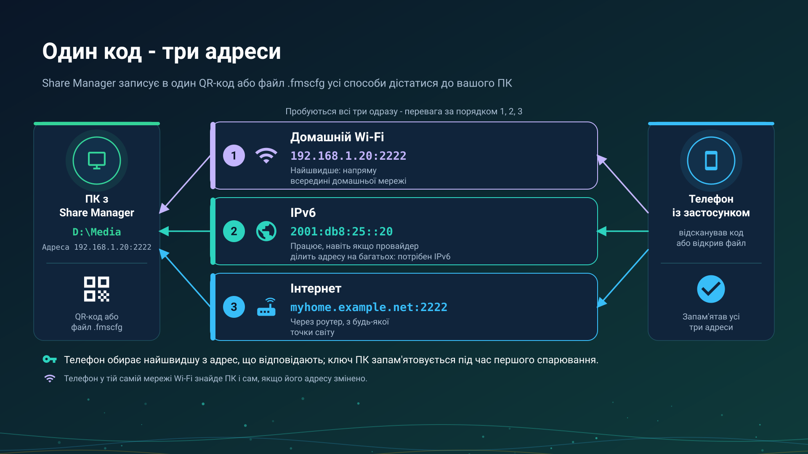

26.10.20 12:17

# Домашня мережа: ваше сховище, доступне ззовні

Способу «домашня мережа» не потрібен чужий сервер: лише ваш роутер і один пристрій, що зберігає теки, - медіа-ПК або телефон. **Працює вже сьогодні.**

## Хто роздає, хто відкриває

- **ПК з Windows роздає** вибрані теки через **Share Manager** - програму в треї, що є частиною роздавання тек у [Fast Media Sorter & Sharing for Windows](windows-servers-uk.html#three-parts). Почніть [із переглядача](windows-servers-uk.html#viewer-first) для ПК, на якому ви ще й працюєте, або [зі сервера](windows-servers-uk.html#server-first) із серверною редакцією для ПК, який має бути доступним, навіть коли ніхто не ввійшов у систему: вона запускає ту саму роздачу як службу Windows. SFTP-служба постачається вимкненою і запускається, лише коли ви її ввімкнете. Сервер обміну - інша частина, і для домашньої мережі він не потрібен.
- **Телефон роздає** свої теки: FastMediaSorter перетворює його на SFTP-сервер у **Налаштуваннях**, на вкладці **Загальні**, у картці **Доступ через SFTP**.
- **NAS або ПК зі спільними теками Windows** віддає свої SMB-ресурси як є, нічого встановлювати не треба.
- **Усі інші пристрої їх відкривають**: телефон, планшет, Android TV і VR-шолом додають теку як мережевий ресурс у FastMediaSorter; годинник теж відкриває мережеві теки.

## Удома

Усередині домашньої мережі пристрої під'єднуються один до одного напряму, на повній локальній швидкості. FastMediaSorter сам знаходить SMB-, FTP- і SFTP-сервери у вашій мережі, тож найчастіше сервер вибирається зі списку, а не вводиться вручну. Тека, яку роздає ПК або телефон, приходить за скануванням його QR-коду - адреса, логін і довірений ключ сервера вже заповнені.

## Ззовні - за шість кроків

1. **Закріпіть адресу сховища.** Зарезервуйте адресу для ПК або телефона в налаштуваннях DHCP роутера, наприклад `192.168.1.20`.
2. **Увімкніть SFTP-сервер** на пристрої, що зберігає теки.
3. **Прокиньте один порт** у роутері: наприклад, TCP 2222 з інтернету на `192.168.1.20:2222`. Кожному серверу потрібен свій порт.
4. **Отримайте публічну адресу**: статичну IP у провайдера або безкоштовне ім'я динамічного DNS, наприклад `myhome.example.net`.
5. **Прив'яжіть пристрій за QR-кодом.** Тека приходить з обома адресами та своїм довіреним ключем.
6. **Користуйтеся звідусіль.** Удома застосунок бере локальну адресу, у дорозі - публічну і вибирає сам.

**Share Manager може спробувати крок 3 за вас.** Якщо роутер дозволяє, Share Manager просить роутер відкрити порт самостійно (через UPnP або NAT-PMP), хіба що ви ввімкнули режим «лише локальна мережа». Потім він пробує порт з інтернету й прямо каже, що з трьох варіантів правда: працює з інтернету, порт не відповідає і прокидання варто перевірити, або роутер порт відкрив, але провайдер блокує вхідні під'єднання. Не кожен роутер дозволяє автоматичне відкриття, тому прокидання порту вручну в роутері лишається надійним способом.

**Один код, три адреси.** QR-код або файл із Share Manager несе всі адреси, за якими ПК досяжний: локальну, IPv6 та інтернет-адресу. Телефон пробує їх усі й віддає перевагу локальній, тому одного сканування вистачає і вдома, і в дорозі. IPv6 може працювати навіть за NAT оператора, де прокидання порту не допомагає, якщо він є на обох кінцях. Порт вибирається один раз і сам ніколи не змінюється, тому правило в роутері й надрукований код лишаються чинними. За ввімкненого режиму «лише локальна мережа» в коді лишається тільки локальна адреса.

**Провайдер не дає публічної адреси?** Багато мобільних і частина домашніх провайдерів ставлять вас за NAT оператора, і тоді жоден прокинутий порт до роутера не доходить. Перше, що варто спробувати, - IPv6: якщо у ПК є адреса IPv6, код із Share Manager уже її несе, і за нею можна дійти до ПК там, де прокидання не працює. VPN у домашню мережу й далі працює; для цього випадку задуманий [сервер обміну](exchange-server-uk.html): кожен пристрій сам під'єднується до нього, тому прокинутий порт з боку пристроїв не потрібен. Як тека відкривається через нього, за кроками: [Теки через сервер обміну](folders-exchange-server-uk.html).

## Покрокові інструкції

- [Під'єднання спільних тек SMB/Windows](../../documentation/network/smb-samba-shares-uk.html)
- [Під'єднання серверів SFTP і FTP](../../documentation/network/sftp-ftp-servers-uk.html)
- [Роздавання тек ПК через Fast Media Sorter & Sharing for Windows](../../documentation/network/windows-companion-uk.html)
- [Телефон як SFTP-сервер](../../documentation/network/phone-as-sftp-server-uk.html)
- [Телефон як сервер: скільки він працює, режим лаунчера й мобільний трафік](phone-sharing-uk.html)
- [Теки через сервер обміну](folders-exchange-server-uk.html)
- [Мережеві теки й хмарні сховища як джерела](../../documentation/storage/network-and-cloud-sources-uk.html)
- [Публікація тек ПК для Android](https://serzhyale.github.io/FastMediaSorter_Lite/publish-folders-android.html) - на сайті продукту для Windows

Назад на [головну сторінку порталу](index-uk.html).

## Вікна налаштувань Windows {#windows-settings-windows}

Для збірок Windows з окремими вікнами налаштувань. У попередніх збірках ці сторінки об’єднані в налаштуваннях менеджера. Зміна навігації не робить невипущений компонент доступним; відомості про доступність вище залишаються чинними.

Спочатку визначте підключення: прямий доступ SFTP чи з’єднання через обліковий запис обміну. Для SFTP перевіряйте мережу й хостинг у налаштуваннях спільного доступу SFTP. Для віддаленого облікового запису відкрийте його сторінку в менеджері. Для сервера на цьому ПК відкрийте налаштування сервера обміну. Установлений, увімкнений, запущений і доступний мережею - різні стани; відкриття налаштувань нічого не вмикає й не запускає.
