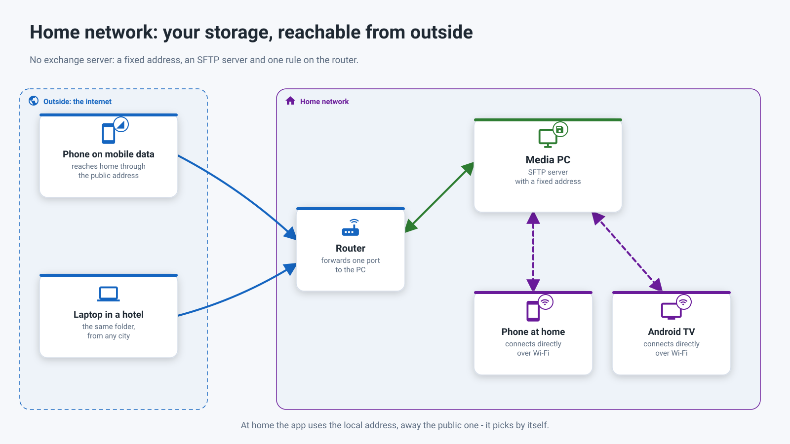
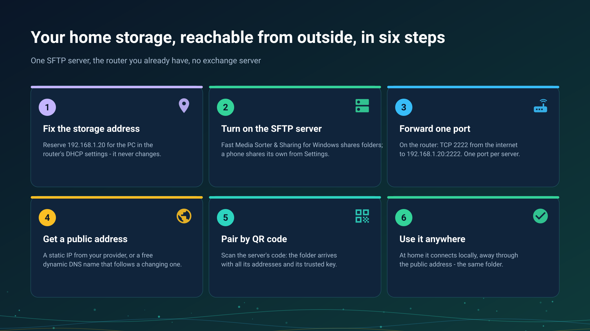
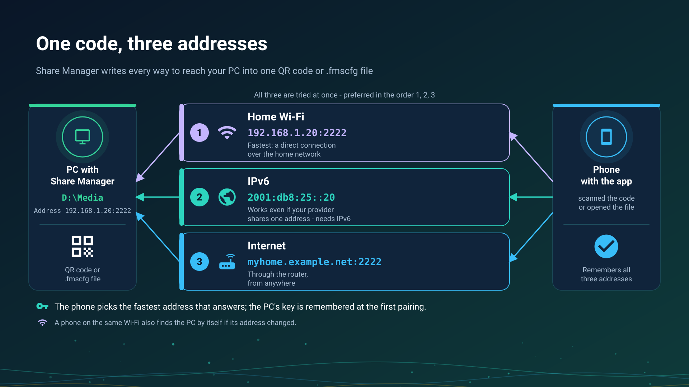

26.10.15 15:03

# Home network: your storage, reachable from outside

The home network way needs no server of anyone else: your own router, and one device that keeps the folders - a media PC or a phone. **It works today.**

## Who shares, who opens

- **A Windows PC shares** the folders you pick with **Share Manager**, the tray program of [Fast Media Sorter & Sharing for Windows](windows-servers.html). A PC that has to stay available with nobody signed in uses the [Server edition](windows-servers.html), which runs the same sharing as a Windows service. The SFTP service ships switched off and starts only once you enable it.
- **A phone shares** its own folders: FastMediaSorter turns it into an SFTP server from **Settings**, the **General** tab, the **Share over SFTP** card.
- **A NAS or a PC with Windows sharing** offers its SMB shares as they are, with nothing to install.
- **Every other device opens them**: a phone, a tablet, an Android TV and a VR headset add the folder as a network resource in FastMediaSorter; the watch opens network folders too.

## At home

Inside the home network the devices connect to each other directly, at full local speed. FastMediaSorter finds SMB, FTP and SFTP servers on your network by itself, so in most cases you pick a server from a list instead of typing an address. A folder shared from a PC or a phone arrives by scanning its QR code, with the address, the login and the server's trusted key already filled in.

## From outside, in six steps

1. **Fix the storage address.** Reserve an address for the PC or the phone in the router's DHCP settings, for example `192.168.1.20`.
2. **Turn on the SFTP server** on the device that keeps the folders.
3. **Forward one port** in the router: for example TCP 2222 from the internet to `192.168.1.20:2222`. Each server needs its own port.
4. **Get a public address**: a static IP from your provider, or a free dynamic DNS name such as `myhome.example.net`.
5. **Pair by QR code.** The folder arrives with both addresses and its trusted key.
6. **Use it anywhere.** At home the app uses the local address, away the public one, and picks by itself.

**Share Manager can try step 3 for you.** When the router allows it, Share Manager asks the router to open the port by itself (through UPnP or NAT-PMP), unless you have switched it to "local network only". It then tries the port from the internet and tells you plainly which of three things is true: it works from the internet, the port does not answer and the forwarding needs a look, or the router opened it but your provider blocks incoming connections. Not every router allows automatic opening, so forwarding the port by hand in the router stays the reliable route.

**One code, three addresses.** The QR code or the file from Share Manager carries every address the PC can be reached at: the local one, the IPv6 one and the internet one. The phone tries them all and prefers the local one, so a single scan works at home and away. IPv6 can work even behind carrier NAT, where port forwarding cannot, as long as both ends have it. The port is chosen once and never changes by itself, so a router rule and a printed code stay valid. With "local network only" switched on, the code carries the local address alone.

**No public address from your provider?** Many mobile and some home providers put you behind carrier NAT, and then no forwarded port reaches your router. The first thing to try is IPv6: when the PC has an IPv6 address, the code from Share Manager already carries it, and it can reach the PC where forwarding cannot. A VPN to your home network still works; the [exchange server](exchange-server.html) is the way meant for this case: every device dials out to it, so no forwarded port is needed on the devices' side. How a folder opens through it, step by step: [Folders through the exchange server](folders-exchange-server.html).

## Step-by-step guides

- [Connecting SMB/Windows shares](../../documentation/network/smb-samba-shares.html)
- [Connecting SFTP and FTP servers](../../documentation/network/sftp-ftp-servers.html)
- [Sharing PC folders with Fast Media Sorter & Sharing for Windows](../../documentation/network/windows-companion.html)
- [Turning the phone into an SFTP server](../../documentation/network/phone-as-sftp-server.html)
- [The phone as a server: how long it lasts, launcher mode and mobile data](phone-sharing.html)
- [Folders through the exchange server](folders-exchange-server.html)
- [Adding network folders and cloud storage as sources](../../documentation/storage/network-and-cloud-sources.html)
- [Publishing PC folders to Android](https://serzhyale.github.io/FastMediaSorter_Lite/publish-folders-android.html), on the Windows product's site

Back to the [portal start page](index.html).
