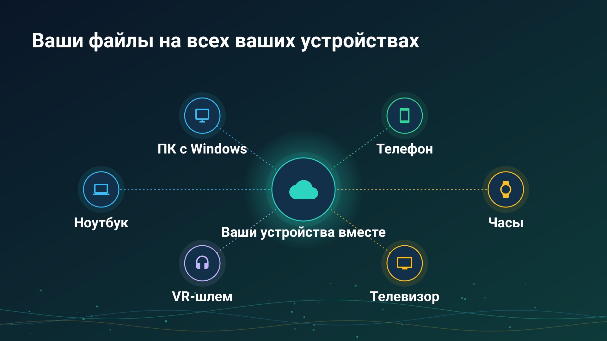
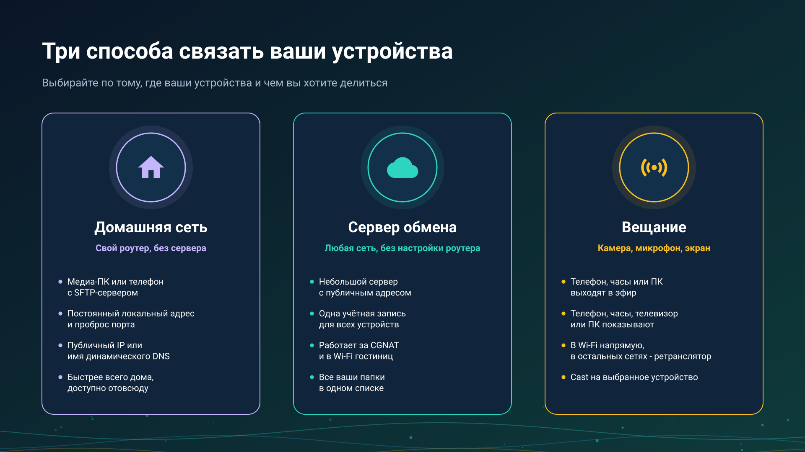

26.10.21 15:52

# Обмен медиа между вашими устройствами

Ваши фото, видео и музыка живут сразу на нескольких устройствах - телефоне, ПК, часах, телевизоре. Портал отвечает на два вопроса до любой настройки: **какой способ связи подходит именно вам** и **какая программа что делает на каждом устройстве**. Каждый раздел заканчивается ссылками на подробные пошаговые инструкции.

## Выберите свой способ

- **[Домашняя сеть](home-network-ru.html)** - ваш собственный роутер, без дополнительного сервера. Медиа-ПК или телефон раздаёт папки по SFTP; дома всё подключается напрямую на полной скорости, а с одним проброшенным портом те же папки открываются откуда угодно.
- ** [Сервер обмена](exchange-server-ru.html)** - один аккаунт для всех устройств, из любой сети, без настройки роутера. Каждый держит свой сервер; хозяин сервера может пригласить на него родных и друзей, а сервера для всех не держит никто. Подробнее: [для чего он нужен и всё, что с ним можно делать](exchange-server-purpose-ru.html), [свой сервер по шагам](exchange-server-quick-start-ru.html), [установка сервера](exchange-server-install-ru.html), [аккаунты и приглашения](exchange-accounts-ru.html), [буфер](exchange-clipboard-ru.html) и [удаление аккаунта](account-deletion-ru.html).
- **[Живая трансляция](live-broadcast-ru.html)** - телефон или часы выходят в эфир с камерой, микрофоном, экраном или готовым файлом, а остальные ваши устройства её воспроизводят: напрямую в одной сети Wi-Fi, через ваш сервер обмена из любой другой сети или по cast, который одно ваше устройство шлёт другому.

Ещё два раздела - о способах, которые не требуют своей настройки:

- **[Облака](clouds-ru.html)** - Google Диск, Dropbox и OneDrive как общий ящик, который открывает каждое устройство, вошедшее в аккаунт.
- **[Редакции](editions-ru.html)** - в какой редакции приложения для Android есть сетевые папки, облака, трансляция и компаньон для часов.

## Какая программа что делает

| Устройство | Программа | Что делает для обмена |
|:-----------|:----------|:----------------------|
| Телефон или планшет Android | FastMediaSorter | Открывает сетевые папки (SMB, SFTP, FTP) и облака; раздаёт свои папки как SFTP-сервер; хранит ваши серверы обмена в «Моих устройствах» и открывает папки и трансляции других ваших устройств; отправляет файлы между вашими устройствами через Google Drive; выходит в эфир с камерой, микрофоном, экраном или готовым файлом; воспроизводит трансляции; шлёт cast на ваши устройства и на Chromecast |
| Часы Wear OS | FastMedia Wear, приложение для часов в паре с FastMediaSorter на телефоне | Входит в ваш аккаунт обмена через телефон и дальше работает по своим Wi-Fi или LTE: открывает папки аккаунта, воспроизводит его трансляции, вещает свой микрофон не более чем четырём слушателям, принимает cast и отправляет свои файлы через «Отправить в..» |
| Android TV | FastMediaSorter | Открывает сетевые папки и облака; воспроизводит трансляции и интернет-потоки |
| VR-шлем | FastMediaSorter, редакция VR | Открывает сетевые папки и облака; воспроизводит трансляции и интернет-потоки внутри шлема |
| ПК с Windows | [Fast Media Sorter & Sharing for Windows](windows-servers-ru.html), с тремя необязательными частями | Просмотрщик и сортировщик фото и видео; раздача папок, которая раздаёт выбранные папки по SFTP на телефоны и в любое SFTP-приложение и привязывает телефон по QR-коду или файлу настроек; и Media Exchange Server - место встречи ваших устройств в одной учётной записи. Начните [с просмотрщика](windows-servers-ru.html#viewer-first) или, для ПК, который только раздаёт, без вошедшего пользователя, [с сервера](windows-servers-ru.html#server-first) |
| ПК с Windows | [STREAMS Player](https://serzhyale.github.io/StreamsPlayer/) | Воспроизводит живые трансляции с телефона или часов |
{: .doc-table}

## Пошаговые инструкции по сценариям

- **[Свой сервер обмена по шагам](exchange-server-quick-start-ru.html)** - от установки пакета до проверки по мобильному интернету.
- **[Папки через сервер обмена](folders-exchange-server-ru.html)** - раздать папку на одном устройстве и открыть её на другом из любой сети.
- **[Файлы и папки через Google Drive](folders-google-drive-ru.html)** - между вашими устройствами, без сервера и без адреса.
- **[Выход в эфир](broadcast-start-ru.html)** - вещать звук, камеру, экран или готовый файл.
- **[Приём трансляции](broadcast-receive-ru.html)** - список ваших устройств, ссылка, пароль и cast.
- **[Часы в вашем аккаунте](watch-exchange-ru.html)** - через телефон и без него.
- **[Расписание над папками других устройств](schedule-remote-folders-ru.html)** - копирование и перемещение по графику.
- **[Телефон как сервер](phone-sharing-ru.html)** - сколько он работает, режим лаунчера и мобильный трафик.
- **[Мои устройства](my-devices-ru.html)** - добавление сервера, код сопряжения и строка подключения.

## Что есть

- Сетевые папки на ПК, NAS или роутере: SMB, SFTP и FTP, с автоматическим поиском серверов в вашей сети.
- Телефон, раздающий свои папки как SFTP-сервер, и привязка другого телефона одним сканированием.
- ПК с Windows, раздающий папки на телефон по QR-коду или файлу. Один код несёт локальный, IPv6- и интернет-адрес, а ПК сам пробует открыть порт на роутере и проверяет его снаружи.
- Серверная редакция, которая работает всегда: ПК с Windows раздаёт как служба, без вошедшего пользователя.
- Google Диск, Dropbox и OneDrive, а также файлы между вашими устройствами через Google Drive без сервера.
- Собственный сервер обмена: один аккаунт для всех устройств, ваши папки из любой сети, приглашения для родных и друзей и буфер, который передаётся между вашими устройствами. Серверная программа работает на ПК с Windows - см. [что входит в каждый пакет](windows-servers-ru.html#availability).
- Живая трансляция с телефона или часов - камера, микрофон, экран или готовый файл - напрямую в одной сети Wi-Fi и через ретранслятор сервера обмена, а также cast на другое ваше устройство, где принимающее устройство спрашивает перед воспроизведением.
- Chromecast для файлов, видео и живых потоков.

## Семья программ

- [FastMediaSorter для Android](../../index-ru.html) - телефон, планшет, телевизор, часы и VR-шлем.
- [Fast Media Sorter & Sharing for Windows](https://serzhyale.github.io/FastMediaSorter_Lite/) - на ПК: просмотрщик и сортировщик, раздача папок и сервер обмена, каждая часть необязательна; [что это за части](windows-servers-ru.html#three-parts).
- [STREAMS Player](https://serzhyale.github.io/StreamsPlayer/) - живые потоки и трансляции на Windows.

Подробные инструкции приложения для Android - в его [документации](../../documentation/index-ru.html).
