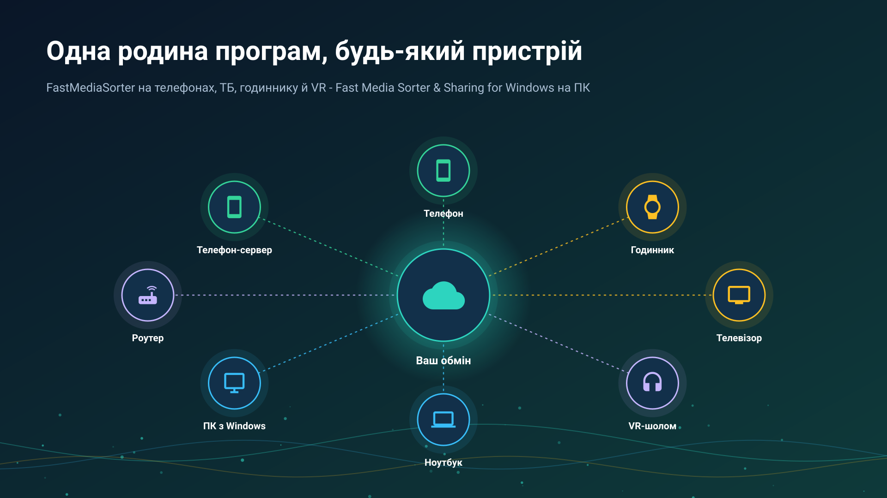
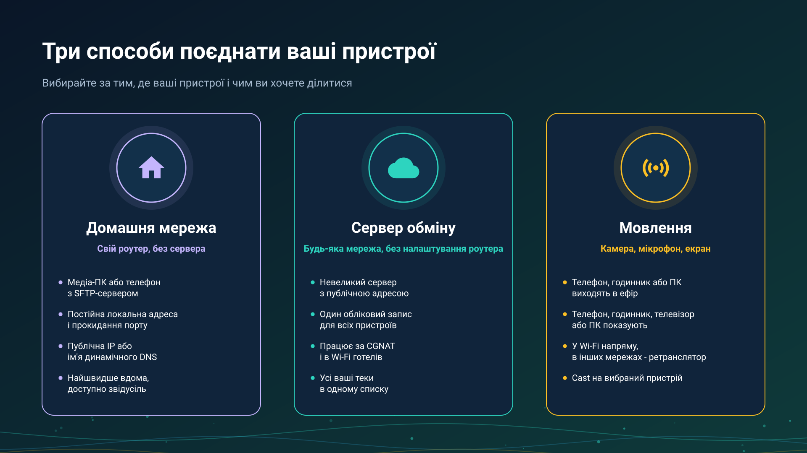

26.10.15 15:17

# Обмін медіа між вашими пристроями

Ваші фото, відео й музика живуть одразу на кількох пристроях - телефоні, ПК, годиннику, телевізорі. Портал відповідає на два запитання ще до будь-якого налаштування: **який спосіб зв'язку підходить саме вам** і **яка програма що робить на кожному пристрої**. Кожен розділ закінчується посиланнями на докладні покрокові інструкції.

## Виберіть свій спосіб

- **[Домашня мережа](home-network-uk.html)** - ваш власний роутер, без додаткового сервера. Медіа-ПК або телефон роздає теки через SFTP; удома все під'єднується напряму на повній швидкості, а з одним прокинутим портом ті самі теки відкриваються звідусіль.
- ** [Сервер обміну](exchange-server-uk.html)** - один акаунт для всіх пристроїв, з будь-якої мережі, без налаштування роутера. Кожен тримає свій сервер; власник сервера може запросити на нього рідних і друзів, а сервера для всіх не тримає ніхто. Докладніше: [встановлення сервера](exchange-server-install-uk.html), [акаунти й запрошення](exchange-accounts-uk.html), [буфер](exchange-clipboard-uk.html) і [видалення акаунта](account-deletion-uk.html).
- **[Пряма трансляція](live-broadcast-uk.html)** - телефон або годинник виходять в ефір з камерою, мікрофоном, екраном чи готовим файлом, а решта ваших пристроїв її відтворює: напряму в одній мережі Wi-Fi, через ваш сервер обміну з будь-якої іншої мережі або за cast, який один ваш пристрій шле іншому.

Ще два розділи - про способи, які не потребують власного налаштування:

- **[Хмари](clouds-uk.html)** - Google Диск, Dropbox і OneDrive як спільна скринька, яку відкриває кожен пристрій, що увійшов в обліковий запис.
- **[Редакції](editions-uk.html)** - у якій редакції застосунку для Android є мережеві теки, хмари, трансляція і компаньйон для годинника.

## Яка програма що робить

| Пристрій | Програма | Що робить для обміну |
|:---------|:---------|:---------------------|
| Телефон або планшет Android | FastMediaSorter | Відкриває мережеві теки (SMB, SFTP, FTP) і хмари; роздає свої теки як SFTP-сервер; зберігає ваші сервери обміну в «Моїх пристроях» і відкриває теки та трансляції інших ваших пристроїв; надсилає файли між вашими пристроями через Google Drive; виходить в ефір з камерою, мікрофоном, екраном чи готовим файлом; відтворює трансляції; шле cast на ваші пристрої й на Chromecast |
| Годинник Wear OS | FastMedia Wear, застосунок для годинника в парі з FastMediaSorter на телефоні | Входить у ваш акаунт обміну через телефон і далі працює по своїх Wi-Fi чи LTE: відкриває теки акаунта, відтворює його трансляції, мовить свій мікрофон не більш ніж чотирьом слухачам, приймає cast і надсилає свої файли через «Надіслати до..» |
| Android TV | FastMediaSorter | Відкриває мережеві теки й хмари; відтворює трансляції та інтернет-потоки |
| VR-шолом | FastMediaSorter, редакція VR | Відкриває мережеві теки й хмари; відтворює трансляції та інтернет-потоки всередині шолома |
| ПК з Windows | [Fast Media Sorter & Sharing for Windows](windows-servers-uk.html) | Роздає вибрані теки через SFTP на телефони й у будь-який SFTP-застосунок; прив'язує телефон за QR-кодом або файлом налаштувань; серверна редакція продовжує роздавати без користувача в системі |
| ПК з Windows | [STREAMS Player](https://serzhyale.github.io/StreamsPlayer/) | Відтворює прямі трансляції з телефона чи годинника |
{: .doc-table}

## Покрокові інструкції за сценаріями

- **[Теки через сервер обміну](folders-exchange-server-uk.html)** - роздати теку на одному пристрої й відкрити її на іншому з будь-якої мережі.
- **[Файли й теки через Google Drive](folders-google-drive-uk.html)** - між вашими пристроями, без сервера й без адреси.
- **[Вихід в ефір](broadcast-start-uk.html)** - мовити звук, камеру, екран чи готовий файл.
- **[Приймання трансляції](broadcast-receive-uk.html)** - список ваших пристроїв, посилання, пароль і cast.
- **[Годинник в акаунті](watch-exchange-uk.html)** - через телефон і без нього.
- **[Розклад над теками інших пристроїв](schedule-remote-folders-uk.html)** - копіювання й переміщення за графіком.
- **[Телефон як сервер](phone-sharing-uk.html)** - скільки він працює, режим лаунчера й мобільний трафік.
- **[Мої пристрої](my-devices-uk.html)** - додавання сервера, код сполучення й рядок підключення.

## Що є

- Мережеві теки на ПК, NAS або роутері: SMB, SFTP і FTP, з автоматичним пошуком серверів у вашій мережі.
- Телефон, що роздає свої теки як SFTP-сервер, і прив'язка іншого телефона одним скануванням.
- ПК з Windows, що роздає теки на телефон за QR-кодом або файлом. Один код несе локальну, IPv6- та інтернет-адресу, а ПК сам пробує відкрити порт на роутері й перевіряє його ззовні.
- Серверна редакція, що працює завжди: ПК з Windows роздає як служба, без користувача в системі.
- Google Диск, Dropbox і OneDrive, а також файли між вашими пристроями через Google Drive без сервера.
- Власний сервер обміну: один акаунт для всіх пристроїв, ваші теки з будь-якої мережі, запрошення для рідних і друзів та буфер, що передається між вашими пристроями.
- Пряма трансляція з телефона чи годинника - камера, мікрофон, екран чи готовий файл - напряму в одній мережі Wi-Fi і через ретранслятор сервера обміну, а також cast на інший ваш пристрій, де пристрій-отримувач питає перед відтворенням.
- Chromecast для файлів, відео й прямих потоків.

## Родина програм

- [FastMediaSorter для Android](../../index-uk.html) - телефон, планшет, телевізор, годинник і VR-шолом.
- [Fast Media Sorter & Sharing for Windows](https://serzhyale.github.io/FastMediaSorter_Lite/) - сортування на ПК і роздавання його тек.
- [STREAMS Player](https://serzhyale.github.io/StreamsPlayer/) - прямі потоки й трансляції на Windows.

Докладні інструкції застосунку для Android - у його [документації](../../documentation/index-uk.html).
