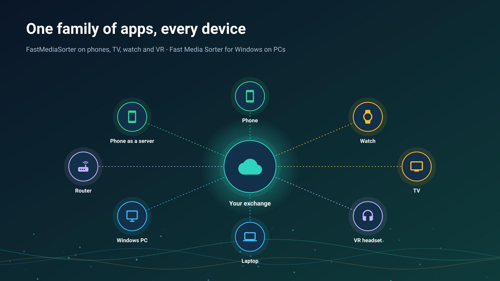
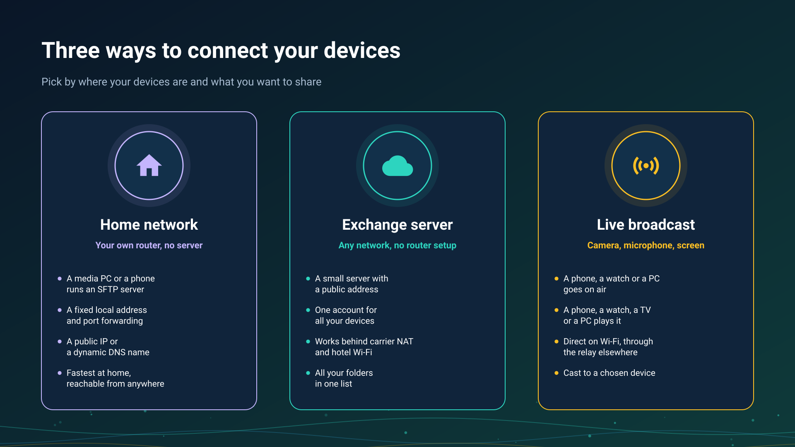

26.10.21 16:08

# Media exchange between your devices

Your photos, videos and music live on several devices at once - a phone, a PC, a watch, a TV. This portal answers two questions before any setup: **which way of connecting fits you**, and **which program does what on each device**. Every section ends with links to the detailed step-by-step guides.

## Choose your way

- **[Home network](home-network.html)** - your own router, no extra server. A media PC or a phone shares folders over SFTP; at home everything connects directly at full speed, and with one forwarded port the same folders open from anywhere.
- ** [Exchange server](exchange-server.html)** - one account for all your devices, from any network, with no router setup. Each person runs their own server; the owner of one may invite relatives and friends to it, and nobody runs a server for everybody. More: [what it is for and everything you can do with it](exchange-server-purpose.html), [deploying your own server in steps](exchange-server-quick-start.html), [installing a server](exchange-server-install.html), [accounts and invitations](exchange-accounts.html), [the clipboard](exchange-clipboard.html) and [deleting an account](account-deletion.html).
- **[Live broadcast](live-broadcast.html)** - a phone or a watch goes on air with its camera, microphone, screen or a ready file, and your other devices play it: directly on one Wi-Fi network, through your exchange server from any other network, or by a cast that one of your devices sends to another.

Two more sections cover the ways that need no setup of your own:

- **[Clouds](clouds.html)** - Google Drive, Dropbox and OneDrive as a shared box that every signed-in device opens.
- **[Editions](editions.html)** - which edition of the Android app has network folders, clouds, broadcasting and the watch companion.

## Which program does what

| Device | Program | What it does for exchange |
|:-------|:--------|:--------------------------|
| Android phone or tablet | FastMediaSorter | Opens network folders (SMB, SFTP, FTP) and clouds; shares its own folders as an SFTP server; keeps your exchange servers in My devices and opens the folders and broadcasts of your other devices; sends files between your devices via Google Drive; goes live with its camera, microphone, screen or a ready file; plays broadcasts; casts to your own devices and to a Chromecast |
| Wear OS watch | FastMedia Wear, the watch app paired with FastMediaSorter on the phone | Joins your exchange account through the phone and then works on its own Wi-Fi or LTE: opens the account's folders, plays its broadcasts, broadcasts its microphone to up to four listeners, takes a cast and sends its own files with Send to.. |
| Android TV | FastMediaSorter | Opens network folders and clouds; plays broadcasts and internet streams |
| VR headset | FastMediaSorter, VR edition | Opens network folders and clouds; plays broadcasts and internet streams inside the headset |
| Windows PC | [Fast Media Sorter & Sharing for Windows](windows-servers.html), with three optional parts | A viewer and sorter for photos and videos; folder sharing, which shares the folders you pick over SFTP to phones and to any SFTP app and pairs a phone by QR code or by a configuration file; and the Media Exchange Server, the meeting point of your devices on one account. Start [viewer first](windows-servers.html#viewer-first), or [server first](windows-servers.html#server-first) for a PC that only serves, with nobody signed in |
| Windows PC | [STREAMS Player](https://serzhyale.github.io/StreamsPlayer/) | Plays live broadcasts from a phone or a watch |
{: .doc-table}

## Step-by-step guides by scenario

- **[Your own exchange server in steps](exchange-server-quick-start.html)** - from installing the package to checking it from mobile data.
- **[Folders through the exchange server](folders-exchange-server.html)** - share a folder on one device and open it on another from any network.
- **[Files and folders via Google Drive](folders-google-drive.html)** - between your own devices, with no server and no address.
- **[Going on air](broadcast-start.html)** - broadcast sound, the camera, the screen or a ready file.
- **[Receiving a broadcast](broadcast-receive.html)** - the list of your devices, a link, a password and a cast.
- **[The watch on your account](watch-exchange.html)** - through the phone and without it.
- **[A schedule over folders of other devices](schedule-remote-folders.html)** - copy and move on a timetable.
- **[The phone as a server](phone-sharing.html)** - how long it lasts, launcher mode and mobile data.
- **[My devices](my-devices.html)** - adding your server, the pairing code and the connection string.

## What is available {#what-is-available}

- Network folders on a PC, a NAS or a router: SMB, SFTP and FTP, with automatic discovery of servers on your network.
- A phone sharing its own folders as an SFTP server, paired with another phone in one scan.
- A Windows PC sharing folders to the phone by QR code or file. One code carries the local, IPv6 and internet addresses, and the PC tries to open the router port by itself and checks it from outside.
- The always-on Server edition: a Windows PC that shares as a service, with nobody signed in.
- Google Drive, Dropbox and OneDrive, and files between your own devices via Google Drive with no server.
- Your own exchange server: one account for all your devices, your folders opened from any network, invitations for relatives and friends, and the clipboard sent between your devices. The server program runs on a Windows PC - see [what each package holds](windows-servers.html#availability).
- Live broadcast from a phone or a watch - camera, microphone, screen or a ready file - directly on one Wi-Fi network and through the exchange server's relay, and a cast to another of your devices, where the receiving device asks before it plays.
- Chromecast for files, videos and live streams.

## The family of programs

- [FastMediaSorter for Android](../../index.html) - phone, tablet, TV, watch and VR headset.
- [Fast Media Sorter & Sharing for Windows](https://serzhyale.github.io/FastMediaSorter_Lite/) - on the PC: a viewer and sorter, folder sharing and the exchange server, each an optional part; [what each part is](windows-servers.html#three-parts).
- [STREAMS Player](https://serzhyale.github.io/StreamsPlayer/) - live streams and broadcasts on Windows.

The detailed guides of the Android app are in its [documentation](../../documentation/index.html).
