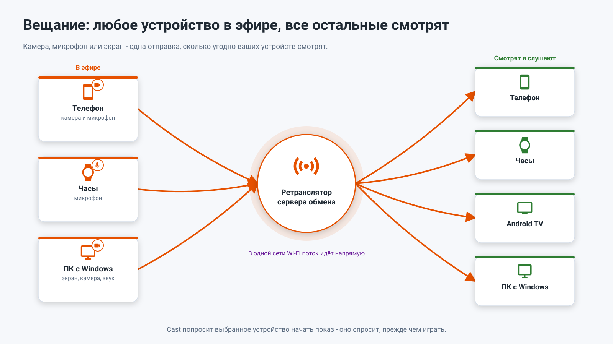
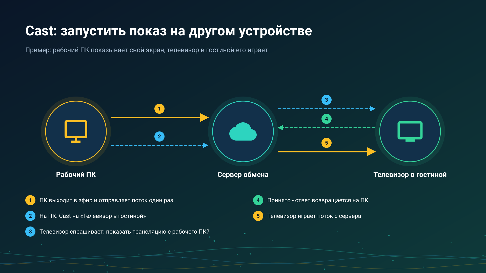

26.10.22 01:29

# Живая трансляция: любое устройство в эфире, остальные слушают

Живая трансляция передаёт то, что устройство видит или слышит прямо сейчас, - камеру, микрофон, экран или готовый файл - на ваши остальные устройства в момент события. Она идёт напрямую в одной сети Wi-Fi и через ваш [сервер обмена](exchange-server-ru.html) из любой другой сети.

## Кто выходит в эфир

- **Телефон Android** - камера и микрофон: видео со звуком, только видео или только звук; объектив можно переключить прямо в эфире. Ещё экран телефона и готовый файл, а камера продолжает работать в фоне в редакциях Standard и noLegal. Есть в редакциях Standard, noLegal и Legacy, см. [Редакции](editions-ru.html). Как это делается: [Выход в эфир](broadcast-start-ru.html).
- **Часы Wear OS** - свой микрофон, до четырёх слушателей одновременно, с плитки или из сетки программ часов.
- **ПК с Windows** - экран, камера и системный звук.

## Кто её воспроизводит

- **Другой телефон или планшет Android** - в разделе «Трансляции» FastMediaSorter: список **Трансляции моих устройств**, QR-код трансляции, присланная ссылка на трансляцию или файл `.fmsbcast`. См. [Приём трансляции](broadcast-receive-ru.html).
- **Часы Wear OS** - список трансляций аккаунта, cast или идущая трансляция, которую экран трансляции на телефоне отправляет на привязанные часы.
- **Android TV или VR-шлем** - в разделе «Трансляции» FastMediaSorter, так же как на телефоне.
- **ПК с Windows** - в [STREAMS Player](https://serzhyale.github.io/StreamsPlayer/).

## Как она идёт

- **В одной сети Wi-Fi** получатель подключается к вещающему устройству напрямую, с наименьшей задержкой.
- **Из любой другой сети** получатель идёт через сервер обмена: раздача потока через сервер - одна отправка от вещающего, любое число слушателей, и хранятся только две последние секунды, поэтому медленный слушатель перескакивает вперёд, а не отстаёт. Картинка и звук шифруются на вещающем устройстве; сервер видит только то, что трансляция существует, см. [сервер обмена](exchange-server-ru.html).

## Cast

**Google Cast работает.** FastMediaSorter отправляет открытое видео, аудиофайл, фото или живой поток на устройство Chromecast в вашей сети.

**Cast на своё устройство** позволяет одному вашему устройству попросить другое начать воспроизведение трансляции - например, рабочий ПК просит телевизор в гостиной. Принимающее устройство всегда спрашивает, прежде чем воспроизводить. Это не Google Cast: кнопки для них никогда не называются одинаково. См. [Приём трансляции](broadcast-receive-ru.html).

## Пошаговые инструкции

- [Выход в эфир](broadcast-start-ru.html)
- [Приём трансляции](broadcast-receive-ru.html)
- [Chromecast и живая трансляция](../../documentation/player/casting-and-broadcast-ru.html)
- [Потоки на телевизоре, часах и VR-шлеме и приём живой трансляции](../../documentation/streams/tv-watch-vr-and-broadcast-ru.html)
- [Прослушивание через часы и трансляция с них](../../documentation/wear/watch-listening-and-broadcast-ru.html)

Назад на [главную страницу портала](index-ru.html).
