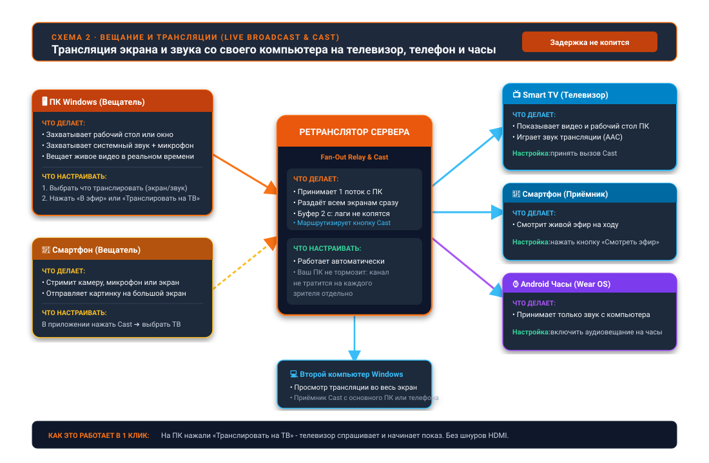

26.10.10 14:45

# Живая трансляция: любое устройство в эфире, остальные слушают

Живая трансляция передаёт то, что устройство видит или слышит прямо сейчас, - камеру, микрофон - на ваши остальные устройства в момент события. **Работает уже сегодня в одной сети Wi-Fi.** Ретранслятор для других сетей, Cast между вашими устройствами и трансляция с ПК ещё не выпущены; каждое помечено ниже.

## Кто выходит в эфир

- **Телефон Android** - камера и микрофон: видео со звуком, только видео или только звук. Объектив можно переключить прямо в эфире. Есть в редакциях Standard, noLegal и Legacy, см. [Редакции](editions-ru.html).
- **Часы Wear OS** - свой микрофон, до четырёх слушателей одновременно, с плитки или из сетки программ часов.
- **ПК с Windows** - экран, камера и системный звук. **Ещё не выпущено:** на рисунке ПК в эфире, но Fast Media Sorter & Sharing for Windows пока не вещает. Это запланировано в Share Manager, после [сервера обмена](exchange-server-ru.html).

## Кто её воспроизводит

- **Другой телефон или планшет Android** - в разделе «Потоки» FastMediaSorter: отсканируйте QR-код трансляции, введите адрес, напечатанный под ним, или откройте присланную ссылку на трансляцию либо файл `.fmsbcast`.
- **Часы Wear OS** - экран трансляции на телефоне отправляет идущую трансляцию прямо на привязанные часы.
- **Android TV или VR-шлем** - в разделе «Потоки» FastMediaSorter, так же как на телефоне.
- **ПК с Windows** - в [STREAMS Player](https://serzhyale.github.io/StreamsPlayer/). **Только в версии для разработки:** просмотрщик Fast Media Sorter & Sharing for Windows уже умеет слушать трансляцию микрофона телефона или часов в той же сети. В выпуске её ещё нет, воспроизводится только звук, и задержку никто не обещает.

## Как она идёт

- **В одной сети Wi-Fi** получатель подключается к вещающему устройству напрямую, с наименьшей задержкой. Так трансляция работает сегодня.
- **За пределами этой сети** получатель будет идти через ретранслятор сервера обмена: одна отправка от вещающего, любое число слушателей, и хранятся только две последние секунды, поэтому медленный слушатель перескакивает вперёд, а не отстаёт. **Ещё не выпущено**, потому что ещё не выпущен [сервер обмена](exchange-server-ru.html).

## Cast

**Chromecast работает уже сегодня.** FastMediaSorter отправляет открытое видео, аудиофайл, фото или живой поток на устройство Chromecast в вашей сети.

**Cast между вашими устройствами ещё не выпущен.** Он позволит одному вашему устройству попросить другое начать воспроизведение трансляции - например, рабочий ПК просит телевизор в гостиной. Принимающее устройство всегда спрашивает, прежде чем воспроизводить.

## Пошаговые инструкции

- [Chromecast и живая трансляция](../../documentation/player/casting-and-broadcast-ru.html)
- [Потоки на телевизоре, часах и VR-шлеме и приём живой трансляции](../../documentation/streams/tv-watch-vr-and-broadcast-ru.html)
- [Прослушивание через часы и трансляция с них](../../documentation/wear/watch-listening-and-broadcast-ru.html)

Назад на [главную страницу портала](index-ru.html).
