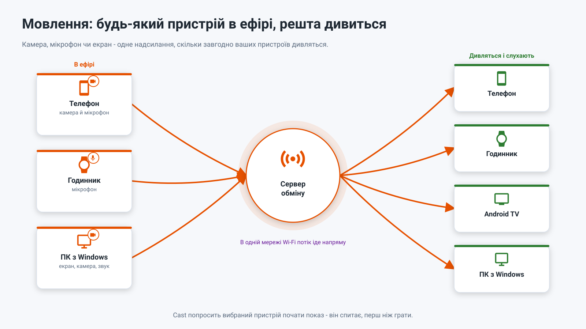
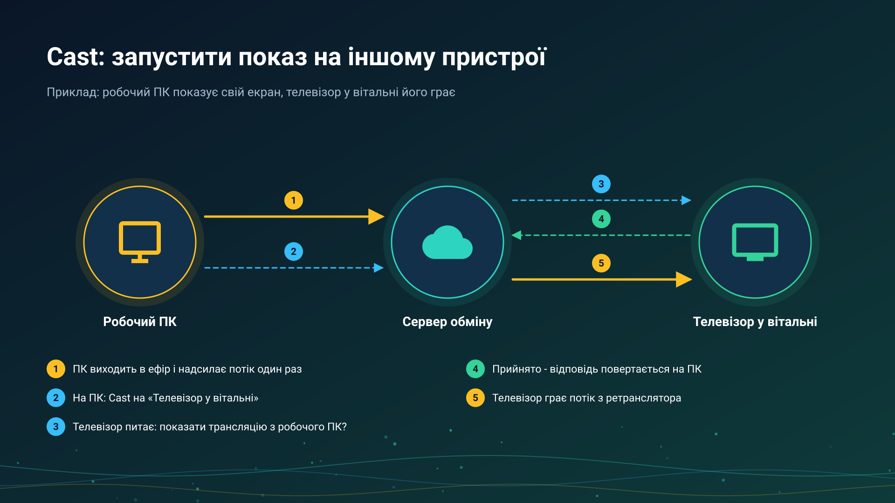

26.10.15 15:10

# Пряма трансляція: будь-який пристрій в ефірі, решта слухає

Пряма трансляція передає те, що пристрій бачить або чує просто зараз, - камеру, мікрофон, екран чи готовий файл - на решту ваших пристроїв у момент події. Вона йде напряму в одній мережі Wi-Fi і через ваш [сервер обміну](exchange-server-uk.html) з будь-якої іншої мережі.

## Хто виходить в ефір

- **Телефон Android** - камера й мікрофон: відео зі звуком, лише відео або лише звук; об'єктив можна перемкнути просто в ефірі. Ще екран телефона й готовий файл, а камера продовжує працювати у фоні в редакціях Standard і noLegal. Є в редакціях Standard, noLegal і Legacy, див. [Редакції](editions-uk.html). Як це робиться: [Вихід в ефір](broadcast-start-uk.html).
- **Годинник Wear OS** - свій мікрофон, до чотирьох слухачів одночасно, з плитки або із сітки програм годинника.
- **ПК з Windows** - екран, камера й системний звук.

## Хто її відтворює

- **Інший телефон або планшет Android** - у розділі «Трансляції» FastMediaSorter: список **Трансляції моїх пристроїв**, QR-код трансляції, надіслане посилання на трансляцію чи файл `.fmsbcast`. Див. [Приймання трансляції](broadcast-receive-uk.html).
- **Годинник Wear OS** - список трансляцій акаунта, cast або поточна трансляція, яку екран трансляції на телефоні надсилає на прив'язаний годинник.
- **Android TV або VR-шолом** - у розділі «Трансляції» FastMediaSorter, так само як на телефоні.
- **ПК з Windows** - у [STREAMS Player](https://serzhyale.github.io/StreamsPlayer/).

## Як вона йде

- **В одній мережі Wi-Fi** отримувач під'єднується до пристрою, що мовить, напряму, з найменшою затримкою.
- **З будь-якої іншої мережі** отримувач іде через ретранслятор сервера обміну: одне надсилання від того, хто мовить, будь-яка кількість слухачів, і зберігаються лише дві останні секунди, тож повільний слухач перескакує вперед, а не відстає. Картинка й звук шифруються на пристрої, що мовить; сервер бачить лише те, що трансляція існує, див. [сервер обміну](exchange-server-uk.html).

## Cast

**Google Cast працює.** FastMediaSorter надсилає відкрите відео, аудіофайл, фото або прямий потік на пристрій Chromecast у вашій мережі.

**Cast на свій пристрій** дозволяє одному вашому пристрою попросити інший почати відтворення трансляції - наприклад, робочий ПК просить телевізор у вітальні. Пристрій-отримувач завжди питає, перш ніж відтворювати. Це не Google Cast: кнопки для них ніколи не називаються однаково. Див. [Приймання трансляції](broadcast-receive-uk.html).

## Покрокові інструкції

- [Вихід в ефір](broadcast-start-uk.html)
- [Приймання трансляції](broadcast-receive-uk.html)
- [Chromecast і пряма трансляція](../../documentation/player/casting-and-broadcast-uk.html)
- [Потоки на телевізорі, годиннику й VR-шоломі та приймання прямої трансляції](../../documentation/streams/tv-watch-vr-and-broadcast-uk.html)
- [Прослуховування через годинник і трансляція з нього](../../documentation/wear/watch-listening-and-broadcast-uk.html)

Назад на [головну сторінку порталу](index-uk.html).
