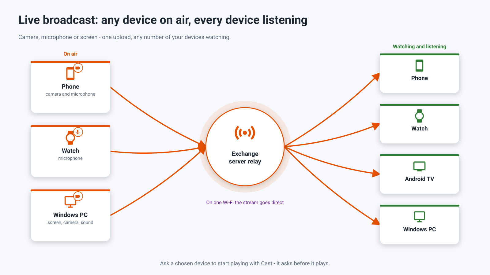
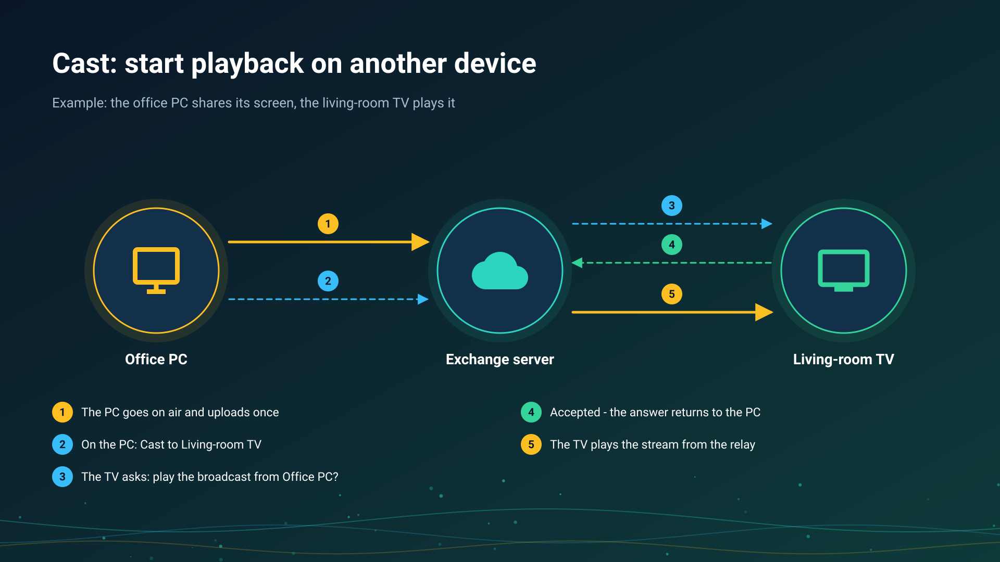

26.10.15 15:10

# Live broadcast: any device on air, your other devices listening

A live broadcast sends what a device sees or hears right now - its camera, its microphone, its screen or a ready file - to your other devices while it happens. It goes directly on one Wi-Fi network and through your [exchange server](exchange-server.html) from any other network.

## Who goes on air

- **An Android phone** - camera and microphone: video with sound, video only or audio only; the lens can be switched while on air. Also the screen of the phone and a ready file, and the camera keeps going in the background in Standard and noLegal. Available in the Standard, noLegal and Legacy editions, see [Editions](editions.html). How: [Going on air](broadcast-start.html).
- **A Wear OS watch** - its microphone, to up to four listeners at once, from a tile or the programs grid of the watch.
- **A Windows PC** - screen, camera and system sound.

## Who plays it

- **Another Android phone or tablet** - in the Streams section of FastMediaSorter: the list **Broadcasts of my devices**, the broadcast's QR code, a shared broadcast link or a `.fmsbcast` file. See [Receiving a broadcast](broadcast-receive.html).
- **A Wear OS watch** - the list of the account's broadcasts, a cast, or the running broadcast that the phone's broadcast screen sends to the paired watch.
- **An Android TV or a VR headset** - in the Streams section of FastMediaSorter, the same way as on a phone.
- **A Windows PC** - in [STREAMS Player](https://serzhyale.github.io/StreamsPlayer/).

## How it travels

- **On one Wi-Fi network** a receiver connects to the broadcasting device directly, with the lowest delay.
- **From any other network** a receiver goes through the exchange server's relay: one upload from the broadcaster, any number of listeners, and only the last two seconds kept, so a slow listener skips ahead instead of falling behind. The picture and the sound are encrypted on the broadcasting device; the server sees only that a broadcast exists, see [the exchange server](exchange-server.html).

## Cast

**Google Cast works.** FastMediaSorter casts an open video, audio file, photo or a live stream to a Chromecast device on your network.

**A cast to your own device** lets one of your devices ask another to start playing a broadcast - for example, an office PC asks the living-room TV. The receiving device always asks before it plays. It is not Google Cast: the two never share a button label. See [Receiving a broadcast](broadcast-receive.html).

## Step-by-step guides

- [Going on air](broadcast-start.html)
- [Receiving a broadcast](broadcast-receive.html)
- [Chromecast casting and live broadcast](../../documentation/player/casting-and-broadcast.html)
- [Streams on a TV, a watch or a VR headset, and tuning in to a live broadcast](../../documentation/streams/tv-watch-vr-and-broadcast.html)
- [Listening through the watch and broadcasting from it](../../documentation/wear/watch-listening-and-broadcast.html)

Back to the [portal start page](index.html).
