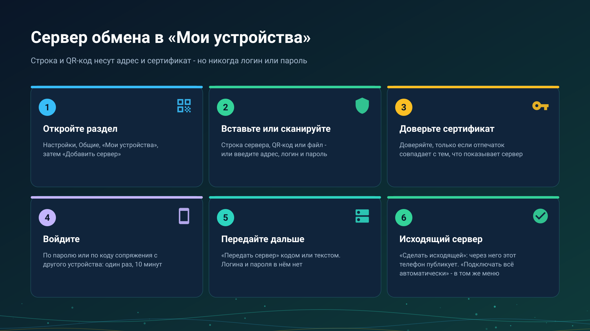

26.10.15 15:10

# Мои устройства: добавление сервера обмена

**Мои устройства** - экран, где телефон, планшет, ТВ или VR-шлем хранит свои серверы обмена: одна карточка на сервер и аккаунт, а под ней - устройства этого аккаунта. С него начинается любой другой способ обмена на этих страницах.

## Откройте его

**Настройки**, вкладка **Общие**, **Мои устройства**. Пока сервер не добавлен, там написано «Сервера обмена пока нет. Добавьте его, чтобы видеть ресурсы и трансляции всех своих устройств». Экран есть в редакциях с сетевыми папками, см. [Редакции](editions-ru.html).

## Добавьте сервер

Нажмите **Добавить сервер**. Экран **Вход на сервер обмена** принимает сервер двумя способами:

- **Строка подключения.** Вставьте её кнопкой **Вставить**, отсканируйте её QR-код кнопкой **Сканировать QR** или выберите её файл `.fmsexch` кнопкой **Выбрать файл**. Строка начинается с `FMSEXCH1:` и называет адрес сервера и отпечаток его сертификата; логина и пароля она не несёт никогда. Её вам даёт тот, кто держит сервер.
- **Вручную.** Введите **Адрес (хост:порт)**, **Логин** и **Пароль**.

## Доверьтесь сертификату

Сервер предъявляет сертификат. Если строка несла его отпечаток, приложение проверяет его за вас и говорит **Сертификат закреплён**. Если нет, **Проверьте сертификат сервера** показывает отпечаток, и вы нажимаете **Доверять** только если он совпадает с тем, что вам показывает тот, кто держит сервер. Если отпечаток позже изменится, приложение скажет, что сервер не похож на тот, к которому вы подключались раньше, и не пойдёт дальше: спросите того, кто держит сервер, прежде чем принимать новый.

## Войдите

- **Пароль.** Логин и пароль вашего аккаунта.
- **Код сопряжения.** Нажмите **У меня код сопряжения вместо пароля** и введите **Код сопряжения**. В нём 8 символов, он срабатывает один раз и действует 10 минут. Его выдаёт устройство, которое уже вошло: откройте карточку его сервера, выберите **Выдать код сопряжения**, и появятся код и время его действия. Он подходит устройству, где трудно набрать надёжный пароль, например ТВ-приставке.
- **Приглашение** для нового аккаунта: его приносит строка, и экран об этом говорит. Приглашения, гости, правила паролей и повторный вход описаны в [аккаунтах, приглашениях и паролях](exchange-accounts-ru.html); выход и удаление аккаунта - в [удалении аккаунта](account-deletion-ru.html); что такое сервер и кто его держит - в [сервере обмена](exchange-server-ru.html).

## Передайте сервер другим своим устройствам

В меню карточки сервера выберите **Передать сервер**. Экран показывает QR-код и кнопку **Отправить** для того же текста. Он несёт адрес и сертификат, но не ваш логин и не ваш пароль, поэтому тот, кто его отсканирует, всё равно входит со своими.

## Выберите исходящий сервер

Устройство публикует свои папки и трансляции через один сервер за раз - **Исходящий**.

- **Сделать исходящей** в меню карточки выбирает его; **Через сервер** в разделе **Доступ отовсюду** карточки **Доступ по SFTP** называет его, а **Изменить** выбирает другой.
- **Подключать всё автоматически** в том же меню заставляет это устройство само подключать каждую папку аккаунта, которой не нужен PIN, поэтому новая папка аккаунта появляется без захода в **С моих устройств**. Папка с PIN-кодом по-прежнему подключается вручную, с её PIN.

## Что ещё делает меню карточки

**Изменить адрес**, **Войти снова**, **Сменить пароль**, **Выйти из аккаунта на этом устройстве**, **Удалить мой аккаунт** и **Подключить часы** - в том же меню. Часы описаны в [Часы в вашем аккаунте](watch-exchange-ru.html). Под карточкой перечислены устройства аккаунта с пометкой **В сети** или **Не в сети**, **Этот телефон** отмечает текущее, а **Отозвать** убирает другое из аккаунта.

## Пошаговые инструкции

- [Папки через сервер обмена](folders-exchange-server-ru.html)
- [Буфер на сервере](exchange-clipboard-ru.html)
- [Установка и проверка сервера обмена](exchange-server-install-ru.html)

Назад на [главную страницу портала](index-ru.html).
