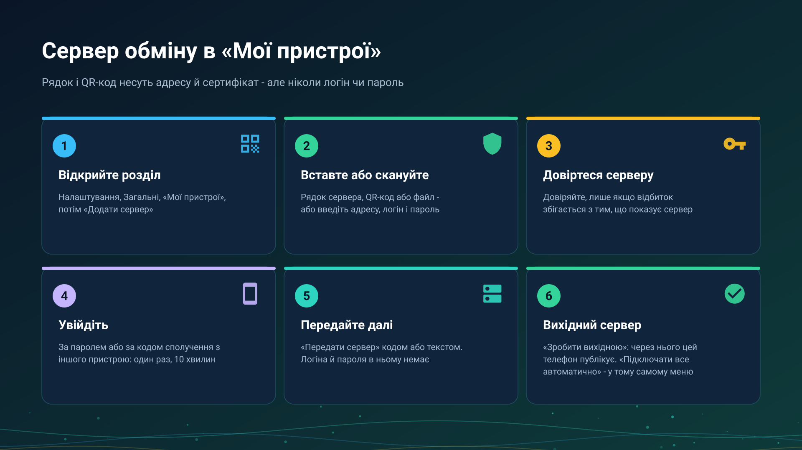

26.10.15 15:10

# Мої пристрої: додавання сервера обміну

**Мої пристрої** - екран, де телефон, планшет, ТБ чи VR-шолом зберігає свої сервери обміну: одна картка на сервер і акаунт, а під нею - пристрої цього акаунта. З нього починається будь-який інший спосіб обміну на цих сторінках.

## Відкрийте його

**Налаштування**, вкладка **Загальні**, **Мої пристрої**. Поки сервер не додано, там написано «Сервера обміну ще немає. Додайте його, щоб бачити ресурси й трансляції всіх своїх пристроїв». Екран є в редакціях із мережевими теками, див. [Редакції](editions-uk.html).

## Додайте сервер

Натисніть **Додати сервер**. Екран **Вхід на сервер обміну** приймає сервер двома способами:

- **Рядок підключення.** Вставте його кнопкою **Вставити**, відскануйте його QR-код кнопкою **Сканувати QR** або виберіть його файл `.fmsexch` кнопкою **Вибрати файл**. Рядок починається з `FMSEXCH1:` і називає адресу сервера та відбиток його сертифіката; логіна й пароля він не несе ніколи. Його вам дає той, хто тримає сервер.
- **Вручну.** Введіть **Адресу (хост:порт)**, **Логін** і **Пароль**.

## Довіртеся сертифікату

Сервер пред'являє сертифікат. Якщо рядок ніс його відбиток, застосунок перевіряє його за вас і каже **Сертифікат закріплено**. Якщо ні, **Перевірте сертифікат сервера** показує відбиток, і ви натискаєте **Довіряти** лише якщо він збігається з тим, що вам показує той, хто тримає сервер. Якщо відбиток згодом зміниться, застосунок скаже, що сервер не схожий на той, до якого ви підключалися раніше, і не піде далі: запитайте того, хто тримає сервер, перш ніж приймати новий.

## Увійдіть

- **Пароль.** Логін і пароль вашого акаунта.
- **Код сполучення.** Натисніть **У мене код сполучення замість пароля** і введіть **Код сполучення**. У ньому 8 символів, він спрацьовує один раз і діє 10 хвилин. Його видає пристрій, який уже ввійшов: відкрийте картку його сервера, виберіть **Видати код сполучення**, і з'являться код та час його дії. Він годиться для пристрою, де важко набрати надійний пароль, наприклад ТБ-приставки.
- **Запрошення** для нового акаунта: його приносить рядок, і екран про це каже. Запрошення, гості, правила паролів і повторний вхід описано в [акаунтах, запрошеннях і паролях](exchange-accounts-uk.html); вихід і видалення акаунта - у [видаленні акаунта](account-deletion-uk.html); що таке сервер і хто його тримає - у [сервері обміну](exchange-server-uk.html).

## Передайте сервер іншим своїм пристроям

У меню картки сервера виберіть **Передати сервер**. Екран показує QR-код і кнопку **Надіслати** для того самого тексту. Він несе адресу та сертифікат, але не ваш логін і не ваш пароль, тож той, хто його відсканує, все одно входить зі своїми.

## Виберіть вихідний сервер

Пристрій публікує свої теки й трансляції через один сервер за раз - **Вихідний**.

- **Зробити вихідною** в меню картки вибирає його; **Через сервер** у розділі **Доступ звідусіль** картки **Доступ через SFTP** називає його, а **Змінити** вибирає інший.
- **Підключати все автоматично** в тому самому меню змушує цей пристрій сам підключати кожну теку акаунта, якій не потрібен PIN, тому нова тека акаунта з'являється без заходу в **З моїх пристроїв**. Тека з PIN-кодом, як і раніше, підключається вручну, з її PIN.

## Що ще робить меню картки

**Змінити адресу**, **Увійти знову**, **Змінити пароль**, **Вийти з акаунта на цьому пристрої**, **Видалити мій акаунт** і **Підключити годинник** - у тому самому меню. Годинник описано в [Годинник в акаунті](watch-exchange-uk.html). Під карткою перелічено пристрої акаунта з позначкою **У мережі** або **Не в мережі**, **Цей телефон** позначає поточний, а **Відкликати** прибирає інший з акаунта.

## Покрокові інструкції

- [Теки через сервер обміну](folders-exchange-server-uk.html)
- [Буфер на сервері](exchange-clipboard-uk.html)
- [Встановлення й перевірка сервера обміну](exchange-server-install-uk.html)

Назад на [головну сторінку порталу](index-uk.html).
