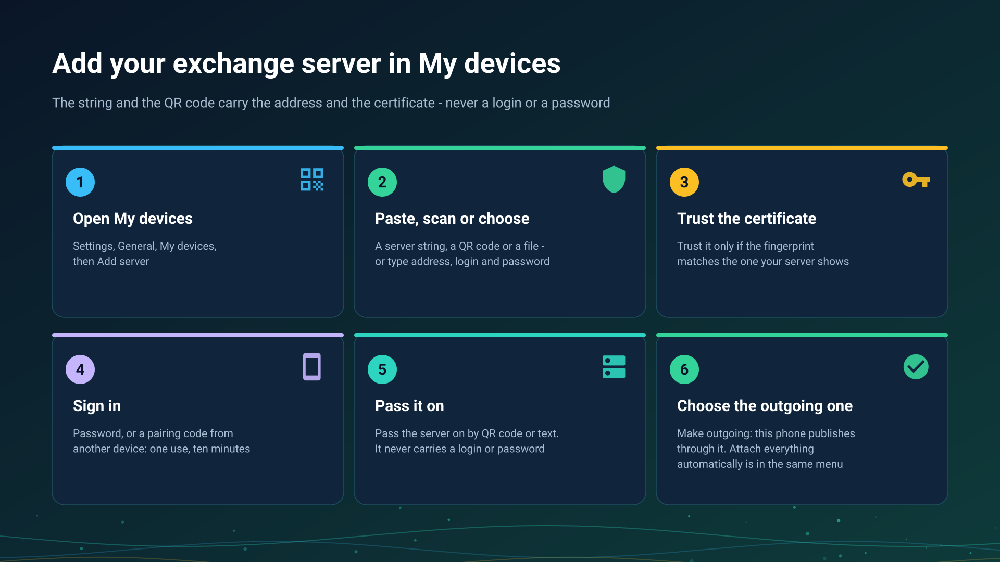

26.10.15 15:10

# My devices: adding your exchange server

**My devices** is the screen where a phone, a tablet, a TV or a VR headset keeps its exchange servers: one card per server and account, with the devices of that account under it. Every other way of exchange on these pages starts here.

## Open it

**Settings**, the **General** tab, **My devices**. Until a server is added it reads "No exchange server yet. Add one to see the resources and broadcasts of all your devices." The screen exists in the editions that carry network folders, see [Editions](editions.html).

## Add a server

Tap **Add server**. The screen **Sign in to an exchange server** takes the server in one of two ways:

- **A connection string.** Paste it with **Paste**, scan its QR code with **Scan QR**, or choose its `.fmsexch` file with **Choose file**. The string starts with `FMSEXCH1:` and names the server's address and the fingerprint of its certificate; it never carries a login or a password. The person who runs the server gives it to you.
- **By hand.** Type the **Address (host:port)**, the **Login** and the **Password**.

## Trust the certificate

A server presents a certificate. When the string carried its fingerprint the app checks it for you and says **Certificate pinned**. When it did not, **Check the server certificate** shows the fingerprint and you tap **Trust** only if it matches the one the person who runs the server shows you. If the fingerprint changes later, the app says the server does not look like the one you connected to before and does not go on: ask whoever runs the server before you accept a new one.

## Sign in

- **A password.** The login and the password of your account.
- **A pairing code.** Tap **I have a pairing code instead of the password** and enter the **Pairing code**. It is 8 characters, works once and is valid for 10 minutes. It is made on a device that is already signed in: open its server card, choose **Issue a pairing code**, and the code and its end time appear. It suits a device where typing a strong password is hard, such as a TV box.
- **An invitation**, for a new account: the string brings it and the screen says so. Invitations, guests, password rules and signing in again are on [accounts, invitations and passwords](exchange-accounts.html); leaving and deleting an account are on [deleting an account](account-deletion.html); what the server is and who runs it is on [the exchange server](exchange-server.html).

## Pass the server on to your other devices

In the menu of the server's card choose **Pass the server on**. The screen shows a QR code and **Send** for the same text. It carries the address and the certificate, never your login or your password, so whoever scans it still signs in with their own.

## Choose the outgoing server

A device publishes its folders and its broadcasts through one server at a time, the **Outgoing** one.

- **Make outgoing** in the card menu chooses it; **Through the server** in the **Access from anywhere** group names it and **Change** picks another.
- **Attach everything automatically** in the same menu makes this device attach by itself every folder the account lists that needs no PIN, so a new folder of the account shows up without a visit to **From my devices**. A folder protected with a PIN is still attached by hand, with its PIN.

## What else the card menu does

**Change address**, **Sign in again**, **Change password**, **Sign out on this device**, **Delete my account** and **Connect watch** are in the same menu. The watch is on [The watch on your account](watch-exchange.html). Under the card the devices of the account are listed with **Online** or **Offline**, **This phone** marks this one, and **Revoke** removes another one from the account.

## Step-by-step guides

- [Folders through the exchange server](folders-exchange-server.html)
- [The clipboard on the server](exchange-clipboard.html)
- [Installing and checking your exchange server](exchange-server-install.html)

Back to the [portal start page](index.html).
