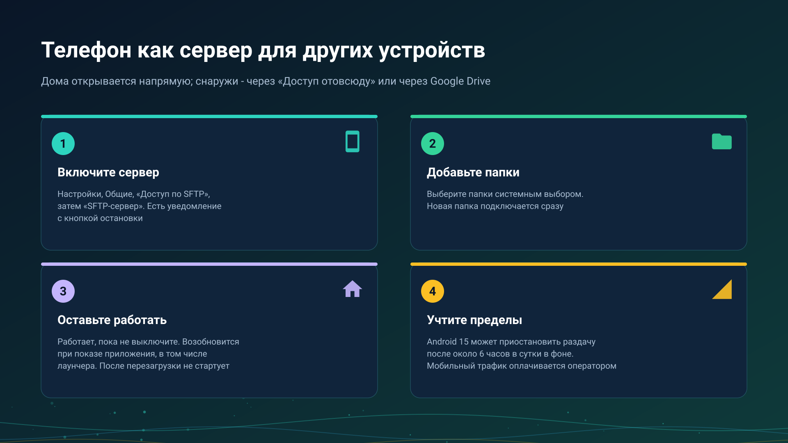

26.10.23 14:53

# Телефон как сервер

Телефон может быть устройством, которое хранит папки: FastMediaSorter превращает его в небольшой сервер, который раздаёт выбранные вами папки обычным для сетевых папок способом, называемым SFTP (переключатель в приложении так и называется - **SFTP-сервер**), а ваши другие устройства открывают их. Эта страница - о самом сервере: как он запускается, сколько работает и чего стоит. Доступ снаружи описан в [Папки через сервер обмена](folders-exchange-server-ru.html) и [Домашняя сеть](home-network-ru.html).

## Включите его

1. Откройте **Настройки**, вкладку **Общие**, карточку **Доступ к этому телефону**.
2. В разделе **Общие папки** нажмите **Добавить папку** и выберите папки системным выбором папок. Папка, добавленная при работающем сервере, подключается к нему сразу.
3. Выберите способ входа: **Пароль** или **SSH-ключ**.
4. Включите **SFTP-сервер**. Состояние меняется с **Выключен** на **Запуск..**, а затем **Работает:** с адресом и портом.

Пока он работает, висит уведомление «SFTP-сервер включён» с адресом и кнопкой **Остановить**. Серверу нужна редакция с сетевыми папками, см. [Редакции](editions-ru.html), и Android 8.0 или новее.

## Сколько он работает

- **Пока вы не выключите.** Закончить его может только ваше собственное выключение или **Остановить** в уведомлении; после этого он остаётся выключенным, пока вы снова его не включите.
- **Он возобновляется при каждом показе приложения.** Если Android или перезапуск приложения остановили сервер, он запустится снова, когда приложение в следующий раз выйдет на передний план.
- **Он следует за сменой Wi-Fi.** Когда телефон подключается к другой сети, показанный и объявленный вашим устройствам адрес меняется без перезапуска.
- **После перезагрузки сам не запускается.** Сервер возвращается, когда приложение откроют в следующий раз; ничто не будит его само.

## Режим лаунчера

Когда FastMediaSorter - главный экран телефона, приложение показывается при каждом возврате на главный экран, поэтому раздача возобновляется само в течение всего дня. Лаунчер есть в редакциях Standard и noLegal, см. [Редакции](editions-ru.html); **Выйти из режима лаунчера** возвращает телефону обычный главный экран.

## Предел Android 15

Android 15 и новее разрешает фоновой службе синхронизации данных одного приложения работать не более 6 часов из 24, а счётчик начинается заново, когда приложение показывают в следующий раз. Когда предел остановил сервер:

- уведомление «Раздача приостановлена» говорит об этом, а открытие приложения продолжает раздачу;
- ваши другие устройства показывают телефон с сообщением «Android приостановил раздачу на этом телефоне. Она продолжится, когда на телефоне откроют приложение.», а не просто «не в сети».

## Телефон без локального адреса

Телефон вне Wi-Fi всё равно может включить сервер. Он пишет «Работает, но телефон не в сети Wi-Fi - другие устройства подключаются к нему через сервер обмена или через Google Drive», не объявляет прямого адреса и остаётся доступным через [сервер обмена](exchange-server-ru.html) с включённым **Доступом отовсюду** или через Google Drive, см. [Файлы через Google Drive](folders-google-drive-ru.html).

## Мобильный трафик

Когда телефон в мобильной сети, то, что другие устройства открывают через него, идёт по вашему мобильному соединению и оплачивается оператором как ваш мобильный трафик. Просмотр списка - это мало, открытие или копирование видео - много. Держите сервер выключенным или телефон в Wi-Fi, если тариф ограничен.

## Пошаговые инструкции

- [Телефон как SFTP-сервер](../../documentation/network/phone-as-sftp-server-ru.html)
- [Домашняя сеть: ваше хранилище, доступное снаружи](home-network-ru.html)
- [Мои устройства: добавление сервера обмена](my-devices-ru.html)

Назад на [главную страницу портала](index-ru.html).
