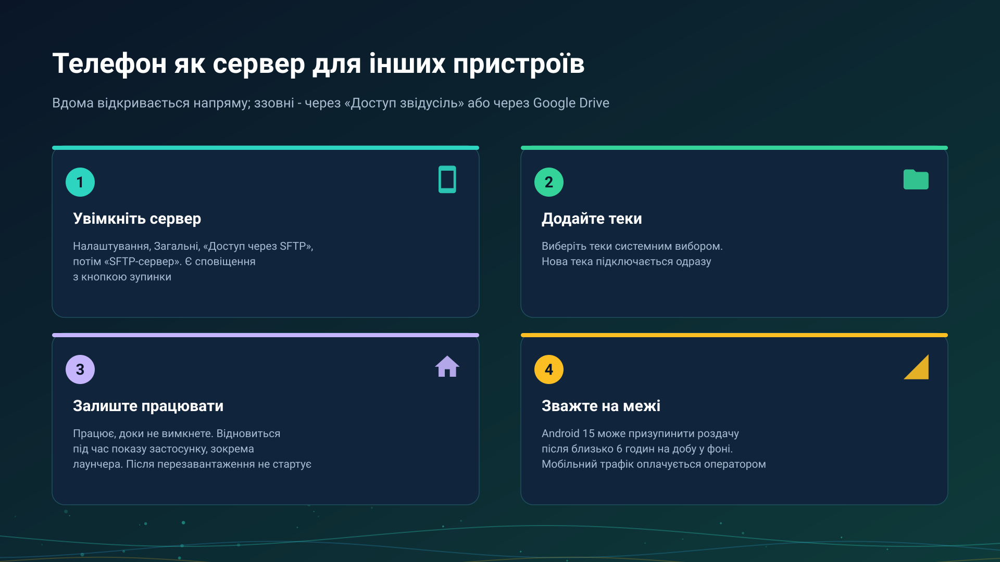

26.10.23 14:53

# Телефон як сервер

Телефон може бути пристроєм, який зберігає теки: FastMediaSorter перетворює його на невеликий сервер, що роздає вибрані вами теки звичайним для мережевих тек способом, який називається SFTP (перемикач у застосунку так і називається - **SFTP-сервер**), а ваші інші пристрої відкривають їх. Ця сторінка - про сам сервер: як він запускається, скільки працює і чого коштує. Доступ ззовні описано в [Теки через сервер обміну](folders-exchange-server-uk.html) і [Домашня мережа](home-network-uk.html).

## Увімкніть його

1. Відкрийте **Налаштування**, вкладку **Загальні**, картку **Доступ з телефону**.
2. У розділі **Спільні папки** натисніть **Додати папку** й виберіть теки системним вибором тек. Тека, додана за працюючого сервера, підключається до нього одразу.
3. Виберіть спосіб входу: **Пароль** або **SSH-ключ**.
4. Увімкніть **SFTP-сервер**. Стан змінюється з **Вимкнено** на **Запуск..**, а потім **Працює:** з адресою й портом.

Поки він працює, висить сповіщення «SFTP-сервер увімкнено» з адресою та кнопкою **Зупинити**. Серверу потрібна редакція з мережевими теками, див. [Редакції](editions-uk.html), і Android 8.0 або новіший.

## Скільки він працює

- **Доки ви не вимкнете.** Закінчити його може лише ваше власне вимкнення або **Зупинити** у сповіщенні; після цього він лишається вимкненим, доки ви знову його не ввімкнете.
- **Він відновлюється під час кожного показу застосунку.** Якщо Android або перезапуск застосунку зупинили сервер, він запуститься знову, коли застосунок наступного разу вийде на передній план.
- **Він іде за зміною Wi-Fi.** Коли телефон під'єднується до іншої мережі, показана й оголошена вашим пристроям адреса змінюється без перезапуску.
- **Після перезавантаження сам не запускається.** Сервер повертається, коли застосунок відкриють наступного разу; ніщо не будить його само.

## Режим лаунчера

Коли FastMediaSorter - головний екран телефона, застосунок показується під час кожного повернення на головний екран, тому роздача відновлюється сама протягом усього дня. Лаунчер є в редакціях Standard і noLegal, див. [Редакції](editions-uk.html); **Вийти з режиму лаунчера** повертає телефону звичайний головний екран.

## Межа Android 15

Android 15 і новіший дозволяє фоновій службі синхронізації даних одного застосунку працювати щонайбільше 6 годин із 24, а лічильник починається заново, коли застосунок показують наступного разу. Коли межа зупинила сервер:

- сповіщення «Роздачу призупинено» каже про це, а відкриття застосунку продовжує роздачу;
- ваші інші пристрої показують телефон із повідомленням «Android призупинив роздачу на цьому телефоні. Вона продовжиться, коли на телефоні відкриють застосунок.», а не просто «не в мережі».

## Телефон без локальної адреси

Телефон поза Wi-Fi усе одно може ввімкнути сервер. Він пише «Працює, але телефон не в мережі Wi-Fi - інші пристрої підключаються до нього через сервер обміну або через Google Drive», не оголошує прямої адреси й лишається доступним через [сервер обміну](exchange-server-uk.html) з увімкненим **Доступом звідусіль** або через Google Drive, див. [Файли через Google Drive](folders-google-drive-uk.html).

## Мобільний трафік

Коли телефон у мобільній мережі, те, що інші пристрої відкривають через нього, йде вашим мобільним з'єднанням і оплачується оператором як ваш мобільний трафік. Перегляд списку - це мало, відкриття чи копіювання відео - багато. Тримайте сервер вимкненим або телефон у Wi-Fi, якщо тариф обмежений.

## Покрокові інструкції

- [Телефон як SFTP-сервер](../../documentation/network/phone-as-sftp-server-uk.html)
- [Домашня мережа: ваше сховище, доступне ззовні](home-network-uk.html)
- [Мої пристрої: додавання сервера обміну](my-devices-uk.html)

Назад на [головну сторінку порталу](index-uk.html).
