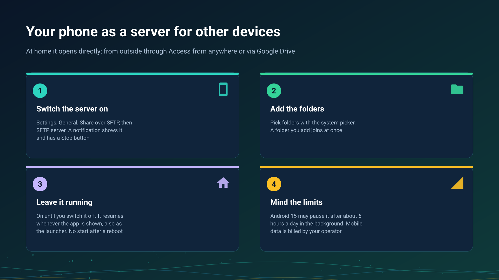

26.10.15 15:10

# The phone as a server

A phone can be the device that keeps the folders: FastMediaSorter turns it into an SFTP server, and your other devices open the folders you picked. This page is about the server itself - how it starts, how long it lasts and what it costs. Reaching it from outside is on [Folders through the exchange server](folders-exchange-server.html) and [Home network](home-network.html).

## Switch it on

1. Open **Settings**, the **General** tab, the **Share from phone** card.
2. Under **Shared folders** tap **Add folder** and pick folders with the system folder picker. A folder you add while the server runs joins it at once.
3. Choose how people sign in, **Password** or **SSH key**.
4. Switch on **SFTP server**. The status moves from **Off** to **Starting..** and then **Running at** the address and port.

A notification "SFTP server is on" stays up while it runs, with the address and a **Stop** button. The server needs an edition with network folders, see [Editions](editions.html), and Android 8.0 or newer.

## How long it lasts

- **Until you switch it off.** Only your own **Off**, or **Stop** in the notification, ends it; it then stays off until you switch it on again.
- **It resumes whenever the app is shown.** If Android or a restart of the app stopped the server, it starts again the next time the app comes to the foreground.
- **It follows a Wi-Fi change.** When the phone joins another network, the address shown and announced to your devices follows it without a restart.
- **There is no start after a reboot.** The server comes back when the app is next opened; nothing wakes it by itself.

## Launcher mode

When FastMediaSorter is the phone's home screen, the app is shown on every return to the home screen, so sharing resumes by itself all day. The launcher exists in the Standard and noLegal editions, see [Editions](editions.html); **Exit launcher mode** returns the phone to its usual home screen.

## The Android 15 limit

Android 15 and newer lets one app's background data-sync service run at most about 6 hours in 24, and the counter starts again when the app is next shown. When the limit ends the server:

- a notification "Sharing paused" says so, and opening the app continues it;
- your other devices list the phone with the message that Android paused sharing on this phone and that sharing continues when the app is opened there, not with plain offline.

## A phone with no local address

A phone that is not on Wi-Fi can still switch the server on. It says "Running, but the phone is not on Wi-Fi - other devices reach it through the exchange server or via Google Drive", announces no direct address, and stays reachable through an [exchange server](exchange-server.html) with **Access from anywhere** switched on, or via Google Drive, see [Files via Google Drive](folders-google-drive.html).

## Mobile data

When the phone is on mobile data, what other devices open through it travels over your mobile connection and is billed by your operator as your mobile traffic. Browsing a list is small; opening or copying videos is not. Keep the server off, or the phone on Wi-Fi, when your plan is limited.

## Step-by-step guides

- [Turning the phone into an SFTP server](../../documentation/network/phone-as-sftp-server.html)
- [Home network: your storage, reachable from outside](home-network.html)
- [My devices: adding your exchange server](my-devices.html)

Back to the [portal start page](index.html).
