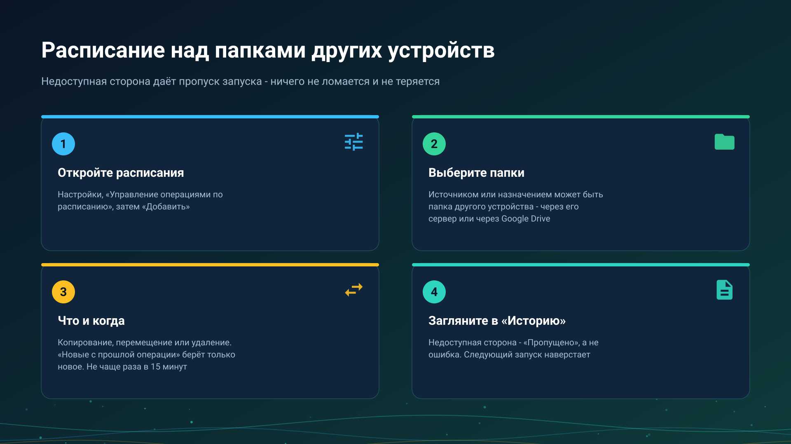

26.10.22 01:23

# Расписание над папками других устройств

Операции по расписанию копируют, перемещают или удаляют файлы в фоне по графику, который вы задали. Источником или назначением может быть папка другого вашего устройства, доступная через сервер обмена или через Google Drive, поэтому телефон может за ночь забрать все новые снимки другого, и никто не прикасается ни к одному из них.

## Настройте одну

1. Откройте **Настройки** и нажмите **Управление операциями по расписанию**. Переключатель **Использовать операции по расписанию** включает и выключает все запуски по расписанию; в выключенном состоянии операции остаются сохранёнными.
2. Нажмите **Добавить**.
3. Выберите **Источник** и **Назначение**. Папку другого устройства сначала подключают из **Добавить ресурс**, **С моих устройств**, см. [Папки через сервер обмена](folders-exchange-server-ru.html).
4. Выберите **Операцию**: **Копирование**, **Перемещение** или **Удаление**.
5. Выберите, какие файлы: **Все**, **Новые за час**, **Новые за сутки** или **Новые с прошлой операции**, и сузьте их типами файлов и условиями.
6. Задайте **Начиная с** и интервал и сохраните кнопкой **Сохранить в список операций**.

## Новые с прошлой операции

**Новые с прошлой операции** берёт файлы, появившиеся после последнего запуска, который завершился хорошо. Отметка сдвигается только после успешного запуска: запуск, который не удался или был пропущен, оставляет её на месте, поэтому файлы этого окна подберёт следующий удачный запуск.

## Сторона, до которой не дотянуться

Когда другое устройство выключено или сети между ними нет, запуск **пропущен**, а не провален:

- ничего не просматривается и ничего не передаётся, поэтому нет полуготовых результатов;
- на карточке расписания появляется предупреждающая отметка, а **История** показывает запуск как **Пропущено** с причиной;
- уведомление не приходит, а следующий срок пробует снова;
- ошибка, которая присылает уведомление, оставлена для того, что действительно пошло не так, например для папки с PIN-кодом, отклонившей сохранённый PIN.

Папка с PIN-кодом открывается тем PIN, который приложение сохранило при подключении, и во время запуска никого не спрашивает.

## Копирование и перемещение над удалённой папкой

- **Копия пишется под временным именем** и переименовывается, когда она целая, поэтому оборвавшийся посередине запуск не оставляет половинчатого файла под настоящим именем, а следующий запуск дозавершает. Имя, которое уже существует, подчиняется настройке операции **Перезаписывать существующие файлы**.
- **Перемещение удаляет оригинал только после того, как копия целая.**
- **Удаление** подчиняется тому же правилу, что и перемещение, когда другое устройство недоступно: запуск пропускается.

## Через Google Drive

Когда все живые пути к другому устройству недоступны и включено **Файлы через Google Drive**, **копирование** забирает изменённые с начала окна файлы через Google Drive и кладёт их в назначение с теми же фильтрами. Перемещение и удаление в этом случае пропускаются: они убрали бы то, что никто не мог проверить. Другое устройство отвечает, когда в следующий раз заглянет в свою очередь Drive: при открытом приложении или раз в 15 минут при включённом **Проверять через Google Drive в фоне**; если нет ни того, ни другого, запуск пропускается. См. [Файлы через Google Drive](folders-google-drive-ru.html).

Через Google Drive файлы и буфер хранятся в вашем собственном аккаунте Google, как и другие ваши файлы на Google Drive; сервер обмена в этом не участвует.

## Пределы

- **Интервал не меньше 15 минут**; меньший исправляется до 15.
- **Точность зависит от энергосбережения.** Android может задержать фоновый запуск. Разрешите приложению работать без оптимизации батареи, когда об этом спросит диалог **Разрешить работу в фоне**, а для проверки расписания используйте **Запустить сейчас**.
- **Запуск ждёт живой сети**, прежде чем начаться.

## Пошаговые инструкции

- [Операции по расписанию](../../documentation/storage/scheduled-operations-ru.html)
- [Фоновые передачи](../../documentation/storage/background-transfers-ru.html)

Назад на [главную страницу портала](index-ru.html).

## Окна настроек программы для Windows {#windows-settings-windows}

В Windows откройте **настройки менеджера**, операции с файлами по расписанию, либо команду расписаний в трее или меню папки. Расписания принадлежат менеджеру в сеансе пользователя и не требуют включённой раздачи папок и установленного на этом ПК сервера обмена. Закрытие окна настроек не останавливает задания.
