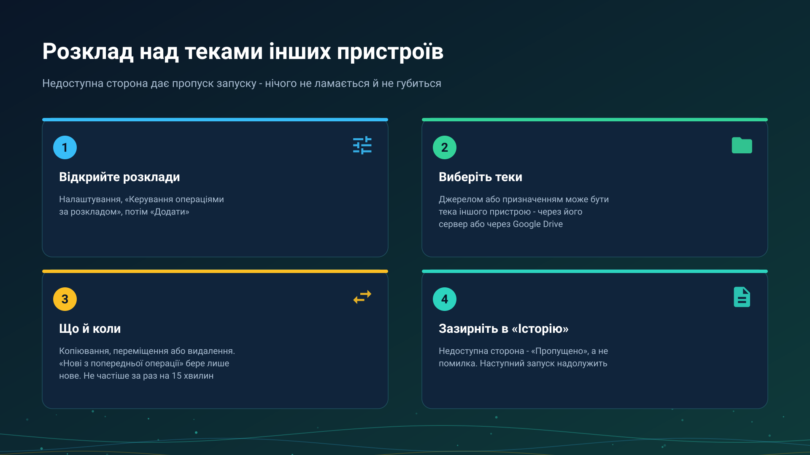

26.10.22 01:23

# Розклад над теками інших пристроїв

Операції за розкладом копіюють, переміщують або видаляють файли у фоні за графіком, який ви задали. Джерелом чи призначенням може бути тека іншого вашого пристрою, доступна через сервер обміну або через Google Drive, тому телефон може за ніч забрати всі нові знімки іншого, і ніхто не торкається жодного з них.

## Налаштуйте одну

1. Відкрийте **Налаштування** і натисніть **Керування операціями за розкладом**. Перемикач **Використовувати операції за розкладом** вмикає й вимикає всі запуски за розкладом; у вимкненому стані операції лишаються збереженими.
2. Натисніть **Додати**.
3. Виберіть **Джерело** і **Призначення**. Теку іншого пристрою спершу підключають із **Додати ресурс**, **З моїх пристроїв**, див. [Теки через сервер обміну](folders-exchange-server-uk.html).
4. Виберіть **Операцію**: **Копіювання**, **Переміщення** або **Видалення**.
5. Виберіть, які файли: **Усі**, **Нові за годину**, **Нові за добу** або **Нові з попередньої операції**, і звузьте їх типами файлів та умовами.
6. Задайте **Починаючи з** та інтервал і збережіть кнопкою **Зберегти в список операцій**.

## Нові з попередньої операції

**Нові з попередньої операції** бере файли, які з'явилися після останнього запуску, що завершився добре. Позначка зсувається лише після успішного запуску: запуск, який не вдався або був пропущений, лишає її на місці, тому файли цього вікна підбере наступний вдалий запуск.

## Сторона, до якої не дотягнутися

Коли інший пристрій вимкнено або мережі між ними немає, запуск **пропущено**, а не провалено:

- нічого не переглядається й нічого не передається, тому немає напівготових результатів;
- на картці розкладу з'являється попереджувальна позначка, а **Історія** показує запуск як **Пропущено** з причиною;
- сповіщення не приходить, а наступний термін пробує знову;
- помилка, яка надсилає сповіщення, залишена для того, що справді пішло не так, наприклад для теки з PIN-кодом, що відхилила збережений PIN.

Тека з PIN-кодом відкривається тим PIN, який застосунок зберіг під час підключення, і під час запуску нікого не питає.

## Копіювання й переміщення над віддаленою текою

- **Копія пишеться під тимчасовим іменем** і перейменовується, коли вона ціла, тому запуск, що урвався посередині, не лишає половинчастого файлу під справжнім іменем, а наступний запуск дозавершує. Ім'я, яке вже існує, підпорядковується налаштуванню операції **Перезаписувати існуючі файли**.
- **Переміщення видаляє оригінал лише після того, як копія ціла.**
- **Видалення** підпорядковується тому самому правилу, що й переміщення, коли інший пристрій недоступний: запуск пропускається.

## Через Google Drive

Коли всі живі шляхи до іншого пристрою недоступні й увімкнено **Файли через Google Drive**, **копіювання** забирає змінені з початку вікна файли через Google Drive і кладе їх у призначення з тими самими фільтрами. Переміщення та видалення в такому разі пропускаються: вони прибрали б те, що ніхто не міг перевірити. Інший пристрій відповідає, коли наступного разу зазирне у свою чергу Drive: за відкритого застосунку або раз на 15 хвилин за ввімкненого **Перевіряти через Google Drive у фоні**; якщо нема ні того, ні іншого, запуск пропускається. Див. [Файли через Google Drive](folders-google-drive-uk.html).

Через Google Drive файли й буфер зберігаються у вашому власному акаунті Google, як і інші ваші файли на Google Drive; сервер обміну в цьому не бере участі.

## Межі

- **Інтервал не менший за 15 хвилин**; менший виправляється до 15.
- **Точність залежить від енергозбереження.** Android може затримати фоновий запуск. Дозвольте застосунку працювати без оптимізації батареї, коли про це спитає діалог **Дозволити роботу у фоні**, а для перевірки розкладу використовуйте **Запустити зараз**.
- **Запуск чекає живої мережі**, перш ніж почнеться.

## Покрокові інструкції

- [Операції за розкладом](../../documentation/storage/scheduled-operations-uk.html)
- [Фонові передачі](../../documentation/storage/background-transfers-uk.html)

Назад на [головну сторінку порталу](index-uk.html).

## Вікна налаштувань програми для Windows {#windows-settings-windows}

У Windows відкрийте **налаштування менеджера**, операції з файлами за розкладом, або команду розкладів у треї чи меню теки. Розклади належать менеджеру в сеансі користувача й не потребують ввімкненого роздавання тек та встановленого на цьому ПК сервера обміну. Закриття налаштувань не зупиняє завдання.
