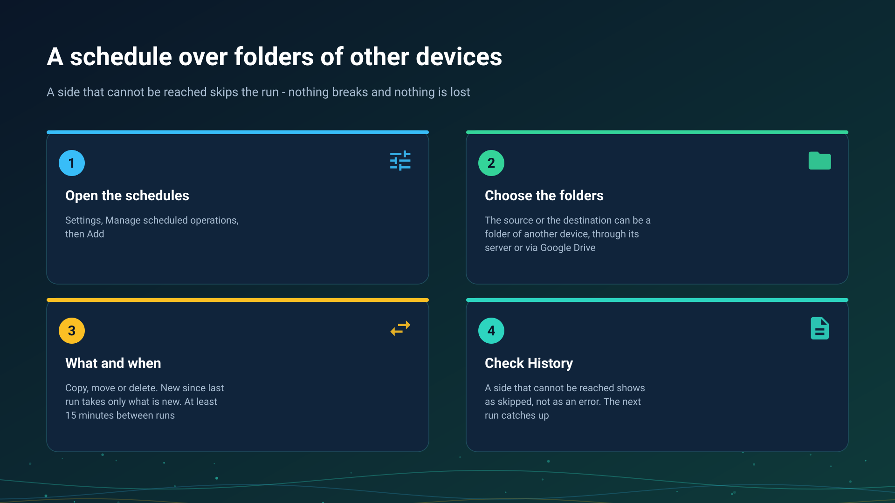

26.10.22 01:23

# A schedule over folders of other devices

Scheduled operations copy, move or delete files in the background on a timetable you set. The source or the destination can be a folder of another of your devices, reached through the exchange server or via Google Drive, so a phone can fetch every new photo of the other one overnight with nobody touching either.

## Set one up

1. Open **Settings** and tap **Manage scheduled operations**. The switch **Use scheduled operations** turns all scheduled runs on or off; the operations stay saved when it is off.
2. Tap **Add**.
3. Choose the **Source** and the **Destination**. A folder of another device is attached first, from **Add Resource**, **From my devices**, see [Folders through the exchange server](folders-exchange-server.html).
4. Choose the **Operation**: **Copy**, **Move** or **Delete**.
5. Choose which files: **All**, **New in last hour**, **New in last day** or **New since last run**, and narrow them with the file types and conditions.
6. Set **Starting at** and the interval, and save with **Save operation**.

## New since last run

**New since last run** takes the files that appeared after the last run that finished well. The mark moves only after a successful run: a run that failed or was skipped leaves it where it was, so the files of that window are picked up by the next run that does succeed.

## A side that cannot be reached

When the other device is off, or the network between is down, the run is **skipped**, not failed:

- nothing is scanned and nothing is transferred, so nothing is half done;
- the schedule's card shows a warning badge and **History** lists the run as **Skipped**, with the reason;
- no notification is posted, and the next slot tries again;
- an error, which does post one notification, is kept for what really went wrong, such as a folder protected with a PIN that refused the stored one.

A folder protected with a PIN is opened with the PIN the app stored when you attached it, without asking anybody at run time.

## Copy and move over a remote folder

- **A copy is written under a temporary name** and renamed when it is whole, so a run cut in the middle leaves no half file under the real name, and the next run finishes it. A name that already exists follows the operation's setting **Overwrite existing files**.
- **A move removes the original only after its copy is complete.**
- **A delete** follows the same rule as a move when the other device cannot be reached: the run is skipped.

## Over Google Drive

When every live path to the other device is down and **Files via Google Drive** is on, a **copy** fetches the files changed since its window start through Google Drive and places them in the destination under the same filters. A move and a delete are skipped instead: they would remove something nobody could check. The other device answers when it next looks at its Drive queue: with its app open, or every 15 minutes with **Check via Google Drive in the background** on; with neither, the run is skipped. See [Files via Google Drive](folders-google-drive.html).

Via Google Drive, files and the clipboard are kept in your own Google account, like your other files on Google Drive; no exchange server takes part.

## Limits

- **The interval is at least 15 minutes**; a smaller one is corrected to 15.
- **Accuracy depends on power saving.** Android may delay a background run. Allow the app to run without battery optimization when the dialog **Allow background activity** asks, and use **Run now** to test a schedule.
- **A run waits for a live network** before it starts.

## Step-by-step guides

- [Scheduled operations](../../documentation/storage/scheduled-operations.html)
- [Background transfers](../../documentation/storage/background-transfers.html)

Back to the [portal start page](index.html).

## Settings windows of the Windows program {#windows-settings-windows}

On Windows, open **Manager settings**, **Scheduled file operations**, or use the schedule entry in the tray or folder menu. Schedules belong to the signed-in manager and do not need folder sharing to be switched on or an exchange server to be installed on this PC. Closing a settings window does not stop scheduled work.
