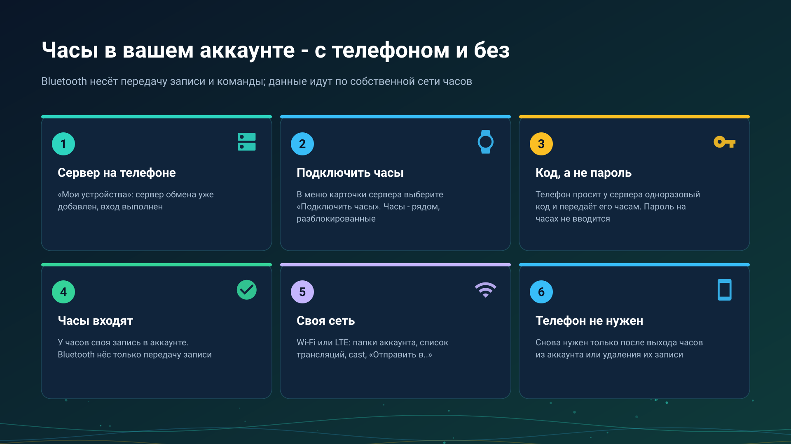

26.10.23 14:53

# Часы в вашем аккаунте

Часы могут пользоваться вашим аккаунтом обмена двумя способами. **Через телефон**: телефон нашёл папку или трансляцию и передал её часам. **Без телефона**: у часов своя запись на сервере, и они работают сами по своим Wi-Fi или LTE, пока телефон выключен или далеко. Это одно и то же устройство с одним входом, который хранится на часах.

## Прежде чем начать

- **Приложение для часов, сопряжённое с телефоном**, см. [Установка FastMediaSorter на часы](../../documentation/wear/installation-and-pairing-ru.html).
- **Компаньон для часов включён** в **Настройках** телефона; иначе телефон ответит «Компаньон для часов выключен».
- **Сервер обмена добавлен и выполнен вход на телефоне**, см. [Добавление сервера обмена в «Мои устройства»](my-devices-ru.html).

## Подключите часы

1. На телефоне откройте **Настройки**, вкладку **Общие**, **Мои устройства**.
2. В меню карточки сервера выберите **Подключить часы**. Держите часы рядом и разблокированными.
3. Телефон просит у сервера одноразовый код сопряжения и передаёт его первым подключённым часам, которые его возьмут. Часы входят по коду и хранят свой токен в собственном защищённом хранилище.
4. Телефон сообщает «Часы вошли в учётную запись». Если часы не ответили, держите их рядом и разблокированными и повторите.

На часах пароль не вводится: телефон передаёт код, а пароль аккаунта часам не отправляется никогда. Часы доверяют тому, что разрешил сопряжённый телефон.

## Что часы делают по своей сети

По собственным Wi-Fi или LTE, пока телефон выключен или далеко:

- **Открывают папки** аккаунта, которые подключил телефон, дома и в дороге, в том числе защищённые, и могут сами добавить папки аккаунта.
- **Воспроизводят трансляции аккаунта**, сгруппированные по вещающему устройству, со звуком или видео.
- **Вещают звук** со своего микрофона не более чем четырём слушателям одновременно - по сумме локальной сети и сервера. Видео с часов не уходит.
- **Принимают cast** с другого устройства аккаунта: сначала спрашивают в уведомлении.
- **Отправляют свои файлы** - записи, снимки, другие файлы - через **Отправить в..** в папки аккаунта и в свои сетевые папки (SMB, FTP и SFTP), без участия телефона.
- **Отправляют и получают буфер**: файл или голосовая запись уходит в буфер на сервере через **Отправить в..**, а последнее значение возвращается, сохраняется на часах и открывается в их плеере. См. [Буфер на сервере](exchange-clipboard-ru.html).

## Что несёт Bluetooth

Связь между телефоном и часами несёт передачу записи сервера, передачу папки или трансляции, команды, состояние, описания и мелкие элементы. Звук и картинку трансляции и данные папки она не несёт никогда: они идут по собственной сети часов, поэтому часы вне зоны Wi-Fi и LTE ничего не воспроизведут с сервера.

## Чего часы не делают никогда

- **Они не папка для других.** Они ничего не публикуют для открытия другими устройствами.
- **Они не вещают видео**: ни своё, ни камеру телефона, запущенную с часов.
- **Они ни у кого не просят пароль** и не получают пароль аккаунта.
- **Они играют только то, что умеют декодировать**: трансляцию такого вида, которую они не умеют, часы отклоняют, а не играют плохо.

## Когда телефон нужен снова

Только для новой передачи: когда часы вышли из аккаунта из-за смены пароля или их запись удалили из аккаунта. На телефоне снова выберите **Подключить часы**.

## Пошаговые инструкции

- [Прослушивание через часы и трансляция с них](../../documentation/wear/watch-listening-and-broadcast-ru.html)
- [Папки телефона и сети на часах](../../documentation/wear/phone-and-network-folders-on-watch-ru.html)
- [Выход в эфир](broadcast-start-ru.html) и [Приём трансляции](broadcast-receive-ru.html)

Назад на [главную страницу портала](index-ru.html).
