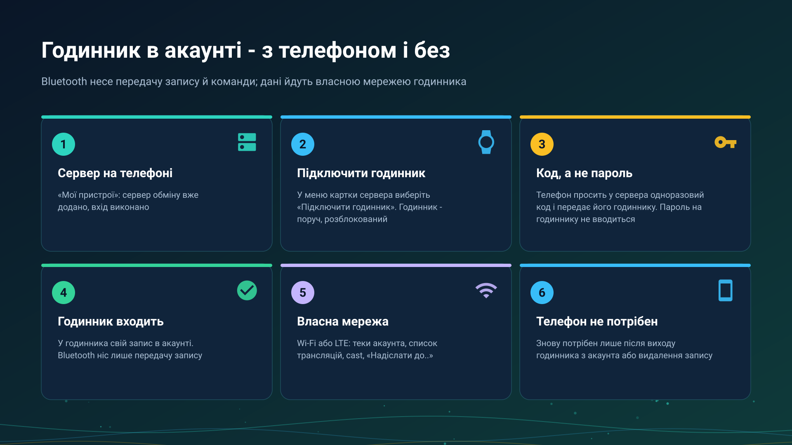

26.10.23 14:53

# Годинник в акаунті

Годинник може користуватися вашим акаунтом обміну двома способами. **Через телефон**: телефон знайшов теку чи трансляцію і передав її годиннику. **Без телефона**: у годинника свій запис на сервері, і він працює сам по своїх Wi-Fi чи LTE, поки телефон вимкнено або далеко. Це той самий пристрій з одним входом, який зберігається на годиннику.

## Перш ніж почати

- **Застосунок для годинника, сполучений з телефоном**, див. [Встановлення FastMediaSorter на годинник](../../documentation/wear/installation-and-pairing-uk.html).
- **Компаньйон для годинника ввімкнено** в **Налаштуваннях** телефона; інакше телефон відповість «Компаньйон для годинника вимкнено».
- **Сервер обміну додано й виконано вхід на телефоні**, див. [Додавання сервера обміну в «Мої пристрої»](my-devices-uk.html).

## Підключіть годинник

1. На телефоні відкрийте **Налаштування**, вкладку **Загальні**, **Мої пристрої**.
2. У меню картки сервера виберіть **Підключити годинник**. Тримайте годинник поруч і розблокованим.
3. Телефон просить у сервера одноразовий код сполучення й передає його першому підключеному годиннику, який його візьме. Годинник входить за кодом і зберігає свій токен у власному захищеному сховищі.
4. Телефон повідомляє «Годинник увійшов до облікового запису». Якщо годинник не відповів, тримайте його поруч і розблокованим і повторіть.

На годиннику пароль не вводиться: телефон передає код, а пароль акаунта годиннику не надсилається ніколи. Годинник довіряє тому, що дозволив сполучений телефон.

## Що годинник робить своєю мережею

Власними Wi-Fi чи LTE, поки телефон вимкнено або далеко:

- **Відкриває теки** акаунта, які підключив телефон, вдома й у дорозі, зокрема захищені, і може сам додати теки акаунта.
- **Відтворює трансляції акаунта**, згруповані за пристроєм, що мовить, зі звуком або відео.
- **Мовить звук** зі свого мікрофона не більш ніж чотирьом слухачам одночасно - за сумою локальної мережі та сервера. Відео з годинника не йде.
- **Приймає cast** з іншого пристрою акаунта: спершу питає у сповіщенні.
- **Надсилає свої файли** - записи, знімки, інші файли - через **Надіслати до..** у теки акаунта й у свої мережеві теки (SMB, FTP та SFTP), без участі телефона.
- **Надсилає й отримує буфер**: файл чи голосовий запис іде в буфер на сервері через **Надіслати до..**, а останнє значення повертається, зберігається на годиннику й відкривається в його плеєрі. Див. [Буфер на сервері](exchange-clipboard-uk.html).

## Що несе Bluetooth

Зв'язок між телефоном і годинником несе передачу запису сервера, передачу теки чи трансляції, команди, стан, описи та дрібні елементи. Звук і картинку трансляції та дані теки він не несе ніколи: вони йдуть власною мережею годинника, тому годинник поза зоною Wi-Fi і LTE нічого не відтворить із сервера.

## Чого годинник не робить ніколи

- **Він не тека для інших.** Він нічого не публікує для відкриття іншими пристроями.
- **Він не мовить відео**: ні своє, ні камеру телефона, запущену з годинника.
- **Він ні в кого не просить пароль** і не отримує пароль акаунта.
- **Він грає лише те, що вміє декодувати**: трансляцію такого виду, яку він не вміє, годинник відхиляє, а не грає погано.

## Коли телефон потрібен знову

Лише для нової передачі: коли годинник вийшов з акаунта через зміну пароля або його запис видалили з акаунта. На телефоні знову виберіть **Підключити годинник**.

## Покрокові інструкції

- [Прослуховування через годинник і мовлення з нього](../../documentation/wear/watch-listening-and-broadcast-uk.html)
- [Теки телефона й мережі на годиннику](../../documentation/wear/phone-and-network-folders-on-watch-uk.html)
- [Вихід в ефір](broadcast-start-uk.html) і [Приймання трансляції](broadcast-receive-uk.html)

Назад на [головну сторінку порталу](index-uk.html).
