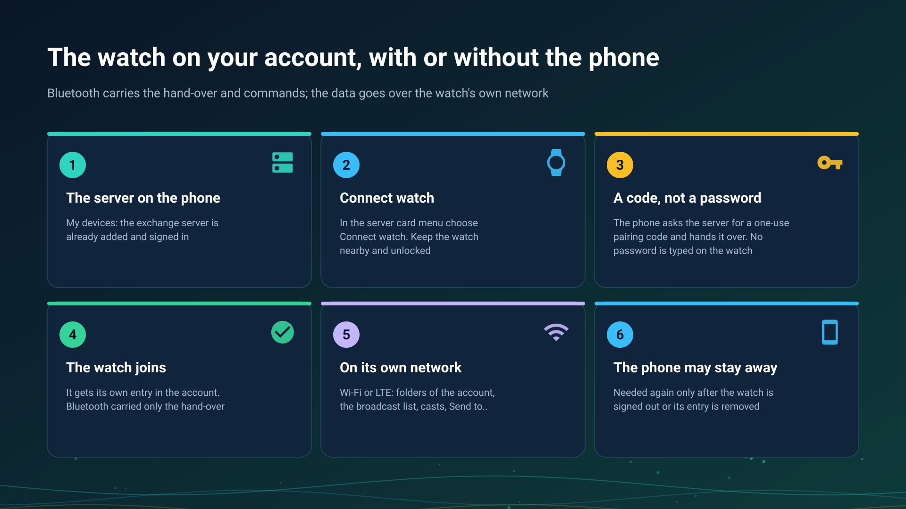

26.10.15 15:10

# The watch on your account

A watch can use your exchange account in two ways. **Through the phone**: the phone found a folder or a broadcast and handed it to the watch. **Without the phone**: the watch has an entry of its own on the server and works on its own Wi-Fi or LTE with the phone off or away. Both are one device with one sign-in, kept on the watch.

## Before you start

- **The watch app paired with the phone**, see [Putting FastMediaSorter on your watch](../../documentation/wear/installation-and-pairing.html).
- **The Wear companion on** in the phone's **Settings**, or the phone refuses with "The Wear companion is off".
- **An exchange server added and signed in on the phone**, see [Adding your exchange server in My devices](my-devices.html).

## Connect the watch

1. On the phone open **Settings**, the **General** tab, **My devices**.
2. In the menu of the server's card choose **Connect watch**. Keep the watch nearby and unlocked.
3. The phone asks the server for a one-use pairing code and hands it to the first connected watch that takes it. The watch signs in with the code and keeps its token in its own secret store.
4. The phone says "The watch joined the account". If the watch did not answer, keep it nearby and unlocked and try again.

No password is typed on the watch: the phone hands over a code, and the account's password is never sent to the watch. The watch trusts what the paired phone allowed.

## What the watch does on its own network

Over its own Wi-Fi or LTE, with the phone off or away:

- **Opens the folders** of the account that the phone attached, at home and away, protected ones included, and can add the account's folders itself.
- **Plays the broadcasts of the account**, grouped by the broadcasting device, with sound or video.
- **Broadcasts sound** from its microphone to up to four listeners at once, on the local network and through the server together. No video leaves the watch.
- **Takes a cast** from another device of the account: it asks first, in a notification.
- **Sends its own files** - recordings, pictures, other files - with **Send to..** to the folders of the account, and to its own SMB, FTP and SFTP folders, with no phone involved.
- **Sends and gets the clipboard**: a file or a voice recording goes to the clipboard on the server through **Send to..**, and the latest value comes back, saved on the watch and opened in its own player. See [The clipboard on the server](exchange-clipboard.html).

## What Bluetooth carries

The link between the phone and the watch carries the hand-over of the server entry, the hand-over of a folder or a broadcast, commands, state, descriptions and small items. It never carries a broadcast's sound or picture, or the data of a folder: those go over the watch's own network, so a watch that is out of Wi-Fi and LTE range plays nothing from the server.

## What the watch never does

- **It is not a folder for others.** It publishes nothing for other devices to open.
- **It broadcasts no video**, not its own and not the phone's camera started from the watch.
- **It asks nobody for a password** and never receives the account's password.
- **It plays only what it can decode**: a broadcast of a kind it cannot play is declined, never played badly.

## When the phone is needed again

Only for a new hand-over: after the watch was signed out because the account's password changed, or after its entry was removed from the account. On the phone, choose **Connect watch** again.

## Step-by-step guides

- [Listening through the watch and broadcasting from it](../../documentation/wear/watch-listening-and-broadcast.html)
- [Phone and network folders on the watch](../../documentation/wear/phone-and-network-folders-on-watch.html)
- [Going on air](broadcast-start.html) and [Receiving a broadcast](broadcast-receive.html)

Back to the [portal start page](index.html).
